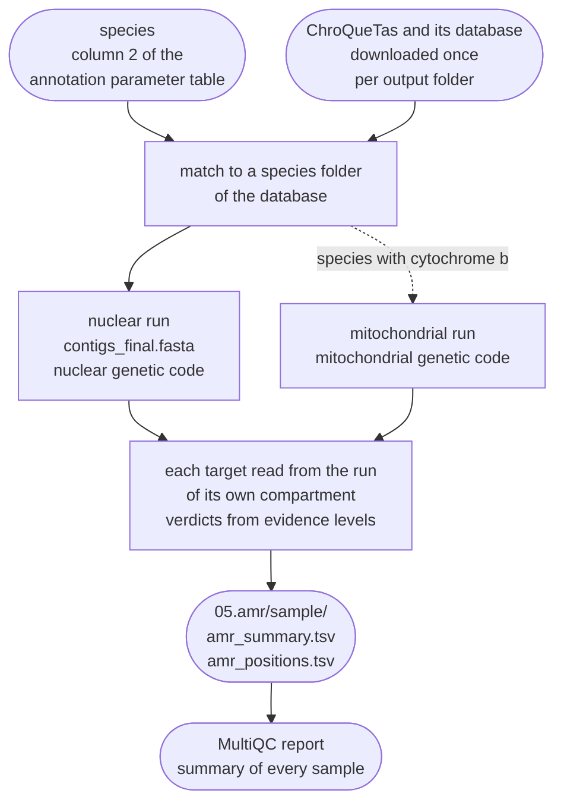

# Antifungal resistance mutations

FunFlux can screen every genome for point mutations studied for resistance to antifungal drugs
and fungicides. The AMR screen (the resistance-mutation screen) runs ChroQueTas against the FungAMR
database (Bédard et al. 2025), which lists such mutations with the evidence for or against
resistance. For every sample it writes
`05.amr/{sample}/amr_summary.tsv`, with one row per target protein of the species and the changes
found. Each change gets a verdict from the evidence FungAMR holds: whether it confers resistance,
to which drugs, and how strong the evidence is ([Evidence levels and verdicts](#evidence-levels)).
The table also appears in the MultiQC report.



The AMR screen is off by default. ChroQueTas and its database are licensed only for
non-commercial use, and switching the screen on is your acceptance of that licence
([Licence](#licence)). To switch it on, set:

```yaml
parameters:
  amr:
    chroquetas: on
```

!!! abstract "Terms used on this page"

    | | |
    |---|---|
    | **AMR screen** | antimicrobial resistance screen: the optional step, off by default, in which ChroQueTas looks in each genome for the changes FungAMR lists for the species |
    | **FungAMR** | the database of mutations studied for resistance to antifungal drugs and fungicides, with evidence levels for and against; ChroQueTas screens each genome against part of it |
    | **target protein** | a protein whose FungAMR positions ChroQueTas checks, such as `Beta-tubulin` or `Cyp51`; `amr_summary.tsv` has one row per target of the species |
    | **FungAMR mutation** | the ChroQueTas call for a change that FungAMR lists at that position, whatever its evidence; it does not by itself mean resistance |
    | **evidence level** | the FungAMR score for a change and a drug, by kind of study: 1 (strongest) to 8 for resistance found, -1 to -8 for none found |
    | **verdict** | the reading of FungAMR's evidence for a change or a target: `resistance`, `conflicting`, `no resistance`, `unknown`, `wild type`, or `not compared` for a position |
    | **compartment** | `nuclear` or `mitochondrial`: the ChroQueTas run, each with its own genetic code, from which a target protein's result is read |
    | **contamination and mitochondrion screen** | the screen of the draft assembly: BLAST against core_nt, BlobTools, the mitochondrion screen and the contig selector; in `contigs` mode only with `parameters.contigs.screen: true` |

## What the screen looks for

Fungi become resistant through changes in their own genes. FungAMR records amino acid
substitutions and other changes, such as more copies of a gene, and ChroQueTas screens the
substitutions. Many of them sit in the protein the drug acts on, at a few known positions. The
gene itself is present in every strain of the species, sensitive or resistant, so a search for
resistance genes, as used for bacteria, does not fit. What tells a resistant strain from a
sensitive one is the amino acid at those positions. The AMR screen therefore finds each target
protein in the assembly and reads those positions.

The table lists the main targets in the database, with drugs named in their entries.

| Target (database name) | Protein | Drugs, for example | Species in the database with this target |
|---|---|---|---|
| `Cyp51` | sterol 14α-demethylase of the ergosterol pathway | azoles: fluconazole, voriconazole, itraconazole, posaconazole | 27 |
| `Cytochrome_b` | cytochrome b of respiratory complex III, encoded in the mitochondrial genome | QoI fungicides (strobilurins): azoxystrobin, pyraclostrobin, trifloxystrobin | 15 |
| `Beta-tubulin` | β-tubulin of the microtubules | benzimidazoles: carbendazim, benomyl, thiophanate-methyl; diethofencarb | 12 |
| `Fks` | β-1,3-glucan synthase of the cell wall | echinocandins: caspofungin, anidulafungin, micafungin | 10 |
| `Sdh` | succinate dehydrogenase, respiratory complex II | SDHI fungicides: boscalid, carboxin, pydiflumetofen | 4 |
| `Bos1`, `OS1` | one histidine kinase of the osmotic stress pathway, listed under two names with the same reference protein (UniProt Q8X1E7) | dicarboximides (iprodione, procymidone), fludioxonil | 1 (*Botrytis cinerea*) |

The database has 210 target proteins in all, under 109 target names. The others include efflux
pumps and their regulators (`Cdr1`, `Pdr1`, `Tac1`, `Mrr1`) and the enzymes that turn
5-fluorocytosine into its toxic form (`Fcy1`, `Fur1`).

In two species the database holds one protein under two names: *Botrytis cinerea* `Bos1` and
`OS1`, and *Fusarium graminearum* `Myosin-1` and `Myosin-5`. Each name gets its own row in the
tables, so a change at a position both names list is reported twice.

## FungAMR and ChroQueTas { #chroquetas }

**FungAMR** (Bédard et al. 2025) was curated by hand from 501 published studies. It holds 35,792
entries for 208 drugs, 246 genes and 95 fungal species. Each entry gives the gene, the mutation
and the drug, with a confidence score for the evidence
([Evidence levels and verdicts](#evidence-levels)). FungAMR can be searched online in the
Comprehensive Antibiotic Resistance Database (CARD).

**ChroQueTas**, from the same paper, screens a genome against the part of FungAMR prepared for it.
FunFlux runs version 1.0.1, downloaded from one fixed commit of its
[GitHub repository](https://github.com/nmquijada/ChroQueTas), as described under
[Settings](#settings). ChroQueTas takes each target protein of the species through four steps:

| Step | Tool | What happens |
|---|---|---|
| 1 | miniprot 0.14 | aligns the reference protein to the genome, across introns, and translates the gene it finds with the genetic code of the run |
| 2 | BLASTP of BLAST+ 2.16.0 | compares the extracted protein with the reference, and ChroQueTas keeps it at more than 90 % identity over more than 75 % of the reference |
| 3 | MAFFT 7.525 | aligns the extracted protein with the reference |
| 4 | ChroQueTas | reads the amino acid at every FungAMR position of the target and calls it |

Every position gets one of the calls below. FunFlux writes ChroQueTas's `FungAMR MUTATION` as
`FungAMR mutation`, its `New mutation` as `new mutation`, and so on.

| Call | Meaning |
|---|---|
| `FungAMR mutation` | the amino acid differs from the reference, and FungAMR lists this change at this position, whatever the evidence says: for resistance, against it, or both. ChroQueTas adds the drugs with their evidence levels, and the verdict says which way they point ([Evidence levels and verdicts](#evidence-levels)) |
| `new mutation` | the amino acid differs from the reference, but FungAMR does not list this change at this position. It is a possible new resistance mutation that needs its own investigation (ChroQueTas README) |
| `no mutation` | the reference amino acid |
| `no alignment` | the found protein has a gap at the position. The gap is a deletion, a part of the gene missing from the assembly (as at a contig end), or a premature stop codon, which MAFFT turns into a gap. A nonsense mutation that FungAMR lists (written `X`) therefore shows up here, not as a FungAMR mutation. The copy's protein, `<name>_<target>.<fragment>.faa`, tells which, because a stop is written `*` there |
| `position not found` | the position lies outside the alignment, or it is not a number, or its codon could not be read (found amino acid `X`) |

The last two calls are not comparisons. They do not count as positions checked, and the summary's
note names them. A target with no compared position at all is `not evaluated`
([Statuses](#statuses)).

Three database rows have no position number. ChroQueTas reports the insertion (*Cryptococcus
deuterogattii* `Uxs1`, `1182ins(fs)`) as `position not found`, and skips the duplication
(*Nakaseomyces glabratus* `Pdr1`, `c.3308dupT`) without a word. It reads the translocation
(*Candidozyma auris* `Ncp1`) as position 1, and FunFlux reports that row as `position not found`
too.

ChroQueTas calls a position a FungAMR mutation when the letter it found is one of those the
database lists there, and a new mutation when it is a letter other than the reference's. In three
cases the letter is not a change, and FunFlux writes another call:

| What ChroQueTas found | ChroQueTas's call | FunFlux's call |
|---|---|---|
| `X`: miniprot's letter for a codon it cannot read, one with `N` bases (a gap in a scaffold). FungAMR writes a stop as `X` too, but miniprot writes a stop as `*` | `FungAMR MUTATION` where FungAMR lists a stop, `New mutation` elsewhere | `position not found` |
| a gap where FungAMR lists a deletion (written `-`, 22 rows), beyond the part of the reference the found protein covers (BLASTP's `sstart` to `send`): the protein ends early, as for a gene cut at a contig end | `FungAMR MUTATION` | `no alignment` |
| the reference amino acid, at the one row that lists the reference amino acid as the change: *Saccharomyces cerevisiae* `Hap1` N832N (clotrimazole, level 4) | `FungAMR MUTATION` | `no mutation` |

A gap inside the found protein, where FungAMR lists a deletion, stays a FungAMR mutation. As on
every row, `fungamr_drugs` keeps ChroQueTas's drug text.

ChroQueTas does not screen the whole of FungAMR. The database of version 1.0.1 holds only single
mutations, and only species with a reliable reference protein (ChroQueTas README):

| | FungAMR | ChroQueTas database 1.0.1 |
|---|---|---|
| entries | 35,792 | 8,285 mutations: only single mutations, tested on their own rather than in combination with others |
| species | 95 | 57: only species for which an accurate reference protein exists; a species without one is left out, because a poor reference could give spurious calls |

An entry can carry evidence for resistance, against it, or both
([Evidence levels and verdicts](#evidence-levels)).

!!! warning "Only single mutations in the target proteins are screened"

    The AMR screen does not detect gene duplication or loss, gene disruption, translocation,
    aneuploidy, combinations of mutations, or any change outside the protein, such as an insertion
    in a promoter that raises the expression of the target.

## Evidence levels and verdicts { #evidence-levels }

The verdicts rest on the evidence levels of FungAMR. FungAMR gives each drug of a change two
confidence scores, which ChroQueTas writes as `Drug(positive/negative)` (Bédard et al. 2025;
[ChroQueTas wiki, "Confidence score for antimicrobial resistance"](https://github.com/nmquijada/ChroQueTas/wiki/Confidence-score-for-antimicrobial-resistance)):

| Score | Meaning |
|---|---|
| positive, 1 to 8 | evidence that the change causes resistance to that drug; 1 is the strongest, 8 the weakest |
| negative, -1 to -8 | evidence, from the same kinds of study, that it does not: the change was reported in susceptible strains; -1 is the strongest |
| `NA` | no report of that kind |

When several studies report a change, each score is the strongest of its kind.

The level names the kind of study. FunFlux writes it in words after the number, and the same words
serve both signs. After a positive level the study found resistance, and after a negative one it
found none.

| Level | What the positive level means (ChroQueTas wiki) | Words in the tables |
|---|---|---|
| 1 | the change was made in a susceptible strain of the same species, and its effect on resistance was measured | `the change made in the species and measured` |
| 2 | the change was made in the same gene expressed in another species, possibly at another level of expression, and its effect measured | `the change made in the gene, expressed in another species` |
| 3 | its effect was measured in a bulk competition assay, such as deep mutational scanning | `bulk competition assay` |
| 4 | it arose in experimental evolution, often enough in independent replicates to suggest that it causes resistance | `experimental evolution` |
| 5 | deleting the gene causes resistance | `gene deletion` |
| 6 | overexpressing or duplicating the gene causes resistance | `gene overexpression or duplication` |
| 7 | a significant association with resistance in a population: GWAS, QTL mapping or classical genetics | `population association study` |
| 8 | found in a resistant natural strain, such as a clinical isolate, without further validation | `natural isolates, not validated further` |

A negative level is the same kind of study with the opposite result. `-8`, for example, records a
natural isolate with the change that was not resistant, and `-3` a deep mutational scan in which
the change gave no resistance.

### A FungAMR mutation is not always a resistance mutation { #verdicts }

ChroQueTas calls every change that FungAMR lists a `FungAMR mutation`, whatever its scores, and
more than half of the changes in its database carry evidence against resistance only. In
ChroQueTas 1.0.1 the evidence splits as follows:

| Evidence | Negative only | Positive only | Both | No drug | All |
|---|---|---|---|---|---|
| rows of the database (changes), all drugs of the row together | 4,655 | 2,943 | 686 | 1 | 8,285 |
| drugs of those rows, one by one | 19,397 | 8,868 | 108 | | 28,373 |

Most of the negative-only rows, 4,596, belong to *Candida albicans* `Cyp51` and *Saccharomyces
cerevisiae* `Fcy1`, and all but five of those come from deep mutational scans (level -3).
FunFlux therefore sorts the drugs of every FungAMR mutation by their evidence. *Candida albicans*
`Cyp51` A61V, for example, reads
`Clotrimazole(3/NA),Fluconazole(NA/-2),Isavuconazole(3/NA),Itraconazole(3/-2),Posaconazole(2/NA),Voriconazole(3/-2)`,
and its drugs are sorted like this:

| A drug with | Goes to | In A61V |
|---|---|---|
| a positive level only | `resistance_to` | clotrimazole, isavuconazole, posaconazole |
| a negative level only | `no_resistance_to` | fluconazole |
| both | both columns, each with its own level: a conflicting drug | itraconazole, voriconazole |

Each position then gets a verdict. For a FungAMR mutation, it is the first of its four rows below
that applies:

| Call | Verdict | When |
|---|---|---|
| `FungAMR mutation` | `resistance` | at least one drug has a positive level only |
| `FungAMR mutation` | `conflicting` | no drug has a positive level only, and at least one has both |
| `FungAMR mutation` | `no resistance` | every drug named has a negative level only |
| `FungAMR mutation` | `unknown` | no drug is named |
| `new mutation` | `unknown` | a change FungAMR does not list, at a position where it lists others |
| `no mutation` | `wild type` | the reference amino acid |
| `no alignment`, `position not found` | `not compared` | the position could not be compared |

A61V is `resistance`, although two of its drugs conflict. A change is `conflicting` only when no
drug has resistance evidence alone, as for *Aspergillus niger* `Cyp51` Q228R, `Voriconazole(8/-8)`.
FunFlux does not weigh one kind of evidence against the other, and both levels stay in the tables.
The 8,285 rows of the database get these verdicts:

| Verdict | Rows |
|---|---|
| `resistance` | 3,610, of which 42 have a conflicting drug as well |
| `no resistance` | 4,655 |
| `conflicting` | 19 |
| `unknown` | 1: the *Cryptococcus deuterogattii* `Uxs1` insertion, which names no drug; ChroQueTas does not compare it ([FungAMR and ChroQueTas](#chroquetas)) |

A target takes the first of these verdicts found among its compared positions, all copies
together: `resistance`, `conflicting`, `unknown`, `no resistance`, `wild type`. A change of
unknown effect ranks above `no resistance` and `wild type`, because it needs a look. A target that
is not evaluated or not found, and a sample that is not screened, get `-`, and the status says
why.

*Botrytis cinerea* β-tubulin E198V, for example, reads
`Benzimidazole(8/NA),Carbendazim(7/NA),Diethofencarb(8/NA),Iprodione(NA/-8)` in the database. A
genome with valine at position 198 gets these cells in `amr_positions.tsv`:

| Column | Cell |
|---|---|
| `verdict` | `resistance` |
| `resistance_to` | `Benzimidazole (8: natural isolates, not validated further); Carbendazim (7: population association study); Diethofencarb (8: natural isolates, not validated further)` |
| `no_resistance_to` | `Iprodione (-8: natural isolates, not validated further)` |

That is evidence that E198V causes resistance to three drugs, and reports of natural isolates with
E198V that were not resistant to iprodione.

### What a level does not say { #level-limits }

A positive level says how good the evidence is that a change causes resistance, and a negative
level how good the evidence is that it does not. Neither is a measurement of the isolate. Whether
this strain is resistant, and how strongly, takes a susceptibility test. The FungAMR authors put it
the same way: a confidence score is not a probability of treatment failure, but reflects the
evidence that a change confers resistance under laboratory conditions (Bédard et al. 2025).

!!! note "The verdict `no resistance` says only what the reports found"

    Evidence of no resistance is the harder kind to judge. A susceptible result can come from an
    assay that was not sensitive enough, and such assays rarely test a resistant control
    alongside. The FungAMR authors kept these reports in the database but left them out of their
    own analyses for that reason (Bédard et al. 2025). The verdict `no resistance` therefore means
    that the reports found no resistance to the drugs named. It does not show that the change
    never matters for resistance, and it says nothing about drugs that were not tested.

Levels 7 and 8 rest on association, not on a test of the change itself. The change was found in
resistant isolates, or linked to resistance in a population. Field isolates are often resistant
to several classes of fungicides at once. A drug at level 7 or 8 that acts on another target can
therefore record a resistance found together with the change rather than caused by it. In
*Botrytis cinerea*, for example, iprodione (level 8) is listed for β-tubulin E198A, and
carbendazim (level 7) and boscalid (level 8) for cytochrome b G143A. Such a drug counts towards
the verdict `resistance` like any other.

## The species { #species }

Each sample is screened against the database folder of its species. The species is column 2 of
the [annotation parameter table](../reference/configuration.md#annotation-parameter-table)
(`files.annotation_params`), the name funannotate uses as well. The database names its species
folders `Genus_species`. FunFlux matches the name to a folder, ignoring case, and takes the first
of three tries that succeeds:

1. The whole name, with spaces turned into underscores and `f. sp.` (or `f.sp.`) removed:
   `Blumeria graminis f. sp. hordei` gives `Blumeria_graminis_hordei`.
2. The first two words: `Zymoseptoria tritici IPO323` gives `Zymoseptoria_tritici`.
3. A short list of other names, older or newer, of species whose database folder carries a
   different name. Each pair is one taxon in NCBI Taxonomy:

    | Name in the annotation table | Database folder |
    |---|---|
    | *Candida glabrata* | `Nakaseomyces_glabratus` |
    | *Candida auris* | `Candidozyma_auris` |
    | *Parastagonospora nodorum* | `Phaeosphaeria_nodorum` |
    | *Pseudocercospora fijiensis* | `Mycosphaerella_fijiensis` |
    | *Fulvia fulva*, *Cladosporium fulvum* | `Passalora_fulva` |
    | *Oculimacula yallundae* | `Tapesia_yallundae` |
    | *Oculimacula acuformis* | `Tapesia_acuformis` |
    | *Issatchenkia orientalis*, *Candida krusei* | `Pichia_kudriavzevii` |
    | *Candida lusitaniae* | `Clavispora_lusitaniae` |
    | *Lodderomyces metapsilosis* | `Candida_metapsilosis` |
    | *Lodderomyces orthopsilosis* | `Candida_orthopsilosis` |
    | *Pyricularia grisea* | `Magnaporthe_grisea` |
    | *Blumeria hordei* | `Blumeria_graminis_hordei` |

Only renamings of one species are listed. *Pyricularia oryzae*, the rice blast fungus, is not
matched to `Magnaporthe_grisea`, because NCBI Taxonomy keeps them as two species (*Magnaporthe
grisea* is *Pyricularia grisea*).

A name that matches no folder leaves the sample not screened, and the run goes on.
`amr_summary.tsv` gets one row with status `not screened`, and a NOTE in the log and on the
console names the database folders of the same genus, if there are any.
`00.resources/chroquetas/species.txt` lists the 57 folders.

!!! note "A species outside the database is not screened against a relative"

    FunFlux never screens a sample against another species of its genus, because the positions of
    a resistance mutation are positions in the reference protein of one species. For a species
    outside the database, FungAMR itself may still list mutations of its targets. Search it in
    CARD (<https://card.mcmaster.ca/fungamrhome>, the address ChroQueTas gives) and compare the
    positions by hand with the predicted proteins in
    `04.annotation/{sample}/funannotate/annotate_results/`.

## Two runs: the nuclear and the mitochondrial genome { #two-runs }

ChroQueTas translates the genome with one genetic code per run. The nuclear and the mitochondrial
genes of one fungus use different codes, so one run cannot translate both correctly. These are
the codes that matter here
([NCBI, The Genetic Codes](https://www.ncbi.nlm.nih.gov/Taxonomy/Utils/wprintgc.cgi)):

| NCBI table | Used by | Differs from the standard code in |
|---|---|---|
| 1, the standard code | the nuclear genes of most fungi | |
| 12 | the nuclear genes of the yeasts of the CTG clade; ChroQueTas chooses 12 for its 8 species of that clade and 1 for the others | CTG read as serine |
| 4, the mold mitochondrial code | fungal mitochondria | TGA codes for tryptophan instead of a stop |
| 3, the yeast mitochondrial code | the mitochondria of *Saccharomyces cerevisiae* and *Candida glabrata* | TGA read as tryptophan too, ATA as methionine and CTN as threonine |

Cytochrome b is the one target of the database encoded in the mitochondrial genome, and it is
held for 15 species. Translated with the nuclear code, its gene gives a poorer protein, and
[the example below](#worked-example) shows how much. Rule `amr_chroquetas` therefore runs
ChroQueTas twice, each run in its own folder:

| Run | Input | Genetic code | Results read from it |
|---|---|---|---|
| nuclear, `chroquetas/nuclear/` | `02.assembly/{sample}/contigs_final.fasta` | chosen by ChroQueTas for the species | every target except `Cytochrome_b` |
| mitochondrial, `chroquetas/mitochondrial/` | `contigs_mitochondrial.fasta` when the contamination and mitochondrion screen splits the mitochondrion off (`parameters.mitochondria.mode: separate_confirmed`, the default); otherwise `contigs_final.fasta` | `parameters.amr.mito_genetic_code`; `auto`: 3 for the four Saccharomycetaceae of the database (*Saccharomyces cerevisiae*, *S. paradoxus*, *Nakaseomyces glabratus*, *Kluyveromyces marxianus*), 4 for every other species, as NCBI Taxonomy records them | `Cytochrome_b` |

A target is read only from the run of its own compartment, and a target the other run also
extracts, translated with the wrong code, is ignored. The mitochondrial run reads the confirmed
mitochondrion when the contamination and mitochondrion screen splits it off, and the whole
assembly when nothing is split off. Whether the mitochondrial run happens, and what it reads, in
each case:

| Case | Mitochondrial run | `Cytochrome_b` |
|---|---|---|
| the species' database folder does not hold `Cytochrome_b` | none | not a target of the species |
| the contamination and mitochondrion screen splits the mitochondrion off and confirmed a contig | on `contigs_mitochondrial.fasta` | read from this run |
| the contamination and mitochondrion screen splits the mitochondrion off but confirmed no contig | none: `contigs_mitochondrial.fasta` is empty | `not evaluated` (no mitochondrial contig) |
| `contigs` mode without the contamination and mitochondrion screen, or any mode with `parameters.mitochondria.mode` `off` or `report`: nothing is split off | on `contigs_final.fasta`, among whose contigs the mitochondrion lies if the assembly holds it | read from this run |

## Statuses { #statuses }

The status tells whether the positions of a target could be compared. Every target of the species
gets one in `amr_summary.tsv`:

| Status | Meaning |
|---|---|
| `evaluated` | at least one copy of the protein passed step 2 and had at least one FungAMR position compared; `amr_positions.tsv` lists them |
| `not evaluated` | no position was compared: the protein was found but has insertions against the reference; or it was found, but every FungAMR position lies in a gap of the found protein, at a codon that could not be read, or outside the protein (`no alignment`, `position not found`); or ChroQueTas skipped it; or, for `Cytochrome_b`, there was no mitochondrial contig to search. The note says which |
| `not found` | no copy passed step 2: miniprot found no alignment of the reference protein in the genome (ChroQueTas's log says `We could not extract <target> from the genome`), or what it found does not pass the filter of step 2 (more than 90 % identity over more than 75 % of the reference). The gene is absent from the assembly, or too different from the reference |
| `not screened` | the species is not in the database ([The species](#species)); one row for the sample, target `-` |

For a copy whose positions it does not compare, ChroQueTas writes
`WARNING: genome contains insertions for <target> and thus AMR are not calculated` instead of
the positions. The line has two causes, which FunFlux reports differently:

- **Insertions.** The extracted protein has residues the reference lacks. FunFlux counts the copy
  as found, with its positions not compared: `not evaluated`.
- **A copy below the thresholds of step 2.** ChroQueTas then keeps no `.blastp.txt` file for it.
  FunFlux counts the copy as not found, and a target with no other copy is `not found`.

A common cause of insertions is an intron the protein aligner could not place, such as an intron
of a mitochondrial cytochrome b gene ([the example below](#worked-example)).

ChroQueTas 1.0.1 also skips a target silently in one case. When a target is not found, it removes
the name from its list of targets by a text replacement that also cuts that name out of longer
names. `Vma16` is therefore lost when `Vma1` was not found. Such a target is `not evaluated`,
with a note that says so.

ChroQueTas numbers the copies of a target it finds as fragment 1, 2, and so on. A second copy can
be a gene duplication, a gene split across two contigs of a fragmented assembly, or aneuploidy
(ChroQueTas README). Each copy is compared on its own, and the summary marks the changes of a
later copy, for example `E198A (copy 2) (resistance)`.

## The tables { #tables }

`amr_summary.tsv` and `amr_positions.tsv` share a few conventions. In both tables `-` marks an
empty cell. Drug names are FungAMR's, with underscores for spaces. A few contain a comma, such as
`Fludioxonil,_Iprodione` (one entry, both drugs together), so the drugs of a FunFlux cell are
separated by `; `. Changes are written as reference amino acid, position and found amino acid,
as in `E198A`.

`05.amr/{sample}/amr_summary.tsv` has one row per target of the species:

| Column | Content |
|---|---|
| `sample` | the sample name |
| `species` | the database folder the species was matched to, for example `Botrytis_cinerea`; for a sample that is not screened, column 2 of the annotation table as written there |
| `target` | the target protein as the database names it, for example `Beta-tubulin`; `-` for a sample that is not screened |
| `compartment` | `nuclear` or `mitochondrial`: the run the result comes from; `-` for a sample that is not screened |
| `status` | `evaluated`, `not evaluated`, `not found` or `not screened` ([Statuses](#statuses)) |
| `positions_checked` | the FungAMR positions compared, over all compared copies; `0` when none |
| `verdict` | the first of `resistance`, `conflicting`, `unknown`, `no resistance`, `wild type` among the verdicts of the target's compared positions, all copies together ([Verdicts](#verdicts)); `-` for a target that is not evaluated or not found, and for a sample that is not screened |
| `fungamr_mutations` | the FungAMR mutations, each with its verdict, separated by `, `: `E198A (resistance)`; `E198A (copy 2) (resistance)` for a change in a second copy |
| `new_mutations` | the other changes at FungAMR positions, separated by `, `: `F200L`, `F200L (copy 2)`. Their verdict is `unknown` |
| `resistance_to` | the drugs with a positive level, from all FungAMR mutations of the target, each with the change and the level: `Carbendazim (E198A, 7); Iprodione (E198A, 8)`. A drug named by two changes appears once for each; a change found on two copies names its drugs once |
| `no_resistance_to` | the drugs with a negative level, written the same way: `Iprodione (E198V, -8)` |
| `note` | for an evaluated target, the copies and positions that were not compared, and a target found more than once; otherwise why the target was not evaluated or not found, or why the sample was not screened |

`05.amr/{sample}/amr_positions.tsv` has one row per FungAMR position of every copy that
ChroQueTas read position by position, including the positions it could not compare (a copy with
insertions has no rows):

| Column | Content |
|---|---|
| `sample`, `target`, `compartment` | as in the summary |
| `fragment` | the copy of the target: 1 for the first |
| `position` | the position in the reference protein |
| `reference_aa`, `found_aa` | the amino acid of the reference and of this genome |
| `call` | `FungAMR mutation`, `new mutation`, `no mutation`, `no alignment` or `position not found` |
| `verdict` | for a FungAMR mutation `resistance`, `conflicting`, `no resistance` or `unknown`; `unknown` for a new mutation; `wild type` for no mutation; `not compared` for the last two calls ([Verdicts](#verdicts)) |
| `resistance_to` | for a FungAMR mutation, the drugs with a positive level, each with the level and its words: `Carbendazim (7: population association study); Iprodione (8: natural isolates, not validated further)` |
| `no_resistance_to` | for a FungAMR mutation, the drugs with a negative level, the same way: `Iprodione (-8: natural isolates, not validated further)` |
| `known_resistance_changes` | for a compared position, the changes the database lists there with a positive level for at least one drug, in the order of the database file: `E198A, E198G, E198K, E198V`. On a `wild type` row, the changes that would matter there; on an `unknown` row, the changes known at that position |
| `fungamr_drugs` | ChroQueTas's text, unchanged: `Carbendazim(7/NA),Iprodione(8/NA)`; `-` where it names no drug (`NA`, or `Unknown` for a new mutation). Its drugs are separated by commas, but a few names hold a comma (`Fludioxonil,_Iprodione`) or brackets (`Azole(s)`): split it at each comma that follows a closing bracket (`),`), not at every comma |

`05.amr/{sample}/amr_summary_mqc.tsv` is the same summary with header lines for MultiQC. They
hold the section name and a description that names FungAMR, says what the verdicts mean and how
to read the evidence levels. The rows of the file are named `{sample}: {target}`, so the tables of
all samples merge into one table in the section **AMR mutations (ChroQueTas)** of
`06.report/multiqc_report.html` ([Report](report.md#sample-names)).

The log `logs/amr_chroquetas_{sample}.log` holds ChroQueTas's messages of both runs. It ends with
one line, `[FunFlux] amr_chroquetas <sample>: ...`, which the rule copies to the Snakemake
console. The line names the database folder used, the targets evaluated, not evaluated and not
found, and the targets per verdict, as in
`verdicts: 1 resistance (Beta-tubulin), 2 wild type (Bos1, OS1)`. It then gives each FungAMR
mutation found, with its verdict and the levels of its drugs, as in
`Beta-tubulin E198A (resistance: Carbendazim 7, Iprodione 8)`. A change with evidence against
resistance only reads `(no resistance: Iprodione -8)`. The NOTE of a sample that is not screened
reaches the console the same way.

### ChroQueTas's own files { #chroquetas-files }

`05.amr/{sample}/chroquetas/nuclear/` and `mitochondrial/` hold ChroQueTas's output as it wrote
it, the files to read when a call needs checking. FunFlux hands the genome to ChroQueTas as
`genome.fasta` in the nuclear run and as `mito.fasta` in the mitochondrial run, and ChroQueTas
names its files after it (`<name>` below):

| File | Content |
|---|---|
| `<name>.ChroQueTaS.AMR_summary.txt` | every FungAMR and new mutation of the run: `Protein`, `Fragment`, `Position_reference`, `AA_reference`, `AA_query`, `Fungicide_resistance`; or the single line `No AMR mutations found in <name>` |
| `<name>.ChroQueTaS.AMR_stats.txt` | per target, the number of FungAMR and new mutations; absent when there is none |
| `<name>.ChroQueTaS.<target>.<fragment>.tsv` | every FungAMR position of that copy: `Position`, `Reference`, `Query`, `Result`, `Fungicides`; or the single `WARNING` line of a protein whose positions were not compared |
| `<name>_<target>.<fragment>.faa` | the protein extracted from the genome |
| `<name>_<target>.<fragment>.paf` | miniprot's alignment of the reference protein to the genome; fields 6 to 9 give the contig and the coordinates |
| `<name>_<target>.<fragment>.blastp.txt` | the BLASTP comparison with the reference: identity, coverage, lengths, gaps; only for a protein that passed the thresholds |
| `tmp/` | ChroQueTas's working files |

A target miniprot could not extract has no file at all, and a run that was not made has no
folder. `mitochondrial/` exists only when the species has cytochrome b and its mitochondrial run
was made ([Two runs](#two-runs)).

!!! warning "Files added to `chroquetas/` are lost when `amr_chroquetas` runs again"

    Snakemake deletes the whole `chroquetas/` folder before `amr_chroquetas` runs again, so each
    run starts clean, and files you add there are lost.

## How the step runs { #rules }

Two rules make the tables. Both run only with `parameters.amr.chroquetas: on`.

| Rule | Runs | Does | Writes |
|---|---|---|---|
| `chroquetas_db` | once per output folder | downloads `bin/ChroQueTas.sh`, `FungAMR_db/db-v20250811.tgz` and `LICENSE` from `links.chroquetas_link`, checks the script and the archive against their SHA-256, unpacks the archive ([Reference databases](../getting-started/databases.md#chroquetas)); conda environment `download` for `curl` and `tar`, and `sha256sum` of the machine | `00.resources/chroquetas/` |
| `amr_chroquetas` | once per sample, as soon as `contigs_final.fasta` exists (and `contigs_mitochondrial.fasta` where it is read) | a FunFlux script matches the species to a database folder, runs ChroQueTas once or twice ([Two runs](#two-runs)) and writes the three tables; conda environment `chroquetas`; up to 4 threads; seconds | `05.amr/{sample}/` |

The FunFlux script runs with the Python 3.12 of the `chroquetas` environment. That environment holds the tools ChroQueTas calls, at the versions its
authors pin in their own conda package: BLAST+ 2.16.0, EMBOSS 6.6.0, MAFFT 7.525, miniprot 0.14
and SeqKit 2.1.0. ChroQueTas itself is a bash script and is not in the environment. The FunFlux
script runs it as `bash ChroQueTas.sh ...` from `00.resources/chroquetas/`. ChroQueTas takes
`bash`, GNU `grep` (it uses `grep -P`), `sed` and basic commands such as `cut`, `paste` and `tr`
from the machine
([Commands outside the conda environments](../getting-started/installation.md#host-commands)).

A failed ChroQueTas run stops the job with `[FunFlux] amr_chroquetas: error: ...` and the last
20 lines of ChroQueTas's log ([Troubleshooting](../troubleshooting.md#chroquetas-amr-screen)). A
run in which no target could be extracted is not a failure, and every target is then `not found`.

The AMR screen reads only the assembly, so it runs early, beside the annotation, without waiting
for it.

## Licence, and why the step is off { #licence }

ChroQueTas and the FungAMR database that comes with it are licensed
[CC BY-NC-ND 4.0](https://creativecommons.org/licenses/by-nc-nd/4.0/): use for non-commercial
purposes only, with credit to the authors, and no distribution of modified copies. ChroQueTas is
not packaged on bioconda or conda-forge, and its authors publish it on their own conda channel.
FunFlux therefore handles both as follows.

- It ships neither the script nor the database, and never changes them.
- It downloads both at run time, unchanged, from one pinned commit of the authors' GitHub
  repository, and checks them against SHA-256 checksums before anything runs them.
- It runs the script with the tools it needs from a pinned environment of bioconda and
  conda-forge packages.
- It keeps the step off by default.

!!! warning "Switching the AMR screen on accepts a non-commercial licence"

    Setting `parameters.amr.chroquetas: on` is your acceptance of that licence, as naming a
    SignalP 6 archive is for DTU's. For commercial use, ask the authors.

Every dry run prints whether the AMR screen is on:
`AMR screen: ChroQueTas on (licence CC BY-NC-ND 4.0: non-commercial use).` or `AMR screen: off.`
`00.resources/chroquetas/` holds the script, the database and their licence text. The licence
allows passing them on unchanged, for non-commercial purposes and with credit
([Licensing](../about/licensing.md)).

## Settings { #settings }

These are the settings of the AMR screen, with their defaults:

```yaml
parameters:
  amr:
    chroquetas: off
    mito_genetic_code: auto
    chroquetas_script_sha256: d8961a0d311be57d4a9939bd9e4d90dbc796589b3298dd1835359ed776abfce3
    chroquetas_db_sha256: 6f89ecb3117110aad85b8b6ca7b8a3d3715cb5984b6cb75450a6cda5633d16e7
links:
  chroquetas_link: https://raw.githubusercontent.com/nmquijada/ChroQueTas/1aad051d6ad48f5e403636699d19095e655764f7
```

| Key | Default | Allowed values | What it does |
|---|---|---|---|
| `chroquetas` | `off` | `off` (also empty, `false`, `no`, `0`, `none`, `null`), `on` (also `true`, `yes`, `1`) | `on`: every sample is screened, the report gets the AMR table, and `links.chroquetas_link` is required. `off`: none of this, and the link is not read. |
| `mito_genetic_code` | `auto` | `auto` (any case; an empty value too), or the number of an NCBI genetic code: 1-6, 9-16 or 21-33 | The genetic code of the mitochondrial run ([Two runs](#two-runs)). A number is used for every sample of the run. |
| `chroquetas_script_sha256` | the checksum of `bin/ChroQueTas.sh` at the template address | 64 hexadecimal characters | The SHA-256 the downloaded script must have. |
| `chroquetas_db_sha256` | the checksum of `FungAMR_db/db-v20250811.tgz` at the template address | 64 hexadecimal characters | The SHA-256 the downloaded database archive must have, checked before it is unpacked. |
| `links.chroquetas_link` | template URL | the raw-file address of one commit of the ChroQueTas repository, without a trailing file name | Where `chroquetas_db` downloads the three files. Required when `chroquetas` is `on`. |

The address names one commit, so the files behind it do not change. To move to a newer version of
ChroQueTas, change the link and both checksums together
([Reference databases](../getting-started/databases.md#chroquetas)). FunFlux reads the files
ChroQueTas 1.0.1 writes, and the position lists of its database (`<target>.txt`, for the known
resistance changes). A version that writes them differently stops `amr_chroquetas` with an error,
and needs a newer FunFlux. The keys are checked before any job starts, and a value outside the
list stops the run with a `[FunFlux] parameters.amr.<key>: ...` message
([Troubleshooting](../troubleshooting.md#amr-screen-settings)).

The table lists what each change runs again.

| Change | Runs again |
|---|---|
| `mito_genetic_code` | `amr_chroquetas` of every sample, and the report |
| column 2 of the annotation table, the species | `amr_chroquetas` of that sample; the species is also funannotate's, so `augustus_model_check`, `funannotate_prediction` and everything after them for that sample too |
| `links.chroquetas_link` or a checksum | `chroquetas_db`, then `amr_chroquetas` of every sample |
| a new `contigs_final.fasta` or `contigs_mitochondrial.fasta` | `amr_chroquetas` of that sample |
| `chroquetas: on` | adds the two rules |
| `chroquetas: off` | the report, without the AMR table; `05.amr/` stays on disk |

A change to an AMR screen setting runs only the AMR screen and the report again. Snakemake's
reasons for running a step again are listed under
[What makes Snakemake re-run a rule](../reference/running.md#what-makes-snakemake-re-run-a-rule).

!!! warning "A change of species also runs the annotation of that sample again"

    The species in column 2 of the annotation table is funannotate's as well, so changing it runs
    the gene prediction and the annotation of that sample again, not only its AMR screen.

## A worked example: *Botrytis cinerea* B05.10 { #worked-example }

The public benchmark genome, *Botrytis cinerea* B05.10, was run in `hybrid` mode. Public ONT reads
of the strain were assembled with hifiasm, and Polypolish corrected the assembly with the strain's
public Illumina pairs. `contigs_final.fasta` holds 33 contigs, and `contigs_mitochondrial.fasta`
the one mitochondrial contig. Column 2 of the annotation table reads `Botrytis cinerea`, which
matches the folder `Botrytis_cinerea` at the first try. The folder holds three proteins under four
target names. `Beta-tubulin`, and `Bos1` and `OS1`, two entries of one histidine kinase, are in the
nucleus, and `Cytochrome_b` is in the mitochondrion.

The nuclear run, with the standard code ChroQueTas chose, took 4.0 s and 0.58 GB of memory. The
mitochondrial run, with code 4 (`auto` for this species), took 1.0 s. `amr_summary.tsv` reads, in
part:

| `target` | `compartment` | `status` | `positions_checked` | `verdict` | `fungamr_mutations` | `resistance_to` | `no_resistance_to` |
|---|---|---|---|---|---|---|---|
| `Beta-tubulin` | nuclear | `evaluated` | 3 | `resistance` | `E198A (resistance)` | `Carbendazim (E198A, 7); Iprodione (E198A, 8)` | `-` |
| `Bos1` | nuclear | `evaluated` | 11 | `wild type` | `-` | `-` | `-` |
| `Cytochrome_b` | mitochondrial | `not evaluated` | 0 | `-` | `-` | `-` | `-` |
| `OS1` | nuclear | `evaluated` | 2 | `wild type` | `-` | `-` | `-` |

The β-tubulin rows of `amr_positions.tsv` read, in part:

| `position` | `reference_aa` | `found_aa` | `call` | `verdict` | `resistance_to` | `known_resistance_changes` |
|---|---|---|---|---|---|---|
| 198 | E | A | `FungAMR mutation` | `resistance` | `Carbendazim (7: population association study); Iprodione (8: natural isolates, not validated further)` | `E198A, E198G, E198K, E198V` |
| 200 | F | F | `no mutation` | `wild type` | `-` | `F200Y` |
| 351 | T | T | `no mutation` | `wild type` | `-` | `T351I` |

B05.10 carries β-tubulin E198A, verdict `resistance`. Its histidine kinase (`Bos1`, `OS1`) is wild
type, and cytochrome b is `not evaluated`, the expected outcome for this strain, as explained
below.

- **β-tubulin E198A.** The extracted protein matches the FungAMR reference (UniProt P53373) at
  99.8 % identity over its whole length, and position 198 is alanine where the reference has
  glutamate. FungAMR holds evidence that E198A causes resistance to carbendazim at level 7 (a
  population-level association) and to iprodione at level 8, and none against it, so the verdict
  is `resistance`. The protein of the B05.10 reference annotation, BctubA (RefSeq
  XP_024546500.1), also has alanine at 198, so the call is the genotype of the strain, not an
  error of the assembly. The iprodione entry is of the kind described under
  [What a level does not say](#level-limits): iprodione acts on the osmotic stress pathway, not on
  tubulin.
- **The known resistance changes.** E198A is one of four changes at position 198 with evidence of
  resistance. Positions 200 and 351 carry the wild type, and their rows name the change that
  would matter there: F200Y (carbendazim, level 7, and diethofencarb, level 8) and T351I
  (zoxamide, level 8).
- **Bos1 and OS1**, two entries of the same protein with 11 and 2 positions (12 distinct, as 373
  is in both), were found at 99.9 % identity. They have the reference amino acid at every FungAMR
  position, so their verdict is `wild type`. The nuclear run did not extract cytochrome b, as
  expected, because the mitochondrion is not in `contigs_final.fasta`.
- **Cytochrome b.** The mitochondrial run extracted a protein of 398 amino acids against the
  reference's 391, at 96.2 % identity. The protein has 7 residues the reference lacks, so
  ChroQueTas compared no position. The status is `not evaluated`, and the verdict `-`. The same
  run with the standard code (table 1) did worse, with 91.2 % identity, 17 gaps, and five
  tryptophans, encoded by TGA, read as stops. That is why the mitochondrial run gets its own
  code.

Cytochrome b has insertions because of its introns. In B05.10 the gene has four introns, and two
of them enclose a short exon of 12 codons, codons 132 to 143. One intron, of 1,366 bp, ends just
before codon 132, and the other, of 1,205 bp, starts right after codon 143. Codon 142 is TGA,
tryptophan in code 4, and codon 143 is GGT, glycine, the wild type. The next exon starts with
codon 144.

Neither intron starts with GT and ends with AG, as most introns do: the first reads `TA...TG`,
the second `TT...TG`. Because miniprot penalises intron ends other than GT-AG (Li 2023), it ended
both introns too early and translated their last nucleotides as protein. That gave 3 extra
residues around codon 131, and 4 at codons 142 and 143, where the protein it built reads `MMINAL`
instead of `WG`. Together they make the 7 residues the reference lacks.

The intron matters beyond the alignment. Banno et al. (2009) found two forms of the *B. cinerea*
cytochrome b gene among field isolates: one with three introns, and one with an additional intron
between codons 143 and 144, the form B05.10 carries. All 88 isolates with that intron were
sensitive to the QoI fungicide azoxystrobin. The authors suggested that G143A, the change known to
make plant pathogens resistant to QoI fungicides, would keep the intron from splicing itself out.
Grasso et al. (2006) found an intron at the same place in the rusts and in *Alternaria solani*, in
which G143A has never been reported. For a strain like B05.10, a `not evaluated` cytochrome b is
therefore the expected outcome, and G143A is not expected.

## Limits { #limits }

- **Species.** 57 species have a database folder. Any other species is not screened, and FunFlux
  does not fall back to a related species. [The species](#species) says where to look instead.
- **Single mutations only.** A combination of mutations that causes resistance only together, gene
  duplication or loss, aneuploidy and changes outside the protein are not detected
  ([FungAMR and ChroQueTas](#chroquetas)).
- **Introns that miniprot cannot place.** A gene with an intron whose ends are not GT...AG, as in
  the mitochondrial cytochrome b of B05.10, can come out with extra residues and stay
  `not evaluated`. The `.faa` then holds wrong residues around the misplaced junction (in B05.10,
  `MMINAL` where codons 142 and 143 should read `WG`), so do not read the position from it.
  Align the reference protein to the contig with the right genetic code instead, and read the
  position from the hit that covers it, since the hits follow the exons. BLAST+ is in the
  `chroquetas` environment:
  `tblastn -query 00.resources/chroquetas/FungAMR_db/<species>/Cytochrome_b.faa -subject 02.assembly/{sample}/contigs_mitochondrial.fasta -db_gencode 4 -outfmt '6 qstart qend sstart send pident qseq sseq'`.
  In B05.10 the hit for codons 132 to 143 reads `YVLPYGQMSLWG`, glycine at 143. The `.paf`
  (fields 6 to 9) shows which contig and region miniprot used.
- **Nonsense mutations.** A premature stop codon at a FungAMR position comes out as
  `no alignment`, not as a FungAMR mutation, even where FungAMR lists the stop. FungAMR lists
  such a stop, written `X`, in 242 rows, most of them in *Saccharomyces cerevisiae* `Fcy1` and
  `Fur1`, for 5-fluorocytosine. The `.faa` of the copy shows the stop as `*`.
- **An unconfirmed mitochondrion.** When the contamination and mitochondrion screen splits the
  mitochondrion off but confirms no contig, cytochrome b is `not evaluated`, even if the
  mitochondrion sits unconfirmed among the contigs of `contigs_final.fasta`.
  `mitochondria/mitochondrial_screen.tsv` says why no contig was confirmed
  ([Mitochondria](mitochondria.md)).
- **The genetic code** is one per run. `mito_genetic_code` sets one code for the mitochondrial run
  of every sample, so a batch of species with different mitochondrial codes needs `auto`.
- **The assembly.** A target split across two contigs, or with a sequencing error at a FungAMR
  position, gives a second copy, a lower identity or a false call. Read the `.paf` and
  `.blastp.txt` files of a surprising call. A copy cut at a contig end can still pass the
  filter of step 2 while it lacks up to a quarter of the protein. The positions it lacks are
  `no alignment`, also where FungAMR lists a deletion, and a codon with `N` bases is
  `position not found` ([FungAMR and ChroQueTas](#chroquetas)). Neither is a finding about the
  strain.
- **Paths without spaces.** ChroQueTas uses its file paths without quotes, so a space in the path
  of the output folder or of the database breaks it. The job then stops with
  `[FunFlux] amr_chroquetas: error: ...` before ChroQueTas starts.
- **Evidence, not phenotype.** A verdict sums up what FungAMR records about a change
  ([Verdicts](#verdicts)). It is not a susceptibility test, and does not replace one for a
  decision on a treatment or a spray programme. ChroQueTas itself ends each completed run with the
  reminder that its mutations must be weighed by their confidence scores.

## How to cite { #cite }

Cite FungAMR and ChroQueTas through Bédard et al. (2025), as the ChroQueTas authors ask, together
with the ChroQueTas repository and version (Quijada et al., 1.0.1). Also cite the tools ChroQueTas
runs: miniprot (Li 2023), BLAST+ (Camacho et al. 2009), MAFFT (Katoh and Standley 2013), SeqKit
(Shen et al. 2016) and EMBOSS (Rice et al. 2000). The full references are on
[Citation and references](../about/citation.md#references).

## Output files

The AMR screen writes these files, and all of them are kept after the run.

| Path | Content | Written by |
|---|---|---|
| `00.resources/chroquetas/ChroQueTas.sh` | the ChroQueTas script, unchanged | `chroquetas_db` |
| `00.resources/chroquetas/FungAMR_db/` | the unpacked database: one folder per species | `chroquetas_db` |
| `00.resources/chroquetas/species.txt` | the 57 database folders | `chroquetas_db` |
| `00.resources/chroquetas/PROVENANCE.txt` | source addresses, download date, checksums, species count, licence | `chroquetas_db` |
| `00.resources/chroquetas/LICENSE` | the licence text of ChroQueTas and its database | `chroquetas_db` |
| `05.amr/{sample}/amr_summary.tsv` | one row per target ([The tables](#tables)) | `amr_chroquetas` |
| `05.amr/{sample}/amr_positions.tsv` | one row per FungAMR position | `amr_chroquetas` |
| `05.amr/{sample}/amr_summary_mqc.tsv` | the summary for the MultiQC report | `amr_chroquetas` |
| `05.amr/{sample}/chroquetas/nuclear/`, `mitochondrial/` | ChroQueTas's own files ([ChroQueTas's own files](#chroquetas-files)) | `amr_chroquetas` |
| `logs/chroquetas_db.log` | the download, the two checksums, the unpacking | `chroquetas_db` |
| `logs/amr_chroquetas_{sample}.log` | ChroQueTas's messages, the one-line summary and the NOTE when there is one | `amr_chroquetas` |

The full output tree is on [Output files](../reference/output.md).
