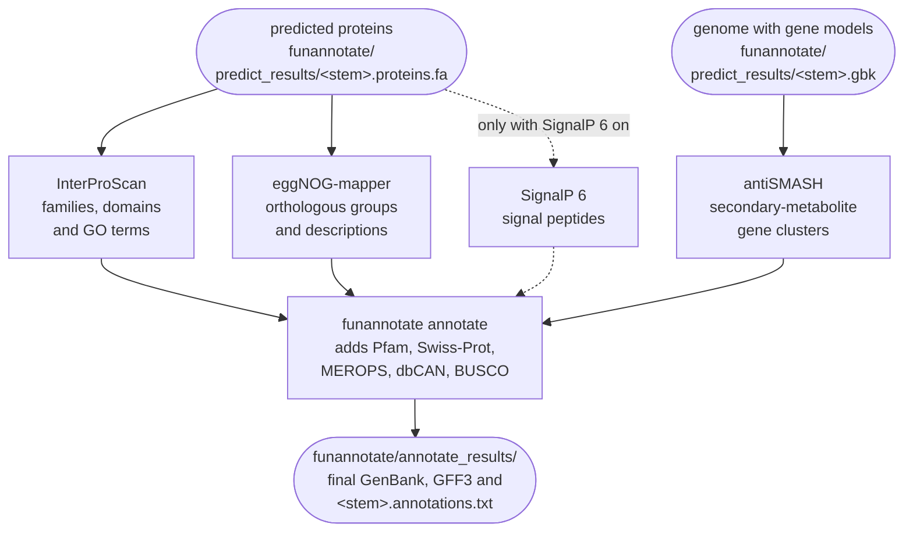

# Functional annotation

Four tools annotate the genes from [gene prediction](gene-prediction.md): InterProScan,
eggNOG-mapper, antiSMASH and, when it is switched on, SignalP 6. funannotate annotate then merges
their results with its own database searches into the final GenBank, GFF3 and table files. This
page describes each step, what it needs and what it writes, and lists the final files of the
annotation.



Paths below are relative to `04.annotation/{sample}/`, except those starting with
`00.resources/`, `04.annotation/` or `logs/`, which are relative to the output folder. `<stem>` is
`<Genus_species>_{sample}`, the file stem of [gene prediction](gene-prediction.md#outputs).

The table lists the rules that run for each sample, with the files each one reads and writes:

| Rule, as the console and the log files name it | Tool | Reads | Writes | Threads (at most) |
|---|---|---|---|---|
| `iprscan_annotation` | InterProScan 5, installed by the user (tested with 5.78-109.0), with OpenJDK 11.0.30 and Python 3.11.15 | `funannotate/predict_results/<stem>.proteins.fa` | `iprscan/interproscan_out.xml` | 10 |
| `eggnog_annotation` | eggNOG-mapper 2.1.13 with DIAMOND 2.0.15 | the same proteins | `eggnog/` | 12 |
| `antismash_annotation` | antiSMASH 8.0.4 | `funannotate/predict_results/<stem>.gbk` | `antismash/` | 12 |
| `signalp6_annotation`, optional | SignalP 6 from the user's archive | the same proteins | `signalp6/prediction_results.txt` | `parameters.signalp6.torch_num_threads` (8), at most `resources.threads` |
| `funannotate_annotation` | funannotate annotate 1.8.17 | all of the above | `funannotate/annotate_results/`, `.annotation_complete.txt` | 12 |
| `cleanup` | `rm` | `.annotation_complete.txt` | `.cleanup_complete.txt` | 1 |

InterProScan is the longest step, usually a few hours for a fungal proteome, while the other tools
usually take minutes to about an hour each. The eggNOG-mapper rule is capped at 12 threads so
that, with `--cores` 22 or more, it runs beside InterProScan instead of waiting for it. The run
time of a whole sample is given on [Run time](../reference/running.md#run-time).

!!! abstract "Terms used on this page"

    | | |
    |---|---|
    | **`<stem>`** | the shared start of funannotate's file names, `<Genus_species>_{sample}`, such as `Fusarium_graminearum_SAMPLE1`; the species comes from the annotation parameter table |
    | **lookup service** | the EBI online service that returns InterProScan matches already computed for known proteins; it receives checksums, not sequences. It did not answer InterProScan 5 in November 2026, and FunFlux does not ask it |
    | **NOTE** | a line starting `[FunFlux] NOTE` that reports something to check without stopping the run; read them after every dry run |
    | **`scaffold_N`** | the name `funannotate sort` gives each contig, `scaffold_1` being the longest; nothing is joined, and the gene models refer to these names |
    | **secretome** | the predicted secreted proteins, which funannotate annotate lists from the SignalP 6 result in `annotations.secretome.txt` and the `Secreted` column; none without SignalP 6 |
    | **model weights** | the trained numbers that make up a model, such as the SignalP 6 model |
    | **funannotate database** | the frozen snapshot of funannotate's data, such as Swiss-Prot, Pfam, the BUSCO set and stored AUGUSTUS models, downloaded once from Zenodo into `directories.funannotate_db` |

## InterProScan

InterProScan looks for known protein families and domains in every predicted protein. Rule
`iprscan_annotation` runs it as follows:

```bash
/path/to/interproscan-5.78-109.0/interproscan.sh -i <stem>.proteins.fa -f XML -goterms -pa -dp \
  -cpu {threads} -T iprscan/tmp -o iprscan/interproscan_out.xml
```

`-goterms` adds the Gene Ontology terms of the matches, and `-pa` the pathway annotation. `-dp`
makes InterProScan compute every match itself, as described below.

InterProScan is not on bioconda and takes about 50 GB once set up, so you install it yourself and
name its `interproscan.sh` in `files.iprscan`. The rule runs it in a conda environment that
provides Java 11 and the Python 3 that InterProScan runs for seven of its analyses, listed in the
table below. The installation is described on
[Licensed and external tools](../getting-started/external-tools.md).

Before and after InterProScan, the rule checks its input and its output, so that an empty or
cut-off XML never reaches funannotate annotate:

- **Before InterProScan**, the rule takes the first `*.proteins.fa` in
  `funannotate/predict_results/`, and stops with `Could not find a *.proteins.fa file in ...` when
  there is none. It then deletes an old XML.
- **After InterProScan**, it checks that the XML parses and that its root element is
  `protein-matches`. Otherwise it stops with `InterProScan XML validation failed for <path>: ...`.

When InterProScan fails, the rule starts the job once more before the run stops, and
`logs/iprscan_annotation_{sample}.log` keeps the last attempt only.

InterProScan's working folder, `iprscan/tmp/` (`-T` in the command), stays after the run, empty or
nearly so.

The command selects no analyses (no `-appl`), so every analysis of the installation runs. With
5.78-109.0, that is every analysis of the download except the three with licensed components:

| Analyses | Which |
|---|---|
| run | AntiFam, CDD, Coils, FunFam, Gene3D, HAMAP, MobiDBLite, NCBIfam, PANTHER, Pfam, PIRSF, PIRSR, PRINTS, PROSITE patterns, PROSITE profiles, SFLD, SMART and SUPERFAMILY |
| of these, run with the Python 3 of the conda environment | FunFam, Gene3D, HAMAP, MobiDBLite, PANTHER, PIRSR and PROSITE profiles |
| switched off in the InterProScan download, because they contain licensed components | Phobius, SignalP and TMHMM |

Signal peptides come instead from [SignalP 6](#signalp-6-optional), when it is switched on.

FunFlux passes InterProScan's `-dp`, so that InterProScan does not ask EBI's precalculated match
lookup service for the matches EBI has already computed for known proteins. Without `-dp`,
InterProScan sends that service checksums of the protein sequences, not the sequences. As checked
in October 2026, the service answered only the newest release, 5.78-109.0, the last
InterProScan 5, and refused older ones (`you cannot use this match lookup service`). In November
2026 it did not answer 5.78-109.0 either: its address returned the InterPro web site. Run without
`-dp`, InterProScan then failed its version check (`Could not determine server version`), wrote
an error with a Java stack trace into its log, printed
`Pre-calculated match lookup service failed - analysis proceeding to run locally` and computed
every match itself.

With `-dp`, InterProScan computes every match itself from the start. The matches are the same as
with the service, no request is sent to EBI, InterProScan needs no internet, and every run gets
the same locally computed e-values. The service returned EBI's e-values instead, which for the
same match can differ from locally computed ones, and very small ones came back as `0.0`.
InterProScan computed every match itself in the four runs of
[Validation on public genomes](../about/validation.md#assembly) made with FunFlux 2.1.0, and took
4.0 to 6.6 hours on 10 threads for about 11,800 proteins of *B. cinerea* B05.10. FunFlux 2.0.0
left the service on. The setting `precalculated.match.lookup.service.url` in
`interproscan.properties` no longer matters to FunFlux.

!!! note "The lookup service saved less time for a new isolate"

    While the service still answered, in October 2026, InterProScan took about 1 hour with it and
    5 hours without on *B. cinerea* B05.10, with 11,728 distinct proteins and 10 threads. In a
    check made the same month, 500 distinct proteins were drawn at random from the annotation of
    B05.10, and 500 from that of
    [*Cordyceps cateniannulata* GXU-8616](../about/validation.md#pacbio-hifi-reads-cordyceps-cateniannulata-gxu-8616).
    The annotation of GXU-8616 has 10,924 predicted proteins, 10,888 of them distinct. The service
    already knew 471 of the 500 from B05.10 (94 %), but only 5 of the 500 from GXU-8616 (1 %).
    B05.10's proteins are public, so the service knew most of them, and for a new isolate the gain
    was smaller.

## eggNOG-mapper

eggNOG-mapper annotates the predicted proteins it can place in eggNOG orthologous groups, from
what is known about those groups. Rule `eggnog_annotation` runs it with DIAMOND:

```bash
emapper.py -i <stem>.proteins.fa --output_dir eggnog --cpu {threads} -m diamond \
  --data_dir /path/to/eggnog_db --output {sample} --temp_dir eggnog/eggnog_tmp --override
```

DIAMOND searches `eggnog_proteins.dmnd`, and the annotation comes from `eggnog.db`. Both lie in
`directories.eggnog_db`, which holds the eggNOG 5.0.2 data of eggNOG-mapper 2.1.13 (48 GB). Its
download is described on [Reference databases](../getting-started/databases.md).

!!! warning "A missing eggNOG folder only gives a NOTE, and the run fails later"

    When the folder named by `directories.eggnog_db` does not exist, FunFlux only prints a NOTE
    before any job starts. `eggnog_annotation` reads the predicted proteins, so it fails only
    after gene prediction has run.

eggNOG-mapper writes its results to `eggnog/`:

| File in `eggnog/` | Content |
|---|---|
| `{sample}.emapper.annotations` | one row per annotated protein: seed ortholog, eggNOG orthologous groups, COG category, description, preferred gene name, GO terms, EC number, KEGG orthology, pathways and modules, CAZy family and Pfam domains. funannotate annotate reads this file |
| `{sample}.emapper.hits`, `{sample}.emapper.seed_orthologs` | the search results behind it |
| `eggnog_tmp/` | the scratch folder; Snakemake deletes it when the job ends |

## antiSMASH

antiSMASH looks for secondary-metabolite gene clusters, groups of neighbouring genes that
together make a secondary metabolite. Rule `antismash_annotation` runs it on the GenBank file of
the genome with its predicted genes:

```bash
antismash --taxon fungi --output-dir antismash --output-basename antismash \
  --databases 00.resources/antismash/databases --genefinding-tool none --cpus {threads} \
  funannotate/predict_results/<stem>.gbk
```

`--taxon fungi` selects the cluster detection rules antiSMASH has for fungi.
`--genefinding-tool none` makes antiSMASH use the genes of the GenBank file instead of predicting
its own, so the clusters lie on the same gene set as the rest of the annotation. `antismash/` holds
the interactive report `index.html`, the `antismash.gbk` that funannotate annotate reads,
`antismash.json`, `antismash.zip` and one GenBank file per region, named
`scaffold_N.regionNNN.gbk`.

The database is `00.resources/antismash/databases/`, made once per output folder by one of two
rules, as `directories.antismash_db` decides:

| `directories.antismash_db` | Rule | What happens |
|---|---|---|
| empty (default) | `antismash_db` | `download-antismash-databases --database-dir 00.resources/antismash/databases`. The database folder of antiSMASH 8.0.4 is 9.4 GB. Kept for later runs on the same output folder; a new output folder downloads it again |
| a folder that holds `clusterblast/` | `antismash_db_local` | `00.resources/antismash/databases/` is filled with one symbolic link per entry of that folder. Nothing is downloaded or copied, and the folder is only read |

Naming a folder therefore lets several output folders share one copy, instead of downloading
9.4 GB for each.

A named folder that does not exist or holds no `clusterblast/` stops the run before any job
starts. FunFlux checks nothing more: antiSMASH checks the programs and database files of its
modules when it starts, and stops if one is missing.

## SignalP 6 (optional)

SignalP 6 predicts signal peptides, which send a protein into the secretory pathway, the route
that secreted proteins take out of the cell. funannotate annotate turns the result into the
secretome, the list of secreted proteins. SignalP 6 is off by default. To switch it on, set a mode
and name the archive:

| Key | Default | Effect |
|---|---|---|
| `parameters.signalp6.mode` | `off` | `fast`, `slow` or `slow-sequential` switches SignalP 6 on and chooses the model |
| `files.signalp6_archive` | empty | absolute path to the SignalP 6 archive downloaded from DTU; required when the mode is not `off` |
| `parameters.signalp6.archive_sha256` | empty | SHA-256 of the archive (`sha256sum <archive>`), compared before the installation |
| `parameters.signalp6.torch_num_threads` | 8 | threads of the rule, passed to PyTorch; a value above `resources.threads` is lowered to it, with a NOTE |
| `parameters.signalp6.batch_size` | 10 | proteins per batch (`--bsize`); raise it only after checking the memory |

The archive must contain the model of the mode, so a fast archive such as
`signalp-6.0i.fast.tar.gz` works only with `mode: fast`.

Rule `install_signalp6` runs once per output folder. In this order, it:

1. checks the SHA-256 of the archive
2. unpacks the archive, refusing paths that would leave the scratch folder
3. checks that the model of the mode is there
4. installs the SignalP package into the signalp6 environment (Python 3.10.13, PyTorch 1.13.1, CPU
   only) without downloading anything
5. moves the package with its model weights to `00.resources/signalp6/package/` (1.6 GB with the
   fast model)
6. writes `00.resources/signalp6/installation.json`

Its log is `logs/install_signalp6.log`.
[Licensed and external tools](../getting-started/external-tools.md#signalp-6) explains how to
obtain the archive, and describes the installation in detail.

Rule `signalp6_annotation` then runs for each sample:

```bash
signalp6 --fastafile <proteins, headers cut to the ID> --organism eukarya \
  --output_dir <scratch folder> --format none --mode <mode> --torch_num_threads {threads} \
  --bsize <batch_size> --model_dir 00.resources/signalp6/package/<model folder>
```

Around the command, the rule does the following:

- **Before SignalP 6**, it checks that SignalP 6 is still installed in its conda environment. A
  rebuilt environment (a changed environment file, another `--conda-prefix`, a deleted
  `.snakemake/conda`) has lost it. The rule then stops and asks you to delete
  `00.resources/signalp6/installation.json`, so that `install_signalp6` installs SignalP 6 again.
- **Also before SignalP 6**, it cuts the protein headers to the transcript ID, the ID by which
  funannotate matches the results. An empty or repeated ID stops the rule.
- **After SignalP 6**, it checks the result (not empty, a `# SignalP-6` line, at least five
  tab-separated columns), and only then replaces `signalp6/` with the new results.

The folder `signalp6/` then holds:

| File in `signalp6/` | Content |
|---|---|
| `prediction_results.txt` | one row per protein: ID, prediction (`SP` for a signal peptide, `OTHER` for none), the probabilities and the cleavage site |
| `output.gff3`, `region_output.gff3`, `output.json`, `processed_entries.fasta` | SignalP 6's other result files |
| `proteins.for_signalp.faa` | the copy of the proteins with headers cut to the transcript ID |

funannotate annotate writes the proteins with a signal peptide to
`funannotate/annotate_misc/annotations.secretome.txt` and to the `Secreted` column. When that file
is missing, `funannotate_annotation` stops with
`Funannotate did not create annotations.secretome.txt from the supplied SignalP 6 results.`

!!! warning "SignalP 6 in the output folder may not be redistributed"

    `00.resources/signalp6/package/` contains SignalP 6 with its model weights, which may not be
    redistributed. Remove it before sharing an output folder. The licences are listed on
    [Licensing](../about/licensing.md).

## funannotate annotate

funannotate annotate builds the final annotation from the results of the four tools. Rule
`funannotate_annotation` runs it as follows:

```bash
funannotate annotate -i funannotate --antismash antismash/antismash.gbk \
  --iprscan iprscan/interproscan_out.xml --eggnog eggnog/{sample}.emapper.annotations \
  [--signalp signalp6/prediction_results.txt] --cpus {threads}
```

To these results it adds its own searches against the funannotate database:

| Database | What it finds | Searched with |
|---|---|---|
| Pfam 38.2 | protein domains | HMMER |
| UniProtKB/Swiss-Prot 2026_03 | curated proteins, for gene and product names | DIAMOND |
| MEROPS 12.5 | peptidases | DIAMOND |
| dbCAN, HMMdb V11 | carbohydrate-active enzymes | HMMER |

It also searches the BUSCO `dikarya` models. These are always `dikarya`, because
`parameters.prediction.busco_db` is passed to funannotate predict only. funannotate annotate
combines gene and product names from UniProt and eggNOG-mapper with its Gene2Product list 1.99,
and compares the antiSMASH clusters with MIBiG 1.4.

Four further points concern this step:

- `PATH` is cut down to the funannotate environment plus `/usr/bin:/bin`, so an eggNOG-mapper or
  SignalP installed elsewhere on the computer cannot add results the configuration did not ask for.
- funannotate annotate skips Phobius (`Skipping phobius predictions`), so the `Membrane` column of
  `<stem>.annotations.txt` stays empty.
- No NCBI submission template (`--sbt`) is passed, so the `.sqn` file carries funannotate's
  default.
- funannotate annotate keeps a copy of the InterProScan XML as
  `funannotate/annotate_misc/iprscan.xml`.

## The final files

The final annotation is in `funannotate/annotate_results/`. It holds the annotated genome as
GenBank and GFF3 files and as one table row per transcript, the sequences, the counts, and the
files a GenBank submission needs. Most files are named `<stem>.*`, for example
`Fusarium_graminearum_SAMPLE1.*`:

| File | Content |
|---|---|
| `<stem>.gbk` | the annotated genome in GenBank format |
| `<stem>.gff3` | gene models with product names and notes (eggNOG, SignalP and other evidence) |
| `<stem>.proteins.fa` | proteins, one per mRNA |
| `<stem>.cds-transcripts.fa`, `<stem>.mrna-transcripts.fa` | coding sequences, transcripts |
| `<stem>.annotations.txt` | one row per transcript: gene and transcript ID, position, name, product, EC number, BUSCO, Pfam, InterPro, eggNOG, COG, GO terms, `Secreted`, `Membrane`, protease (MEROPS), CAZyme, antiSMASH, notes, and the sequences |
| `<stem>.clusters.txt` | the genes of each antiSMASH cluster with their annotation and MIBiG hits |
| `<stem>.stats.json` | counts: assembly statistics, genes, mRNAs, tRNAs, and the proteins with each kind of functional annotation |
| `<stem>.scaffolds.fa` | the annotated genome (`scaffold_N`) |
| `<stem>.tbl`, `.sqn`, `.agp`, `.contigs.fsa`, `.discrepency.report.txt` | files for a GenBank submission: the feature table, the submission file and the discrepancy report of tbl2asn 25.7, and an AGP file with the contigs split at gaps |
| `Gene2Products.must-fix.txt`, `Gene2Products.need-curating.txt`, `Gene2Products.new-names-passed.txt` | funannotate's checks of the product names for a GenBank submission |

The counts in `<stem>.stats.json` vary slightly from run to run, because the gene models do (see
[Gene prediction](gene-prediction.md#run-to-run-variation)).

## Cleanup

Rule `cleanup` runs last for each sample and removes three kinds of leftovers from the top of
`04.annotation/{sample}/`: the `clean_*` scratch folders of an interrupted `funannotate clean`,
`*.log` files and `genome.fixedproducts`. It lists what it removed in `logs/cleanup_{sample}.log`
and writes the marker `.cleanup_complete.txt`.

Everything else stays, so the `04.annotation/` folder of a finished sample holds several GB, most
of it funannotate's working files and two copies of the InterProScan XML. See
[Disk use](../reference/output.md#disk-use).
