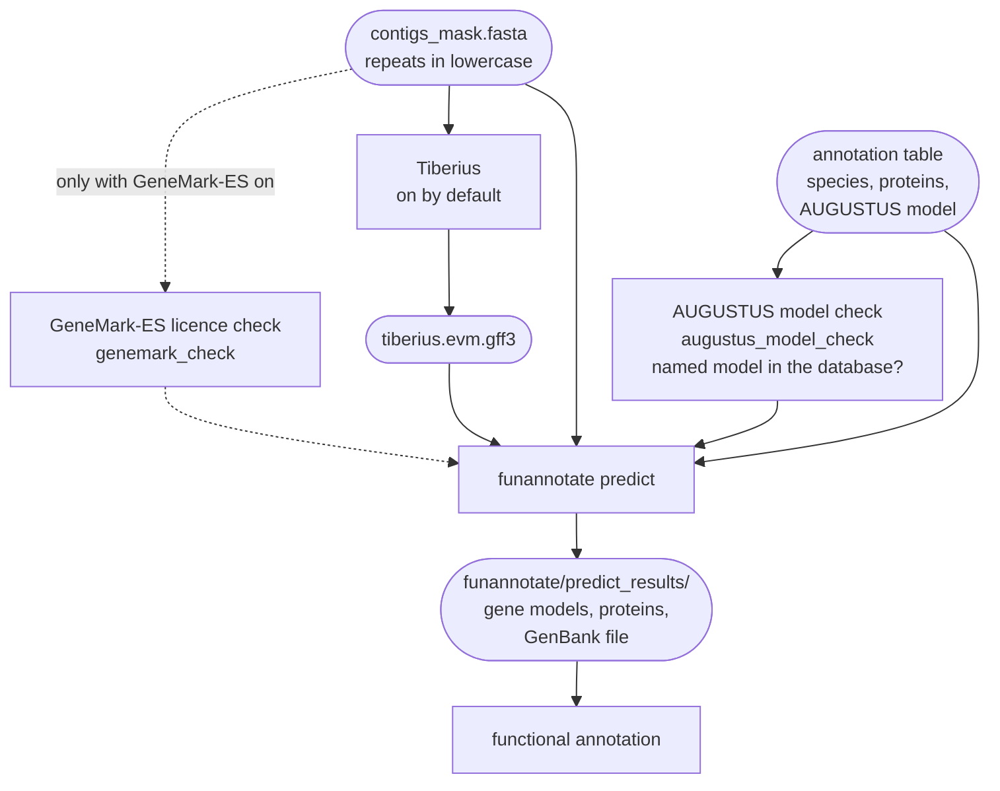

# Gene prediction

FunFlux predicts the protein-coding and tRNA genes of each sample with funannotate predict 1.8.17,
on the soft-masked genome from [repeat masking](repeat-masking.md). Tiberius, a gene finder that is
not trained on your genome, runs first and adds its gene models to the evidence. Two checks run
before the prediction, so that a wrong AUGUSTUS model or an expired GeneMark-ES key stops the run
early instead of hours into it. Read this page to choose the AUGUSTUS model of each sample, to
decide whether GeneMark-ES and Tiberius run, and to interpret the gene models and their files.



One rule, `funannotate_prediction`, makes the gene models with funannotate predict. The other rules
prepare its evidence or check its settings:

| Rule, as the console and the log files name it | What it does |
|---|---|
| `augustus_model_check` | checks the AUGUSTUS model of column 4 of the annotation parameter table, `files.annotation_params` ([The AUGUSTUS model](#augustus-model)) |
| `genemark_check` | runs GeneMark-ES on a slice of the genome to catch an expired licence key ([GeneMark-ES and the licence check](#genemark-es-and-the-licence-check)) |
| `tiberius_model`, `tiberius_prediction`, `tiberius_gff3` | download the Tiberius model, predict genes, convert them for funannotate ([Tiberius](#tiberius)) |
| `funannotate_prediction` | runs funannotate predict on `04.annotation/{sample}/contigs_mask.fasta`, one sample at a time, with all `resources.threads` |

The output folder of funannotate predict, `04.annotation/{sample}/funannotate/`, feeds every step
of the [functional annotation](functional-annotation.md).

!!! abstract "Terms used on this page"

    | | |
    |---|---|
    | **soft-masking** | writing repeats in lower case, so that gene finders can treat them differently without losing the sequence |
    | **annotation parameter table** | the tab-separated file named by `files.annotation_params`, one row per sample: name, species, a protein FASTA of related fungi and, optionally, an AUGUSTUS model |
    | **funannotate database** | the frozen snapshot of funannotate's data, such as Swiss-Prot, Pfam, the BUSCO set and stored AUGUSTUS models, downloaded once from Zenodo into `directories.funannotate_db` |
    | **stored AUGUSTUS model** | the AUGUSTUS parameters trained earlier for one species, kept in `trained_species/` of the funannotate database; named in column 4, they are used as they are |
    | **BUSCO set** | the BUSCO genes funannotate looks for to train SNAP, GlimmerHMM and, without a stored AUGUSTUS model, AUGUSTUS: `dikarya` (`dikarya_odb9`) unless `parameters.prediction.busco_db` names another |
    | **EVidenceModeler** | the program inside `funannotate predict` that builds one consensus gene per locus from the gene finders and protein alignments, weighting each source's votes |
    | **ab initio** | said of a gene finder that predicts genes from the DNA sequence with a trained model, such as AUGUSTUS or SNAP; EVidenceModeler counts Tiberius apart |
    | **licence key** | the file `~/.gm_key` that GeneMark-ES needs; it expires one year after download, and an expired key stops the run at `genemark_check`, before gene prediction |

## Evidence

funannotate predict builds the gene models from the evidence below. The annotation table chooses
the proteins and the AUGUSTUS model of each sample, and the configuration chooses the rest for
every sample.

| Evidence | Where it comes from | Set by |
|---|---|---|
| the genome, repeats in lowercase, contigs named `scaffold_N` | [repeat masking](repeat-masking.md) | `parameters.masking_method` |
| proteins of related fungi | column 3 of the annotation table | `files.annotation_params` |
| UniProtKB/Swiss-Prot 2026_03 (`uniprot_sprot.fasta`, 575,748 proteins) | the funannotate database | `directories.funannotate_db` |
| a stored AUGUSTUS model, if any (see [The AUGUSTUS model](#augustus-model)) | column 4 of the annotation table: one of the models the funannotate database holds; empty or `-` trains AUGUSTUS on this genome | `files.annotation_params`, `parameters.prediction.augustus_optimize` |
| a BUSCO set, to find conserved genes on which SNAP and GlimmerHMM (and AUGUSTUS, when column 4 is empty) are trained | the funannotate database: `dikarya` (BUSCO `dikarya_odb9`, 1,312 genes) is the only set it comes with | `parameters.prediction.busco_db` |
| GeneMark-ES, optional and licensed | the user's installation | `directories.genemark_dir`, `parameters.genemark.mode` |
| Tiberius's gene models, on by default | [Tiberius](#tiberius) | `parameters.tiberius.mode` |

`dikarya`, the only BUSCO set the funannotate database comes with, suits fungi of the Dikarya. For
a fungus outside the Dikarya, add another BUSCO set, such as `fungi`, to the funannotate database
first and set `prediction.busco_db` to its name. When the database is on disk and the named set is
not in it, the run stops before any job starts, with
`[FunFlux] parameters.prediction.busco_db: '<name>' is not in the funannotate database at '<db>'. Add it with FunFlux's funannotate conda environment activated ('Other BUSCO sets for gene prediction' in the documentation shows how to find it): funannotate setup -i busco -b <name> -d <db> -w`.
[Other BUSCO sets for gene prediction](../getting-started/databases.md#busco-sets) shows how to find
and activate that environment.

## The command

Rule `funannotate_prediction` runs this command for each sample, shown here with a stored AUGUSTUS
model in column 4 and Tiberius on:

```bash
funannotate predict -i contigs_mask.fasta -o 04.annotation/{sample}/funannotate \
  -s "<species>" --name {sample} --strain {sample} \
  --augustus_species <augustus_species> \
  --other_gff 04.annotation/{sample}/tiberius/tiberius.evm.gff3:1 --busco_db dikarya \
  --protein_evidence <proteins> /path/to/funannotate_db/uniprot_sprot.fasta \
  --cpus {threads}
```

The annotation table and the Tiberius setting change the command. Column 4 decides whether a
stored AUGUSTUS model is used or AUGUSTUS is trained on the genome, and `tiberius.mode` decides
whether Tiberius's gene models are part of the evidence:

| Setting | Effect on the command |
|---|---|
| column 4 of the annotation table names a stored AUGUSTUS model | `--augustus_species <augustus_species>`, as above |
| column 4 empty | `--augustus_species` is left out; `--optimize_augustus` takes its place when `parameters.prediction.augustus_optimize` is true |
| `parameters.tiberius.mode: on` (the default) | `--other_gff <file>:1` hands funannotate Tiberius's gene models with weight 1 |
| `parameters.tiberius.mode: off` | `--other_gff` is left out |

Before the command, the rule sets `FUNANNOTATE_DB`, cuts `PATH` down to the funannotate
environment plus `/usr/bin:/bin`, and clears `GENEMARK_PATH` unless GeneMark-ES is enabled. A
GeneMark-ES installed elsewhere on the computer is therefore never used by accident.

## What funannotate predict does

funannotate predict turns the evidence into gene models in the following steps:

| Step | Tools |
|---|---|
| align the protein evidence to the genome | DIAMOND 2.2.4, then Exonerate 2.4.0 |
| self-train on the genome and predict (when enabled) | GeneMark-ES |
| find conserved genes for training | BUSCO, with `prediction.busco_db` |
| predict with the stored AUGUSTUS model of column 4, or, with column 4 empty, train on the BUSCO models first | AUGUSTUS 3.5.0 |
| train on the BUSCO models and predict | SNAP 2017_03_01, GlimmerHMM 3.0.4 |
| combine into one consensus | EVidenceModeler 1.1.1 |
| drop models shorter than 50 amino acids or spanning a gap; the repeat filter drops models that lie for at least 90 % in a masked (lowercase) repeat or whose protein matches a transposable element | funannotate |
| find tRNA genes | tRNAscan-SE 2.0.13 |

EVidenceModeler builds one consensus gene per locus from all of this. Every source votes for the
exons, introns and gene ends it predicts or supports, each vote multiplied by the weight of the
source, and the gene structure with the highest total wins. A weight is a relative trust, so only
the ratios between weights matter. funannotate writes the sources, with the kind and the weight it
gives each, to `predict_misc/weights.evm.txt`:

| Source in EVidenceModeler | Evidence | Kind | Weight |
|---|---|---|---|
| `Augustus` | AUGUSTUS models | ab initio (`ABINITIO_PREDICTION`) | 1 |
| `HiQ` | AUGUSTUS models with more than 90 % of their exons supported by the protein alignments; they count here instead of under `Augustus` | other (`OTHER_PREDICTION`) | 2 |
| `snap`, `GlimmerHMM` | SNAP and GlimmerHMM models | ab initio (`ABINITIO_PREDICTION`) | 1 each |
| `GeneMark` | GeneMark-ES models, when GeneMark-ES is on | ab initio (`ABINITIO_PREDICTION`) | 1 |
| `other_pred1` | Tiberius models, when Tiberius is on (fixed in FunFlux) | other (`OTHER_PREDICTION`) | 1 |
| `exonerate` | the protein alignments | protein (`PROTEIN`) | 1 |

AUGUSTUS models that the proteins support therefore count double, and every other source counts
once. The ab initio sources also score the stretches between genes. `HiQ` and `other_pred1` count
only for the exons and introns they predict, not for the stretches between genes.

The log lists where the training of each predictor came from:

```text
augustus     pretrained
genemark     selftraining
glimmerhmm   busco
snap         busco
```

| Word in the log | Meaning |
|---|---|
| `pretrained` | column 4 named a stored AUGUSTUS model of the database, which AUGUSTUS uses as it is |
| `busco` | trained on this genome's BUSCO models: SNAP and GlimmerHMM always, AUGUSTUS when column 4 is empty |
| `selftraining` | GeneMark-ES trained itself on the genome |

A name that is not in the database would also make funannotate train AUGUSTUS, without a word.
FunFlux stops on such a name instead, as [The AUGUSTUS model](#augustus-model) explains.

The GFF3 numbers genes and tRNA genes together, so its gene count is the protein-coding genes plus
the tRNA genes.

## The annotation parameter table

The [annotation parameter table](../reference/configuration.md#annotation-parameter-table) and the
sample name fill in the parts of the command that differ between samples:

| From | Option of `funannotate predict` | Effect |
|---|---|---|
| column 2 | `-s` | the species |
| column 3 | `--protein_evidence` | the protein evidence, beside Swiss-Prot |
| column 4, if it names a model | `--augustus_species` | the stored AUGUSTUS model |
| the sample name | `--name` | the locus-tag prefix: genes are numbered `SAMPLE1_000001`, `SAMPLE1_000002`, ..., their transcripts `SAMPLE1_000001-T1` |
| the sample name | `--strain` | adds the sample name to the file stem |

The funannotate database comes with 166 stored AUGUSTUS models, and
`ls /path/to/funannotate_db/trained_species/` lists them. Fungal models among them include
`aspergillus_fumigatus`, `aspergillus_nidulans`, `botrytis_cinerea`, `fusarium`,
`fusarium_graminearum`, `magnaporthe_grisea` and `neurospora_crassa`.

NCBI accepts a locus-tag prefix of 3 to 12 letters or digits that starts with a letter, and
FunFlux prints a NOTE for a sample name that does not fit. Such a sample runs, but its gene IDs
cannot be submitted to GenBank as they are.

## The AUGUSTUS model { #augustus-model }

Column 4 of the annotation table decides which parameters AUGUSTUS runs with. The choice matters
because AUGUSTUS models with strong evidence (more than 90 % of their exons supported) carry
weight 2 in EVidenceModeler. That is the highest weight of any gene finder here, and every other
model counts 1.

| Column 4 | What AUGUSTUS does | The log says |
|---|---|---|
| empty, `-`, or no fourth column (the default) | is trained on this genome's BUSCO models with `etraining`, AUGUSTUS's training program (a few seconds) | `augustus busco` |
| a stored AUGUSTUS model, such as `fusarium_graminearum` | uses that species' parameters from `<funannotate_db>/trained_species/` as they are; it is not trained on this genome | `augustus pretrained` |
| empty, with `prediction.augustus_optimize: true` | the same, then `optimize_augustus.pl` tunes the model's meta-parameters by 8-fold cross-validation, and AUGUSTUS is trained again (details below) | `augustus busco` |

The default, an empty column 4, trains AUGUSTUS on the genome itself and needs no choice. Name a
stored AUGUSTUS model instead when you know one that suits the genome, typically one of the same
species or genus, or when the genome yields too few BUSCO models for training (below). The choice
changes a large share of the final gene models, so FunFlux records it for every sample.

!!! warning "Training AUGUSTUS on fewer than 200 BUSCO models stops the prediction late"

    Training needs at least 200 BUSCO models (funannotate's `--min_training_models`, which FunFlux
    does not change). With fewer, funannotate stops after the protein alignment and the BUSCO
    search, well into the prediction, with
    `Not enough gene models <N> to train Augustus (200 required), exiting`. The `dikarya` set has
    1,312 BUSCO genes, but a fragmented assembly, or a fungus outside the Dikarya with the `fungi`
    set (290 genes), can give fewer than 200. Name a stored AUGUSTUS model for such a genome.

With `prediction.augustus_optimize: true`, `optimize_augustus.pl` tunes the model's
meta-parameters, the settings the quick training keeps fixed, such as the width of the windows
around splice sites in which AUGUSTUS learns sequence patterns. It tunes them by 8-fold
cross-validation. The test genes, the tenth of the BUSCO models funannotate sets aside for
testing, are cut into 8 parts, and each part is predicted by a model trained without it. AUGUSTUS
is then trained again. This takes about a quarter of an hour for a 40 Mb genome and uses at
most 8 CPUs.

With column 4 empty, funannotate first looks for a stored AUGUSTUS model under the name it gives a
newly trained one, `<genus>_<species>_<sample>` in lower case (`beauveria_bassiana_arsef3097`).
Such a model exists only if someone added an earlier result to the database with
`funannotate species`, as funannotate's last message suggests. If it exists, funannotate uses it
as it is instead of training, and FunFlux says so in a NOTE and in the record described below.

Rule `augustus_model_check` runs right after the funannotate database is ready, long before the
gene prediction. It stops the run on a name the database does not hold and gives the closest names
it does hold, also in `logs/augustus_model_check_{sample}.log`. It writes the choice to
`04.annotation/{sample}/augustus_model.txt`, which the gene prediction copies to the top of its
log. When the database is already on disk, the same check runs before any job starts, so a dry
run shows the error too. Every dry run prints one line with the choice for each sample, for
example:

| Column 4 | Dry-run line |
|---|---|
| empty | `AUGUSTUS: ARSEF3097 is trained on its BUSCO genes.` |
| a stored AUGUSTUS model | `AUGUSTUS: ARSEF3097 uses the stored model fusarium_graminearum.` |
| either, before the database is downloaded | the line ends in `(checked once the database is unpacked)` |

## GeneMark-ES and the licence check

GeneMark-ES is optional and needs a licence. Two configuration keys decide whether it runs:

| `directories.genemark_dir` | `parameters.genemark.mode` | GeneMark-ES |
|---|---|---|
| names an installation (the folder with `gmes_petap.pl`) | `auto`, the default; a `mode` left empty (`mode:` or `mode: ""`) also means `auto`, as for the other mode keys | used |
| empty | any | not used |
| any | `off` | not used |

When it is not used, funannotate runs without it, and the dry run prints
`GeneMark-ES: off (funannotate runs its no-GeneMark branch).` FunFlux v2 was tested with
GeneMark-ES, and with `mode: off` on one public genome
([Validation on public genomes](../about/validation.md#gene-finders)). See
[Licensed and external tools](../getting-started/external-tools.md) for the installation and the
key.

The licence key, `~/.gm_key` of the user who runs Snakemake, expires one year after download, and
the date of the key file does not tell when. `gmes_petap.pl` only checks that the file exists, so
an expired key would show only when funannotate predict reaches GeneMark-ES, well into the run,
with `Your license period has ended`. With GeneMark-ES on, rule `genemark_check` therefore runs
GeneMark-ES on the first 200,000 bytes of `contigs_mask.fasta` before the prediction. This check
takes about a minute. It stops the run when the licence or the installation fails, and writes its
result to `04.annotation/{sample}/genemark_check.txt`. The command, its outcomes and its messages
are on
[The licence check before gene prediction](../getting-started/external-tools.md#the-licence-check-before-gene-prediction).

## Tiberius { #tiberius }

Tiberius ([Gabriel et al. 2024](../about/citation.md)) finds genes with a deep neural network
joined to a hidden Markov model. A hidden Markov model is the kind of model AUGUSTUS and
GeneMark-ES use for the order of exons, introns and the DNA between genes. Unlike them, Tiberius
is not trained on your genome. It uses
one model, `fungi`, that its authors trained on many fungal genomes. It needs no licence and no
evidence, and it runs whether or not GeneMark-ES does. With both on, both count in
EVidenceModeler.

Tiberius is on by default and needs no setting. Three configuration keys control it:

| Setting | Default | Meaning |
|---|---|---|
| `parameters.tiberius.mode` | `on` | `off` leaves Tiberius out; the `funannotate predict` command is then the one without `--other_gff` |
| `links.tiberius_model_link` | the `fungi` model on the Tiberius authors' server | where the model is downloaded from; required while Tiberius is on |
| `parameters.tiberius.model_sha256` | the checksum of the model file of 8 February 2026 | the SHA-256 the downloaded file must have |

Tiberius runs in three rules, from the download of its model to the file funannotate reads:

| Rule | Runs | What it does | Writes |
|---|---|---|---|
| `tiberius_model` | once per output folder | downloads the model archive (about 30 MB), checks its SHA-256 checksum and unpacks it | `00.resources/tiberius/model/` |
| `tiberius_prediction` | per sample | runs Tiberius 1.1.8 (bioconda; its own conda environment with the CPU build of TensorFlow 2.17) on `contigs_mask.fasta`, so that the scaffold names are the ones funannotate predict uses | `04.annotation/{sample}/tiberius/tiberius.gtf` |
| `tiberius_gff3` | per sample | converts that GTF with EVidenceModeler's own converter (`augustus_GTF_to_EVM_GFF3.pl`) into the file `funannotate predict` gets with `--other_gff` | `04.annotation/{sample}/tiberius/tiberius.evm.gff3` |

The `fungi` model was trained without repeat masking, the kind of model the Tiberius authors
recommend as the safer default, so Tiberius runs with `--no_softmasking`. Tiberius therefore reads
lowercase and uppercase letters alike, and `contigs_mask.fasta` gives it the same input as the
unmasked genome. After EVidenceModeler, funannotate's repeat filter removes the gene models that
fall in repeats, whatever gene finder they came from
([What funannotate predict does](#what-funannotate-predict-does)). Tiberius also gets
`--seq_len 100080`, the model's own length for the pieces the genome is cut into, which Tiberius
1.1.8 does not take from the model.

The model's address carries no version number, so the authors can replace the file at the same
address. A file that does not match the checksum stops the run with a message instead of quietly
changing the gene models. To accept a new model, check it, compute its checksum with
`sha256sum <archive>` and put that into `parameters.tiberius.model_sha256`, as described under
[Tiberius model](../getting-started/databases.md#tiberius-model).

For a fungal genome of about 40 Mb, Tiberius needs:

| Resource | Need |
|---|---|
| memory | about 16 GB. On a single computer Snakemake does not reserve this memory, so switch Tiberius off on a computer with less free memory. On a cluster the job asks for `resources.ram_gb`, which must then be at least 16 GB |
| CPU | all of `resources.threads`; roughly half an hour on 24 to 32 threads |
| graphics card | not used: Tiberius runs on the CPU |

The weight of Tiberius in EVidenceModeler is fixed at 1, the weight of the other gene finders, and
other values have not been tested.

The logs are `logs/tiberius_model.log`, `logs/tiberius_prediction_{sample}.log` and
`logs/tiberius_gff3_{sample}.log`.

## Run time

For each sample, the two prediction steps run one after the other:

| Step | Run time for a fungal genome |
|---|---|
| Tiberius, before funannotate predict | about half an hour for a 40 Mb genome |
| funannotate predict | usually an hour or more |

## Run-to-run variation

funannotate predict does not give the same gene models twice from the same masked genome and
settings. The differences are small, but they change the gene counts and the counts of the
functional annotation. [Run-to-run differences](../methods/run-to-run-differences.md) explains
which steps differ, and why.

!!! note "Compare two runs by coordinates, not by gene IDs"

    Gene IDs are numbered along the scaffolds, so one model gained or lost renumbers every gene
    after it. Match the gene models of two runs by scaffold, strand and CDS intervals instead.

## Outputs

funannotate predict writes its results into `04.annotation/{sample}/funannotate/`. In the paths
below, `<stem>` is `<Genus_species>_{sample}`, for example `Fusarium_graminearum_SAMPLE1`:

| Path in `funannotate/` | Content |
|---|---|
| `predict_results/<stem>.gff3` | gene models: genes, mRNAs, exons, CDS, tRNAs |
| `predict_results/<stem>.gbk` | the genome with the gene models, GenBank format; the input of antiSMASH |
| `predict_results/<stem>.proteins.fa` | the predicted proteins; the input of InterProScan, eggNOG-mapper and SignalP 6 |
| `predict_results/<stem>.cds-transcripts.fa`, `.mrna-transcripts.fa` | coding sequences, transcripts |
| `predict_results/<stem>.scaffolds.fa`, `.tbl`, `.stats.json` | the genome, the feature table, counts |
| `predict_results/<stem>.discrepency.report.txt`, `.error.summary.txt`, `.validation.txt` | the checks of tbl2asn 25.7 |
| `predict_results/<model>.parameters.json` | the AUGUSTUS parameters used: named after the stored AUGUSTUS model, or `<genus>_<species>_<sample>` in lower case for a model trained on this genome (`beauveria_bassiana_arsef3097.parameters.json`) |
| `predict_misc/` | working files: alignments, the models of each predictor, EVidenceModeler |
| `logfiles/` | funannotate's own logs, `funannotate-predict.log` among them |

With Tiberius on, `04.annotation/{sample}/tiberius/` holds `tiberius.gtf`, Tiberius's gene
models, and `tiberius.evm.gff3`, the same models as funannotate hands them to EVidenceModeler.

The [functional annotation](functional-annotation.md) adds `annotate_results/` and
`annotate_misc/` to the same folder, and `annotate_results/` holds the final files.

The rule log is `logs/funannotate_prediction_{sample}.log`. Like every log, it holds the latest
attempt only.

!!! warning "Re-running the prediction deletes the annotation"

    Snakemake treats `funannotate/` as one output and deletes it before `funannotate_prediction`
    runs again. `funannotate/` holds both the prediction and the final annotation. Whenever the
    prediction runs again, for example after a change in the annotation table, the annotation is
    therefore deleted and every annotation step runs again, with slightly different gene models.
    Copy `annotate_results/` elsewhere first if you need to keep it.
