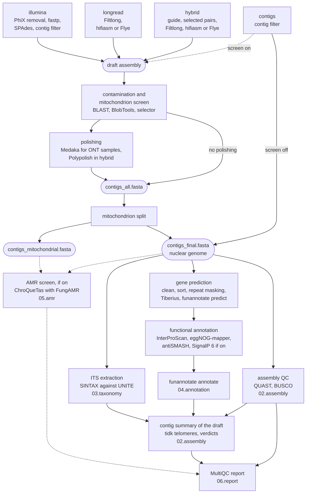

# Architecture

This page shows the path from your input to the annotated genome: the stages, the file each step
hands to the next, and the settings that add or remove steps. Read it to trace a result back to
the step and the file it came from. [Output files](reference/output.md) describes every file, and
[Running FunFlux](reference/running.md) every command.

!!! abstract "Terms used on this page"

    | | |
    |---|---|
    | **front end** | the steps that differ by mode, chosen by `mode`: read processing, assembly and contig filter before the screen, and polishing after it |
    | **contig filter** | rule `filter_contigs`: on SPAdes-style headers it drops contigs under 500 bp or 2x coverage; other headers are only cut at their first space or tab |
    | **the screen** | the contamination and mitochondrion screen of the draft: BLAST against core_nt, BlobTools, the mitochondrion screen and the contig selector; in `contigs` mode only with `parameters.contigs.screen: true` |
    | **draft assembly (the draft)** | the assembly the screen examines, before any contig is removed: `contigs_filt.fasta` in `illumina` mode and in `contigs` mode with the screen, `assembly.fasta` in `longread` and `hybrid` |
    | **nuclear genome** | the delivered genome without the confirmed mitochondrial contigs, `contigs_final.fasta`; it holds every contig when nothing is split off (`parameters.mitochondria.mode` `off` or `report`, or no screen) |
    | **AMR screen (resistance-mutation screen)** | the optional step, off by default (`parameters.amr.chroquetas`), in which ChroQueTas looks in each genome for the changes FungAMR lists for the species; results in `05.amr/` |
    | **`scaffold_N`** | the name `funannotate sort` gives each contig, `scaffold_1` being the longest; nothing is joined, and the gene models refer to these names |
    | **launcher environment** | the conda environment you create by hand for Snakemake itself |

## Data flow

The diagram follows one sample through the workflow, from its input to the report. The numbered
names in the boxes are the folders of the output directory.

!!! note "From the screen on, every mode runs the same steps, except polishing"

    The `mode` key chooses the front end, the part of the run that differs between modes. Before
    the screen, it is read processing, assembly and the contig filter, whichever of these the mode
    runs. After the screen, it is polishing, in `longread` and `hybrid` only. Medaka polishes ONT
    samples unless `medaka_model: false` switches it off, and Polypolish corrects every `hybrid`
    sample. When the screen runs, the front end ends with `contigs_all.fasta`. The contamination
    and mitochondrion screen and the mitochondrion split are shared by all modes.

The MultiQC report holds QUAST, BUSCO and the contig summary in every mode. It adds the read and
mapping QC of the read-based modes, and the AMR table when the AMR screen is on. See
[Report](analysis/report.md).

## From the draft to the nuclear genome

Between the draft and the genome files, each step works on the file the step before it wrote:

| Order | Step | Writes, in `02.assembly/{sample}/` | Runs |
|---|---|---|---|
| 1 | Draft assembly: the SPAdes contigs or your FASTA after the contig filter, or the hifiasm or Flye assembly | `contigs_filt.fasta` (`illumina`; `contigs` with the screen) or `assembly.fasta` (`longread`, `hybrid`) | whenever the screen runs |
| 2 | Assembler evidence (`assembly_evidence`): the read depth and circularity of each contig, from the assembler's own files (`hifiasm/hifiasm.p_ctg.gfa` or `flye/assembly_info.txt`) | `assembly_evidence.tsv` | `longread`, `hybrid` |
| 3 | Contamination screen: BLAST against NCBI core_nt and BlobTools give each contig a genus | `contaminants/` | with the screen |
| 4 | Mitochondrion screen: finds the mitochondrial contigs from the BLAST hits and, in `longread` and `hybrid`, the table of row 2 | `mitochondria/mitochondrial_screen.tsv` | with the screen |
| 5 | Contig selector: keeps or removes contigs by genus, as `parameters.decontamination` says (the default, `off`, keeps all); with `parameters.mitochondria.mode: separate_confirmed`, the default, the confirmed mitochondrial contigs are kept whatever their genus | `contaminants/contigs_decontam.fasta`, `contaminants/contig_taxonomy_decisions.tsv` | with the screen |
| 6 | Medaka polishing | `medaka/consensus.fasta` | ONT samples with Medaka (`longread`, `hybrid`) |
| 7 | Polypolish correction with the Illumina pairs | `polypolish/polished.fasta` | `hybrid` |
| 8 | End of the front end: a copy of the last file written above | `contigs_all.fasta` | with the screen |
| 9 | Mitochondrion split | `contigs_final.fasta`, `contigs_mitochondrial.fasta` | with the screen |

`logs/finalize_assembly_{sample}.log` names the file that became `contigs_all.fasta`. In `contigs`
mode without the screen, the contig filter writes `contigs_final.fasta` directly, and rows 2 to 9
do not run.

Three of these files are read by more than the next step:

| File | Also read by |
|---|---|
| the draft (row 1; in `contigs` mode without the screen, `contigs_final.fasta`) | the telomere search and the [contig summary](analysis/contig-summary.md), which therefore describes every contig of the draft, also those the screen removed |
| `contigs_final.fasta` | QUAST, BUSCO, the ITS extraction, the annotation and the AMR screen |
| `contigs_mitochondrial.fasta` | the contig summary, in every run with the screen; the AMR screen, when it is on ([Two runs](analysis/amr.md#two-runs)) |

[Delivered genome files](index.md#delivered-genome-files) shows what `contigs_all.fasta`,
`contigs_final.fasta` and `contigs_mitochondrial.fasta` hold for each setting of the screen.

## ONT and PacBio HiFi samples

In `longread` and `hybrid` mode, the file-name suffix sets the technology of each sample, and one
batch may hold both, as
[Mixing ONT and PacBio HiFi samples](getting-started/choosing-a-mode.md#mixing-ont-and-pacbio-hifi-samples)
explains. Only one decision changes the steps: whether Medaka runs. Medaka is on by default for
ONT samples (`medaka_model: auto`) and adds two jobs to an ONT sample and none to a PacBio HiFi
sample:

| | ONT sample, with Medaka on (the default) | PacBio HiFi sample |
|---|---|---|
| Medaka jobs | `check_medaka_model`, which reads the raw reads before the assembler starts, so a wrong model name stops the run within seconds; `long_read_consensus` | none |
| `contigs_all.fasta` in `longread` | made from the Medaka consensus | made from the decontaminated assembly |
| `contigs_all.fasta` in `hybrid` | the Medaka consensus, corrected by Polypolish with the Illumina pairs | the decontaminated assembly, corrected by Polypolish with the Illumina pairs |

With `medaka_model: false`, an ONT sample follows the PacBio HiFi column. In `hybrid`, Polypolish
corrects both kinds of sample. `_pacbio` files must hold HiFi (CCS) reads, and CLR reads are not
supported. [Long reads](modes/longread.md) and [Hybrid](modes/hybrid.md) describe the two front
ends.

## Annotation steps

The annotation runs on `contigs_final.fasta`, one step after the other. The rule names are those
Snakemake prints while it runs, and the log files in `logs/` are named after them.

| Order | Step | Rule | Writes, in `04.annotation/{sample}/` |
|---|---|---|---|
| 1 | funannotate clean and sort: removes short and duplicated contigs, sorts the rest longest first and renames them `scaffold_1`, `scaffold_2`, ... | `funannotate_preprocess` | `contigs_clean.fasta`, `contigs_sort.fasta`, `contigs_removed_by_clean.txt` |
| 2 | Repeat masking: tantan (the default), or RepeatModeler and RepeatMasker (`masking_method: repeatmodeler_repeatmasker`) | `repeat_masking` | `contigs_mask.fasta` |
| 3 | Tiberius gene prediction (on by default) | `tiberius_prediction`, `tiberius_gff3` | `tiberius/tiberius.gtf`, `tiberius/tiberius.evm.gff3` |
| 4 | Gene prediction: funannotate predict combines its own gene finders with the Tiberius genes | `funannotate_prediction` | `funannotate/predict_results/`: gene models, proteins, GenBank file |
| 5 | Functional annotation of the predicted proteins, four tools side by side | `iprscan_annotation`, `eggnog_annotation`, `antismash_annotation`, `signalp6_annotation` (SignalP 6 on) | `iprscan/interproscan_out.xml`, `eggnog/`, `antismash/`, `signalp6/` |
| 6 | funannotate annotate merges the gene models and the functional annotation | `funannotate_annotation` | `funannotate/annotate_results/`: the final GenBank, GFF3, proteins and `.annotations.txt`, the functional annotation with one row per transcript |
| 7 | Removal of funannotate's scratch files | `cleanup` | `.cleanup_complete.txt` |

The gene models therefore use the `scaffold_N` names of step 1, not those of
`contigs_final.fasta`, and the `annotated_as` column of the contig summary links the two.

Gene prediction waits for two short checks. An expired GeneMark-ES licence key or a wrong AUGUSTUS
model name therefore stops the run before gene prediction starts, instead of partway through it.

| Check | What it does | Stops the run when | Writes |
|---|---|---|---|
| `genemark_check` (GeneMark-ES on) | runs GeneMark-ES on a 200 kb slice of `contigs_mask.fasta`; takes about a minute | the licence key has expired | `genemark_check.txt` |
| `augustus_model_check` | runs as soon as the funannotate database is ready, within minutes of the start, even when the run downloads the database first | column 4 of the [annotation parameter table](reference/configuration.md#annotation-parameter-table) names an AUGUSTUS model that the database does not hold | `augustus_model.txt`: whether a stored AUGUSTUS model is used or AUGUSTUS is trained ([The AUGUSTUS model](analysis/gene-prediction.md#augustus-model)) |

## Settings that add or remove steps

With the defaults, FunFlux runs the screen in every read-based mode, splits off the mitochondrion,
masks with tantan and predicts genes with Tiberius. GeneMark-ES, SignalP 6 and the AMR screen are
added only when you switch them on. Each setting below adds or removes steps:

| Setting | Default | Effect | Also needs |
|---|---|---|---|
| `mode` | none: required | which front end runs | the input folder of the mode |
| `parameters.contigs.screen` (`contigs` mode) | `false` | `true` adds the contamination and mitochondrion screen, which the read-based modes always run | `directories.blast_db`, in every run with the screen |
| `parameters.mitochondria.mode` | `separate_confirmed` | `report` or `off`: nothing is split off, and `contigs_final.fasta` keeps the mitochondrial contigs | |
| `parameters.<mode>.assembler` (`longread`, `hybrid`) | `hifiasm` | `flye` assembles with Flye instead | |
| `parameters.<mode>.medaka_model` (`longread`, `hybrid`) | `auto` | `false` removes the Medaka model check and Medaka polishing of ONT samples | |
| `parameters.masking_method` | `tantan` | `repeatmodeler_repeatmasker` masks with RepeatModeler and RepeatMasker; it takes hours | |
| `parameters.genemark.mode` | `auto` | adds the GeneMark-ES licence check and GeneMark-ES to gene prediction, but only when `directories.genemark_dir` is set | a licence key in `~/.gm_key` |
| `parameters.tiberius.mode` | `on` | `off` removes the Tiberius model download and the Tiberius gene prediction | `links.tiberius_model_link` while on |
| `parameters.signalp6.mode` | `off` | `fast`, `slow` or `slow-sequential` adds the SignalP 6 installation and the signal-peptide prediction | `files.signalp6_archive` |
| `parameters.amr.chroquetas` | `off` | `on` adds the ChroQueTas download, the AMR screen of every sample (`05.amr/`) and the AMR table of the report | `links.chroquetas_link` |
| `directories.unite_db`, `directories.antismash_db` | empty | a folder you set is linked into `00.resources/` instead of downloading UNITE or the antiSMASH databases | |

Every key is listed on [Configuration](reference/configuration.md).

## Which Python runs the helper scripts

Several steps run FunFlux's own small Python scripts, most of them kept in `workflow/scripts/`.
Each runs with the Python pinned in its rule's conda environment, not with the system Python, so
the scripts behave the same on every computer:

| The rule | The Python |
|---|---|
| has a tool environment (the Medaka model check, the telomere search, the contig summary, the ITS steps, the check of the InterProScan result, the SignalP 6 installation, the AMR screen) | the pinned Python of that environment |
| has none of its own (the contig selector, the mitochondrion screen and split, the assembler's evidence table, the repair of the funannotate database paths, the AUGUSTUS model check) | the `python` environment: Python 3.12.15 and nothing else |

Snakemake's own Python, in the launcher environment, only reads the configuration and runs
FunFlux's checks before any job starts. The commands that the workflow
still takes from the computer are listed on
[Commands outside the conda environments](getting-started/installation.md#host-commands).
