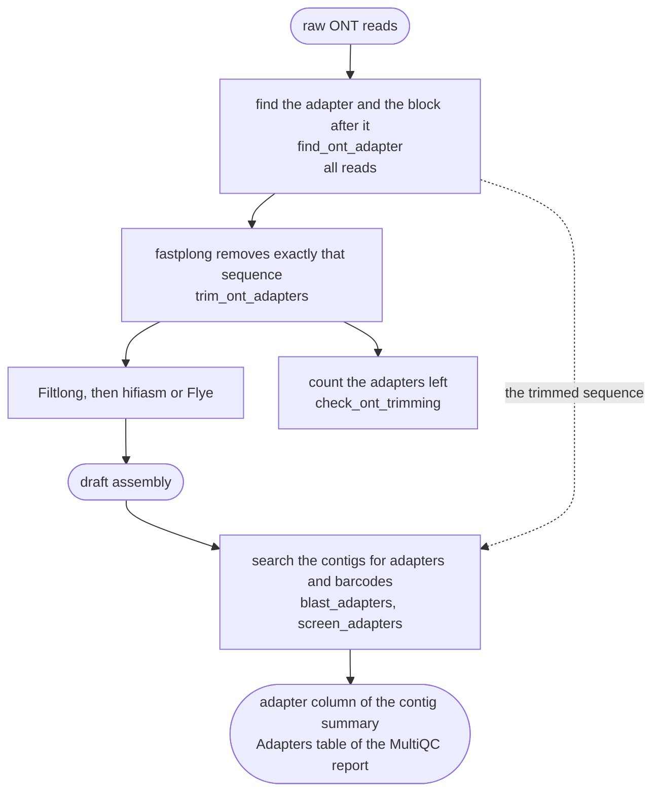

# Adapter trimming and the adapter screen

An Oxford Nanopore (ONT) read starts with the sequencing adapter, and in a barcoded library the
barcode follows it. Left in the reads, both can end up at the ends of the assembled contigs, most
often just outside the telomere. FunFlux therefore removes them from ONT reads before assembly,
with fastplong, and searches every assembly for adapter sequence afterwards, in every mode.

Dorado removes adapters and barcodes when it is run by hand (`dorado basecaller`, kit14 kits), but
reads basecalled live in MinKNOW, or with `dorado duplex`, usually keep them. A FASTQ file does not
say which, so FunFlux looks at the reads themselves. PacBio HiFi reads are not trimmed: the PacBio
software that makes them moves reads with adapter sequence to a separate file of failed reads.

!!! abstract "Terms used on this page"

    | | |
    |---|---|
    | **adapter** | the short synthetic DNA that brings a molecule to the nanopore; ONT's ligation, native and rapid adapters share the top strand `CCTGTACTTCGTTCAGTTACGTATTGCT` |
    | **barcode block** | in a barcoded library, the sequence after the adapter: for native barcoding `AAGGTTAA`, the 24 bp barcode and `CAGCACCT` |
    | **trimmed sequence** | what fastplong removes from the reads of one sample: the adapter, the adapter and its barcode block, or a sequence you set |
    | **chimeric read** | one read that holds two molecules joined end to end, with an adapter between them |
    | **end hit** | adapter sequence within 100 bp of a contig end |
    | **telomere** | the tandem repeat (TTAGGG in most filamentous fungi) at the end of every chromosome |
    | **rule** | one step of the workflow as Snakemake defines it, such as `trim_ont_adapters`; the console and the log files in `logs/` use its name |

## Settings

The key goes in the block named after the mode, `parameters.longread` or `parameters.hybrid`:

| `ont_adapter` | Effect |
|---|---|
| `detect` (the default; also empty) | FunFlux works the sequence out from the reads, or leaves reads that are already trimmed as they are |
| a sequence of 20 to 200 bases of A, C, G and T | that sequence is trimmed, as written |
| `off` (also `false`, `no`, `none`) | no trimming: Filtlong reads the raw reads, as in FunFlux v2.0.0 |

A sequence that is a short unit repeated end to end, such as a telomere repeat, is refused when the
workflow starts. A sequence shorter than 50 bp gets a NOTE, because fastplong then trims it only at
the read ends (see below). The contig adapter screen has no thresholds to set.

## How the sequence is found

Rule `find_ont_adapter` reads every read of the sample once; on the 5.8 Gb *Botrytis cinerea*
B05.10 file this took about two minutes.

1. **The adapter.** The first 150 bp of every read are searched for the 20 bp core of the adapter
   top strand, `TTCGTTCAGTTACGTATTGC`. The core must match exactly, so reads whose adapter carries
   a basecalling error there are not counted: the share of reads with the adapter is a lower
   bound.
2. **The block after it.** In a barcoded library most reads continue after the adapter with the
   same barcode block, while in a library without barcodes they continue into the genome, which
   differs from read to read. FunFlux takes the longest block, up to 120 bp, that at least 60 % of
   the reads with the adapter share. In B05.10 the 40 bp native barcode block was shared by 87 %
   of them; the most common 44 bp sequence, by 1 %.
3. **ONT's published barcodes.** The sequence after the adapter is compared with the 96 native
   and 96 rapid barcodes that ONT publishes in its Chemistry Technical Document; a read counts for
   a barcode when at most 3 of the 24 barcode bases differ. In B05.10, 92.9 % of the reads with
   the adapter carry native barcode NB24, and no other barcode reaches 1 %. The list names the
   barcode and sorts the reads of a file that holds several barcodes; the sequence trimmed for
   each barcode is still the block found in its own reads. ONT publishes the rapid barcodes only
   in part, so the reads are the safer source, and a kit or barcode the list lacks is trimmed all
   the same.
4. **The decision.**
    - When fewer than 1 % of reads start with the adapter, and fewer than 1 % start with a barcode
      block, the reads count as already trimmed and pass through unchanged.
    - When published barcodes are found, each in at least 1 % of the reads with the adapter, the
      adapter followed by each barcode's block is trimmed. Two or more barcodes above 10 % get a
      NOTE, because such a file may hold several samples; a barcode below 10 % is usually a few
      reads of a neighbouring sample assigned to this one, and it is trimmed without a note.
    - Otherwise the trimmed sequence is the adapter followed by the block, if there is one, or the
      adapter alone (a library without barcodes).
    - When the adapter is missing but at least 1 % of reads start with a native or rapid barcode
      block (the adapter was removed earlier, the barcode left), each such block is trimmed.

    A block that is a short tandem repeat is never added. A block with barcode flanks around a
    barcode that ONT does not publish is trimmed as found, with a NOTE. When the reads continue
    with two or more different blocks that are not published barcodes, only the part they share
    is trimmed, with a NOTE: those sequences then stay in the reads, and the adapter screen
    reports them. Write the whole sequence into `ont_adapter` to trim it.

The file `adapters/{sample}_adapter_scan.tsv` counts the reads with the adapter in every block of
10,000 reads. A batch of already-trimmed reads in an otherwise untrimmed file shows up there: in
the public B05.10 file, reads 1 to about 95,000 carry no adapter, and most of the reads after them
do.

## What fastplong does with it

Rule `trim_ont_adapters` runs fastplong 0.7.1 with the most common sequence (`-s`), and with a
FASTA file of every sequence to trim, in both orientations (`-a`). fastplong searches the first
200 bp of every read for the `-s` sequence and the last 200 bp for its reverse complement, which
is how the barcode and adapter sit at the end of a native-barcoded read; the `-a` sequences are
searched at both ends as written, which is how every barcode of a file that holds several is
trimmed. fastplong allows a quarter of the bases to differ and removes the sequence together with
everything outside it. FunFlux adds:

| Option | Why |
|---|---|
| `--trimming_extension 0` | fastplong's default cuts 10 more bases past the sequence, which after a whole adapter and barcode are genome: on B05.10 it shortened every read that starts in a telomere |
| `-Q -L` | fastplong's quality and length filters stay off: Filtlong, the next step, is the read filter of the workflow |
| `--disable_chimera_splitting`, when a sequence to trim is shorter than 50 bp | fastplong also cuts a read where it finds the sequence in the middle (a chimeric read). With the 28 bp adapter alone, that split 1,041 B05.10 reads, and 1,001 of them were not chimeric; with the 68 bp adapter and barcode it split 73, all of them genuine joins |

Rule `check_ont_trimming` then counts the reads that still start with the adapter, among the reads
kept after fastplong and Filtlong (the reads the assembler gets). Above 1 % it prints a NOTE; the
run goes on.

fastplong's own guess of the adapter is never used. fastplong guesses from the first reads of the
file only, and takes the most common sequence at the read ends. In fungal reads that can be the
telomere repeat: on B05.10 it chose `CCCTAA…` and `TTAGGG…`, trimmed the telomeres from the reads,
and the assembly kept a telomere at 2 contig ends instead of 34.

## The contig adapter screen

Rule `blast_adapters` searches the draft contigs of every sample, in every mode, with BLAST
(`blastn -task blastn-short`) for:

| Sequences | Source |
|---|---|
| ONT adapters, the 96 native barcodes and the 96 rapid barcodes with their flanks | ONT Chemistry Technical Document (shipped with FunFlux) |
| PacBio and MGI adapters | NCBI UniVec (shipped with FunFlux) |
| Illumina adapters and primers | NCBI UniVec build 10.1, downloaded into the run, because Illumina's sequences are copyrighted |
| the sequence trimmed from the sample's reads | rule `find_ont_adapter` (trimmed ONT samples) |

Rule `screen_adapters` keeps a hit when at least 90 % of its aligned bases are identical and it
is at least 20 bp long within 100 bp of a contig end, or at least 28 bp long, a whole adapter,
inside a contig. Overlapping hits form one locus. The end rule does not ask how much of an adapter
record is covered, because adapter is often cut short at the very end of a contig, and a barcode
whose adapter was trimmed must still count.

The result goes into the `adapter` column of the contig summary (`none`, `at_end`, `internal` or
`at_end+internal`), into `02.assembly/{sample}/eval/adapter_screen.tsv` with one row per locus,
and into the Adapters table of the MultiQC report. The screen changes no contig and no verdict.

!!! note "Before a GenBank submission"

    The lists cover the common adapters only. NCBI screens every genome submitted to GenBank with
    its own tool, FCS-adaptor, which is distributed as a container; run it on the genome before you
    submit.

## What it did on *Botrytis cinerea* B05.10

The public B05.10 ONT reads (SRR40741277) are native-barcoded, and about 70 % of them were not
trimmed at basecalling. FunFlux `longread` mode assembled them with hifiasm, as delivered and after
trimming:

| Reads given to hifiasm | Chromosomes in one contig | Contig ends with a telomere | Contigs with a telomere at both ends | Median distance from the telomere to the contig end | Contig ends with adapter or barcode |
|---|---|---|---|---|---|
| as delivered | 18 of 18 | 34 | 15 | 78 bp | 28 |
| adapter only trimmed (28 bp) | 18 of 18 | 35 | 17 | 72 bp | 27 |
| adapter and barcode trimmed (68 bp, the sequence FunFlux finds) | 18 of 18 | 36 | 17 | 0 bp | 0 |

With Flye, the reads as delivered left adapter or barcode at 17 of 54 contig ends, and the trimmed
reads at none. The public reference genome of B05.10 (ASM14353v4) gives no hit in the screen.

These numbers come from one strain, one native-barcoding kit and one barcode. Four public runs of
the Rapid Barcoding Kit V14, one of them a yeast (*Diutina catenulata*, ERR17348184), had been
trimmed at basecalling: the scan left three unchanged, and with the yeast reads FunFlux produced
the same assembly with trimming on and off. In the fourth (*Bacillus cereus*, ERR16717241) it found
rapid barcode RB10 left at the start of 1.4 % of the reads and trimmed it. Untrimmed reads of a
rapid or ligation kit have not been tested yet.
