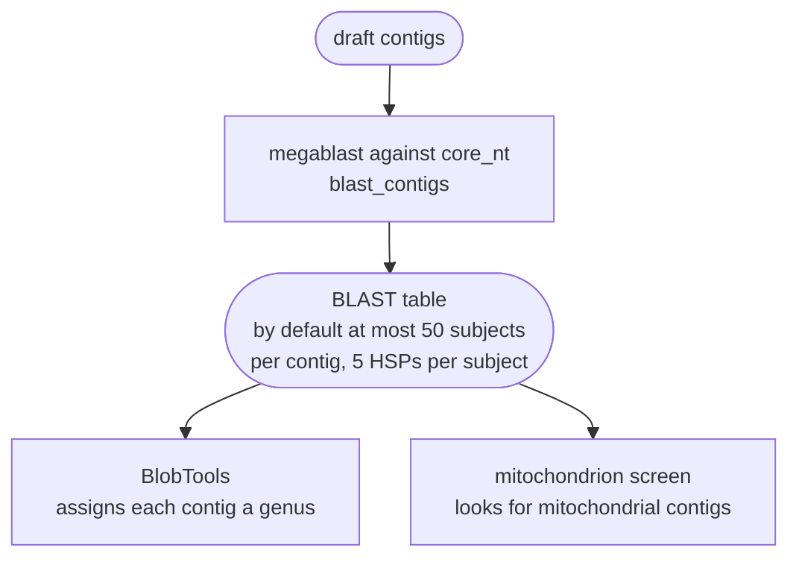

# BLAST hit depth

This page explains how many BLAST hits FunFlux keeps for each contig, and why. Read it before you
change `parameters.blast_max_target_seqs` or `parameters.blast_max_hsps`, or when you compare
genus calls with those of FunFlux 1.1.x.

!!! abstract "Terms used on this page"

    | | |
    |---|---|
    | **the screen** | the contamination and mitochondrion screen of the draft: BLAST, BlobTools, the mitochondrion screen and the contig selector; in `contigs` mode only with `parameters.contigs.screen: true` |
    | **core_nt** | the NCBI core nucleotide BLAST database, which the screen searches every draft contig against; you download it, with its taxonomy files, into `directories.blast_db` |
    | **subject** | the BLAST word for a database sequence a contig matched, the contig being the query; BLAST keeps up to 50 per contig (`blast_max_target_seqs`) |
    | **HSP** | high-scoring segment pair, one local alignment between a contig and a subject; BLAST keeps up to `blast_max_hsps` (5) per subject |
    | **FunFluxL, FunFluxL+** | two of the v1 workflows that FunFlux v2 replaces: FunFluxL for long reads and the unpublished FunFluxL+ for hybrid data |
    | **clean circle** | a contig the assembler recorded as circular, not as a repeat and not as an alternative copy of another contig |
    | **genus filter** | the setting `parameters.decontamination.mode: include` or `exclude`, under which the contig selector keeps or removes contigs by the genus BlobTools gave them |

The contamination and mitochondrion screen runs one BLAST search per draft assembly. Rule
`blast_contigs` runs it with megablast against core_nt and an e-value of 1e-5, and in `hybrid`
rule `blast_guide_contigs` does the same for the guide assembly, with the same two keys. Two programs read
its result table, BlobTools and the mitochondrion screen:



Two BLAST options decide how much of the search is kept. FunFlux v2 sets them to 50 and 5 in
every mode.

| Key | Default | blastn option | blastn help text (BLAST+ 2.16.0) |
|---|---|---|---|
| `parameters.blast_max_target_seqs` | 50 | `-max_target_seqs` | "Maximum number of aligned sequences to keep (value of 5 or more is recommended)" |
| `parameters.blast_max_hsps` | 5 | `-max_hsps` | "Set maximum number of HSPs per subject sequence to save for each query" |

| Workflow or source | `max_target_seqs` / `max_hsps` | e-value |
|---|---|---|
| FunFlux 1.1.x (Illumina) | 10 / 1 | 1e-5 |
| FunFluxL and FunFluxL+ | 50 / 5 | 1e-5 |
| FunFlux v2, every mode | 50 / 5 | 1e-5 |
| BlobTools manual, for its "most accurate results" | 10 / 1 | 1e-25 |
| BlobToolKit tutorial "Adding hits" | 10 / 1 | 1e-25 |
| Sanger Tree of Life BlobToolKit pipeline | 10 / 1 | 1e-10 |

FunFlux v2 keeps the values of FunFluxL. They do not come from a published comparison, and the
three BlobTools sources do not explain theirs either. The sources' 10 / 1 serves the taxonomy
alone. FunFlux v2 also reads the table in its mitochondrion screen, which needs more than one HSP
per subject ([below](#five-hsps-what-the-mitochondrion-screen-needs)). The e-value of 1e-5 is more
permissive than the sources' 1e-10 or 1e-25. The difference matters only for weak, short matches,
which can give a contig a genus where a stricter cut-off would leave it without a hit. A contig
that matches a database sequence over hundreds of bases has an e-value far below all three
cut-offs.

FunFlux 1.1.x used 10 / 1, so its genus calls can differ from those of v2, as described in
[What changes with fewer hits](#what-changes-with-fewer-hits).

## Five HSPs: what the mitochondrion screen needs

The mitochondrion screen, rule `screen_mitochondria`, reads the BLAST column `qcovs` ("Query
Coverage Per Subject"). `qcovs` is the share of the contig covered by all the HSPs that BLAST saved
for one subject. With `-max_hsps 1` only the best HSP is saved, and `qcovs` equals `qcovhsp` ("Query
Coverage Per HSP"). Rearrangements, indels or a different start position on the circle can make a
mitochondrial genome align to its closest reference in several blocks. With one HSP per subject,
such a genome then looks partly covered.

For each contig, the mitochondrion screen takes the highest `qcovs` among its hits to organelle
genomes and confirms the contig as follows:

| Mode | Evidence from the assembler | A contig is confirmed when its highest `qcovs` |
|---|---|---|
| `contigs`, `illumina`, the `hybrid` guide | none | reaches `mitochondria.min_direct_blast_qcov` (default 35). A contig with a weaker organelle hit becomes a `mitochondrial_candidate`, which stays in `contigs_final.fasta` and goes through the nuclear gene prediction |
| `longread`, the `hybrid` long-read assembly | the depth, or a clean circle | reaches `mitochondria.very_strong_qcov` (70) on its own, or reaches `min_direct_blast_qcov` but then only together with the assembler's depth or a clean circle |

!!! warning "One HSP per subject can leave a complete mitochondrial genome unconfirmed"

    With one HSP per subject, only the best block of a multi-block match counts. A complete
    mitochondrial genome that aligns to its nearest core_nt reference in many pieces can then fall
    below `min_direct_blast_qcov`. The mitochondrion screen is described on
    [Mitochondria](../analysis/mitochondria.md).

The default of 5 HSPs has not been compared with other values on a public genome.

## Fifty target sequences: BLAST's own advice

BLAST applies `-max_target_seqs` during the search, not as a filter on the finished, ranked list
of hits. A small value can therefore drop subjects that would have ranked higher (Shah et al.
2019). NCBI's reply confirmed the mechanism, fixed a related bug in BLAST+ 2.8.1 and made BLAST+
warn when fewer than five subjects are requested (Madden et al. 2019). BLAST+ 2.16.0 prints:

```
Warning: [blastn] Examining 5 or more matches is recommended
```

FunFlux uses 50, the value of FunFluxL; the BlobTools sources in the table above use 10. Both meet
NCBI's advice of at least five.

## What changes with fewer hits

FunFlux 1.1.x took 10 / 1 from the BlobToolKit tutorial "Adding hits", which prepares a BLAST
table for the taxonomy only, with `-max_target_seqs 10 -max_hsps 1 -evalue 1e-25`. FunFlux v2
also reads the table for its mitochondrion screen, which needs the coverage that one HSP per
subject cannot measure. Keeping fewer subjects and HSPs has these effects:

- **Genus calls.** BlobTools' `bestsum` rule sums the bit scores of all saved hits per taxon. The
  number of subjects and HSPs kept can therefore change the genus a contig is assigned to. This
  matters most for a fungus whose own genus has few reference sequences in core_nt. Its contigs
  are then called from related genera, and the call can differ between settings.
- **Mitochondrion screen.** The coverage of a multi-block match is that of its best block only, as
  explained [above](#five-hsps-what-the-mitochondrion-screen-needs).
- **Size of the BLAST table.** At 50/5 the table holds several times more lines than at 10/1, but
  it stays a small text file.
- **Run time.** It does not change in practice, because BLAST computes the alignments either way.

The genus calls matter only with a genus filter, `decontamination.mode` `include` or `exclude`.
With `off`, the default, every contig is kept whatever its genus, so the genus calls change no
delivered genome file. See [Decontamination](../analysis/decontamination.md).

## Notices and re-runs

Both values must be whole numbers of at least 1. With the screen on, two notices can print when
the workflow starts:

```
[FunFlux] NOTE: parameters.blast_max_hsps is 1. Below 5, BLAST reports the coverage of a multi-block mitochondrial match as that of its best block only, which weakens the mitochondrion screen (a complete mitogenome can fall under min_direct_blast_qcov).
[FunFlux] NOTE: parameters.blast_max_target_seqs is 3; BLAST recommends 5 or more.
```

The first notice, on `blast_max_hsps`, prints when that value is below 5 and `mitochondria.mode`
is not `off`. The second, on `blast_max_target_seqs`, prints when that value is below 5.

Changing either value runs the BLAST search again.

## Reproducing FunFlux 1.1.x

Set these values only to reproduce results of FunFlux 1.1.x:

```yaml
parameters:
  blast_max_target_seqs: 10
  blast_max_hsps: 1
```

The run then prints the `blast_max_hsps` notice, because the mitochondrion screen is weaker with one
HSP. The 10 / 1 setting has not been run with v2 yet.

## References

- Shah N., Nute M.G., Warnow T., Pop M. (2019). Misunderstood parameter of NCBI BLAST impacts the
  correctness of bioinformatics workflows. *Bioinformatics* 35(9):1613-1614.
  <https://doi.org/10.1093/bioinformatics/bty833>
- Madden T.L., Busby B., Ye J. (2019). Reply to the paper: Misunderstood parameters of NCBI BLAST
  impacts the correctness of bioinformatics workflows. *Bioinformatics* 35(15):2699-2700.
  <https://doi.org/10.1093/bioinformatics/bty1026>
- BlobToolKit, "Adding hits":
  <https://blobtoolkit.genomehubs.org/blobtools2/blobtools2-tutorials/adding-data-to-a-dataset/adding-hits/>
- BlobTools manual, "Taxonomy file": <https://blobtools.readme.io/docs/taxonomy-file>
- Sanger Tree of Life, BlobToolKit pipeline, BLAST settings in `conf/modules.config`:
  <https://github.com/sanger-tol/blobtoolkit>
