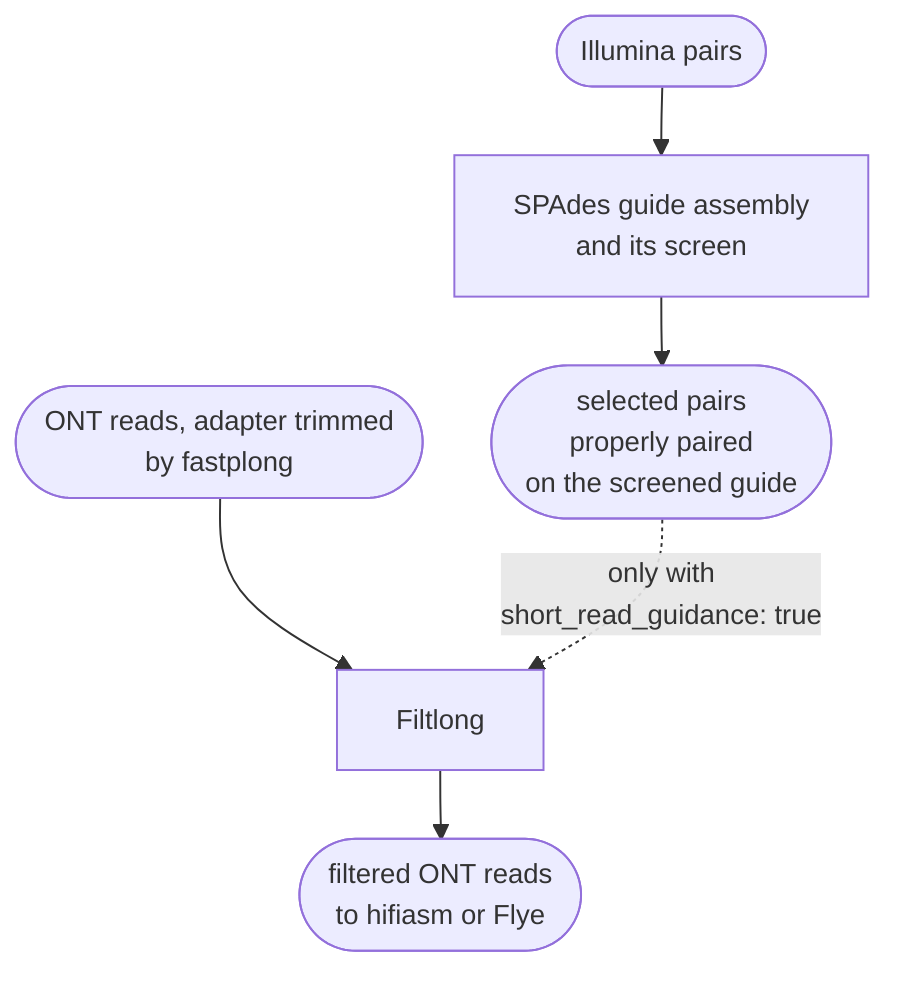

# Filtlong guidance in hybrid mode

In `hybrid` mode the Illumina reads of a sample can guide Filtlong, the filter that chooses which
ONT reads go into the assembly. The guidance is **off by default**, and the ONT reads then get the
same length and quality filter as in `longread` mode. This page gives the reasons for that
default, describes what the guidance does when it is on, and shows how to compare the settings on
your own data.

With `short_read_guidance: true`, Filtlong scores each ONT read by how much of it the Illumina
reads confirm. It trims unconfirmed bases from the read ends and removes every stretch of 1,000 or
more consecutive unconfirmed bases, splitting the read there. PacBio HiFi reads are never guided.



!!! abstract "Terms used on this page"

    | | |
    |---|---|
    | **Filtlong guidance** | the `hybrid` setting `short_read_guidance: true`, off by default: Filtlong scores each ONT read by k-mer matches to the selected pairs and can cut unmatched stretches |
    | **plain filter** | the Filtlong run with only the length and quality settings of `longread` mode: `--min_length`, `--keep_percent`, `--length_weight` and, if set, `--target_bases` |
    | **guide assembly** | the SPAdes assembly of the Illumina reads; it is screened, and only the pairs that map to it go on |
    | **selected pairs** | the Illumina pairs properly paired on the screened guide assembly, kept in `01.reads/{sample}/selected/`; Polypolish corrects with them, and Filtlong uses them when guided |
    | **properly paired** | both reads of a pair map to the same contig, in the expected orientation and distance |
    | **external reference** | the Filtlong term for reads it judges long reads against instead of their Phred scores; in FunFlux, the selected pairs, only with the guidance on |
    | **k-mer** | a short sequence of fixed length; Filtlong compares long reads with the Illumina reads through their 16-mers, k-mers of 16 bases |

## Why it is off by default

Three sources weigh against making the guidance the default:

- **Filtlong's own advice.** The [Filtlong README](https://github.com/rrwick/Filtlong) says: "I
  recommend *against* using short reads as an external reference unless you are very confident in
  the quality of your short-read set."
- **Measured on bacteria.** In
  [BacFlux's tests on five bacterial genomes](https://iLivius.github.io/BacFlux/methods_reference_genome_run/),
  guidance turned a 6-contig *Shigella flexneri* assembly into 40 contigs and cost
  *Enterobacter hormaechei* a whole replicon. It helped on one genome of five, the least
  repetitive one with the deepest Illumina reads.
- **Measured on a fungal genome.** On *Botrytis cinerea* B05.10, with the same 136x ONT reads,
  the guided `hybrid` run and the unguided `longread` run gave almost the same assembly. The
  guided run has 34 contigs and the unguided run 33, and in both, each of the 18 chromosomes is in
  one contig ([Assembly per mode](../about/validation.md#assembly)). Neither run gave the
  mitochondrion as one circular contig. The guided run gave about one and a half copies
  (122,980 bp), and the unguided run a 139,240-bp contig flagged as a concatemer. On these reads
  the mitochondrion changes with small changes in the input, such as the adapter trimming, so the
  difference cannot be put down to the guidance
  ([Other results](../about/validation.md#other-results)).

!!! warning "Guidance can break an assembly apart at repeats"

    The Illumina reads cover repeats worst, and the long reads that span repeats are the ones that
    hold an assembly together. Scoring them low, or cutting them there, can break the assembly
    apart. On one fungal genome the guidance gained nothing measurable. Switch it on only with
    deep, even Illumina coverage, and compare the result with an unguided run as described under
    [Comparing the three settings](#comparing-the-three-settings).

## Settings

Two keys in `parameters.hybrid` control the guidance, and the `filtlong` block beside them sets
the length and quality filter that every sample gets:

| Key | Default | Effect |
|---|---|---|
| `parameters.hybrid.short_read_guidance` | `false` | `false`: the plain length and quality filter of `longread` mode. `true`: ONT samples get the selected pairs as Filtlong's reference (`-1`, `-2`) |
| `parameters.hybrid.filtlong_split` | `1000` | used only with `short_read_guidance: true`. A whole number of bases, at least 1, adds `--trim --split <N>`. `null` scores the reads against the Illumina reads but neither trims nor splits them, because FunFlux adds `--trim` only together with `--split`. With the guidance off, a number other than 1000 makes the workflow print `parameters.hybrid.filtlong_split is ignored because short_read_guidance is false.` |
| `parameters.hybrid.filtlong` | `min_length: 1000`, `keep_percent: 90`, `length_weight: 10`, no `target_bases` | the same filter as in `longread` mode, for every sample |

With the guidance on, Filtlong first scores an ONT read by how much of it the Illumina reads
confirm, then trims and splits it at its unconfirmed stretches. What remains is filtered with the
same `filtlong` settings. Rule `filter_long_reads` runs this command for a guided ONT sample, on
the reads that fastplong trimmed first ([Adapter trimming and the adapter screen](adapter-trimming.md);
with `ont_adapter: off`, on the raw reads):

```
filtlong -1 01.reads/{sample}/selected/{sample}_selected_R1.fastq \
    -2 01.reads/{sample}/selected/{sample}_selected_R2.fastq \
    --trim --split 1000 --min_length 1000 --keep_percent 90 --length_weight 10 \
    01.reads/{sample}/long/{sample}_trimmed.fastq.gz > 01.reads/{sample}/long/{sample}_filtered.fastq
```

When the workflow starts, it prints the decision for every sample. With the guidance on, for
example:

```
[FunFlux] SAMPLE1: ont reads -> Filtlong guided by the Illumina reads, hifiasm --ont, minimap2 map-ont, Medaka.
[FunFlux] SAMPLE2: pacbio reads -> Filtlong not guided, hifiasm, minimap2 map-hifi, no Medaka.
```

## The Illumina reads that guide

The pairs that guide Filtlong are the selected pairs, chosen in three steps:

1. SPAdes assembles the Illumina reads into a guide assembly, which goes through the contamination
   and mitochondrion screen. With `decontamination.mode: off`, the default, every guide contig is
   selected.
2. The trimmed read pairs are mapped back to the selected guide contigs with bowtie2
   (`--no-unal`).
3. `samtools fastq -f 0x2` writes only the properly paired reads, to
   `01.reads/{sample}/selected/{sample}_selected_R1.fastq` and `_R2.fastq`. These files are kept
   after the run.

Polypolish uses these pairs in every run. With the guidance on, Filtlong uses them as its
reference too for ONT samples, so it waits for them and starts only after the guide assembly and
its screen. With
the guidance off, Filtlong and the long-read assembly start at once.

## What Filtlong does with them

The [Filtlong README](https://github.com/rrwick/Filtlong) describes how the scoring, the trimming
and the splitting work:

- With an external reference, Filtlong ignores the Phred scores. It collects the 16-mers of the
  reference. From short reads, a 16-mer is collected only after it has been seen a few times, so
  read errors are left out. Each base of a long read then gets a quality of 100 if it lies in such
  a 16-mer, otherwise 0. The mean quality and the window quality of a read are computed from these
  values.
- `--trim` removes the unmatched bases at the start and end of each read.
- `--split N` removes every run of N or more consecutive unmatched bases, and the pieces become
  separate reads. They replace the original reads before `--keep_percent` and `--target_bases`
  choose the best bases. In the README's words, "A lower value will split more aggressively and a
  higher value will be more conservative."

With the guidance on, the settings `--min_length 1000 --keep_percent 90 --length_weight 10 --trim --split 1000`
are the README's "Length priority" example without its `--target_bases 500mb`. Of `--split 1kb`
the README says: "This larger split value makes Filtlong less likely to split a read [...] This
helps to keep the output reads longer."

## Why PacBio HiFi reads are not guided

HiFi (CCS) reads are already accurate, at Q20 and above, and guided filtering would cut them
wherever the Illumina coverage has a gap. In `hybrid` mode, ONT reads are guided only with
`short_read_guidance: true`, while PacBio HiFi reads are never guided. A PacBio HiFi sample gets
the plain filter, no Medaka, and Polypolish with its selected pairs.

## Before you switch it on

Filtlong's FAQ names two cases in which short reads mislead it:

- **Short reads that miss part of the genome.** In the FAQ's words, "long reads which span the
  poor-short-read-coverage part of the genome may be erroneously considered low-quality".
- **Read sets that differ biologically.** The FAQ's example is a plasmid present only in the long
  reads. Filtlong can then remove the long reads of that region.

When either applies, leave the guidance off.

## Comparing the three settings

The guidance can run with or without splitting, so there are three settings to compare, the
default and its two alternatives:

| Run | Setting | What Filtlong does with the ONT reads |
|---|---|---|
| the default | `short_read_guidance: false` | the plain length and quality filter of `longread` mode |
| guidance | `short_read_guidance: true`, `filtlong_split: 1000` | scores them against the Illumina reads, trims and splits them |
| guidance without split | `short_read_guidance: true`, `filtlong_split: null` | scores them against the Illumina reads, without trimming or splitting |

To compare them on your own data, record for each run the contig count, N50, the mitochondrion's
length and topology, and BUSCO. QUAST and BUSCO, in `02.assembly/{sample}/eval/`, give the contig
count, N50 and completeness. `mitochondria/mitochondrial_screen.tsv` gives the length of the
mitochondrial contig, its topology in the `assembler_circular` column, and its `concatemer_flag`, which marks a contig that may hold two copies of
the mitochondrial genome joined end to end. The flag is `Y` only when `length_ratio` is above 1.5
and the assembler did not record the contig as circular
([Mitochondria](../analysis/mitochondria.md)).
