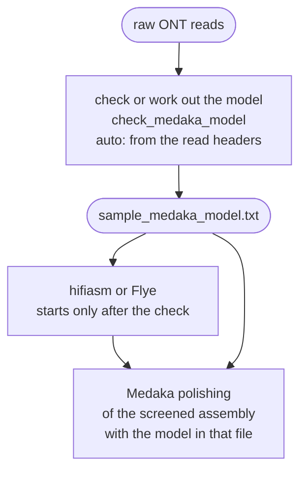

# The Medaka model

Medaka polishes an ONT assembly with the ONT reads, and its model must match the basecaller model
that produced them. FunFlux checks a named model, or works the model out from the raw reads,
before the assembler starts. A wrong model therefore stops the run within seconds instead of after
the assembly.

Only ONT samples in `longread` and `hybrid` mode run Medaka, and PacBio HiFi samples never do. On
*Botrytis cinerea* B05.10, Medaka removed 289 indels, 15 % of those in the assembly, and added 14
mismatches ([Medaka on the 42x run](../about/validation.md#medaka)).



!!! abstract "Terms used on this page"

    | | |
    |---|---|
    | **Medaka model** | the trained model Medaka polishes an ONT assembly with; FunFlux checks it before the assembler starts |
    | **basecaller model** | the model the ONT basecaller called the bases with; the Medaka model must match it |
    | **basecaller tag** | the `basecall_model_version_id=` field in ONT read headers, which names the basecaller model; with `medaka_model: auto`, Medaka reads it from the first 100 reads |
    | **consensus model** | a Medaka model for polishing an assembly, as opposed to Medaka's variant-calling models; with `auto`, FunFlux asks Medaka for its generic `consensus` model |
    | **model weights** | the trained numbers that make up a model; Medaka downloads those of models it does not ship |
    | **rule** | one step of the workflow as Snakemake defines it, such as `check_medaka_model`; the console and the log files in `logs/` use its name |
    | **guide assembly** | the SPAdes assembly of the Illumina reads; it is screened, and only the pairs that map to it go on |
    | **Flye read mode** | the Flye option for the read type: `--pacbio-hifi` for every PacBio sample, `--nano-hq` or `--nano-raw` for ONT samples |

## Settings

The Medaka keys go in the block named after the mode, `parameters.longread` or
`parameters.hybrid`. `medaka_model` chooses the model, or switches Medaka off:

| `medaka_model` | Effect |
|---|---|
| `auto` (the default; also empty or an unquoted `null`, `true`, `yes`, `on`, `1`) | the model is worked out from the read headers |
| a Medaka model name, for example `r1041_e82_400bps_sup_v4.3.0` | that model, once the check has found it in the installed Medaka |
| the path of a model file | that file, as it is |
| `false` (also `0`, `no`, `off`, `none`, `null` in quotes) | no Medaka for any sample. `longread` mode then delivers the screened assembly unpolished, while `hybrid` mode still polishes it with Polypolish |

`medaka_model_fallback_auto` (default `false`) decides what happens when a named model is not
available. With `true`, the check works the model out from the reads instead of stopping the run.

When the workflow starts, it prints one of these lines:

| Line | When |
|---|---|
| `Medaka model: <name>.` | a model is named and the batch has ONT samples |
| `Medaka model will be worked out from the FASTQ headers (checked before assembly).` | `auto`, and the batch has ONT samples |
| `Medaka disabled in the config. Skipping consensus polishing.` | `false`, and the batch has ONT samples |
| `No ONT samples in this batch: any medaka_model setting is ignored.` | only PacBio samples |

## How the model is checked or worked out

The check is rule `check_medaka_model`, which runs once for every ONT sample that uses Medaka, in
the Medaka 2.2.2 environment on one thread. It writes the model to
`02.assembly/{sample}/{sample}_medaka_model.txt`. The assembly of that sample waits for this file,
while PacBio samples do not wait. A changed `medaka_model` therefore re-runs the check, the
assembly of every ONT sample and everything after it.

After the assembly, the polishing rule `long_read_consensus` runs `medaka_consensus -m` with the
model in that file, so the check and the polishing always use the same model. A named model and
`auto` are checked in different ways:

| | A named model | `auto` |
|---|---|---|
| How it is checked or found | compared with the list that `medaka tools list_models` prints | `medaka tools resolve_model --auto_model consensus <raw reads>` |
| What goes into the file | the name, unchanged | the path of the model file |
| Network, for the check | needed once, unless Medaka ships the model. Once the name has passed, the check downloads the model weights from GitHub (`medaka tools download_models`), and later runs reuse the stored copy | needed once. The first time Medaka meets a model that is not installed, it downloads the model weights from GitHub, and later runs reuse the stored copy |
| What the reads need | no basecaller tag needed | exactly one basecaller model among the first 100 reads |

With `auto`, Medaka reads the basecaller model from the `basecall_model_version_id=` tag in the
headers of the first 100 reads and returns the matching consensus model. FunFlux asks Medaka for
its generic `consensus` model. Medaka reads `.fastq.gz` directly and stops after 100 records, so
the call takes a few seconds whatever the size of the read file.

`auto` therefore needs one basecaller tag in the read headers. Reads from public archives, reads
whose headers were rewritten, and reads pooled from several basecalling runs often lack the tag or
mix two. Name the model for them.

The check reads the raw reads, not Filtlong's output, because the filtered reads can come late.
In `hybrid` mode with `short_read_guidance: true`, they exist only after the Illumina guide
assembly and its contamination and mitochondrion screen, hours into the run.

To see what the raw reads carry, print the header of the first read:

```bash
zcat /path/to/reads/SAMPLE_ont.fastq.gz | head -n 1
```

## What can fail

When the check fails, it writes its messages to its log, prints the log to the console and stops
the run (exit status 1) before the assembly:

| Situation | Message | What to do |
|---|---|---|
| `auto`, and Medaka cannot work out a model | `ERROR: Medaka could not infer a model from the reads: their FASTQ headers carry no basecaller tag, or one this Medaka version does not recognise. Set parameters.<mode>.medaka_model to one of the consensus models below (pick by your flowcell / device / accuracy), or to FALSE to skip Medaka.` | name the model, or set `false` |
| a named model that the installed Medaka does not have | `ERROR: Configured medaka_model '<name>' is not available in this Medaka version.` | correct the name from the table that follows |
| the same, with `medaka_model_fallback_auto: true`, and `auto` also fails | `ERROR: Configured medaka_model '<name>' is not available, and fallback auto-inference could not infer a usable model from the reads.` | name an available model |
| a named model that exists, whose weights are not stored and cannot be downloaded | `ERROR: Medaka model '<name>' exists, but its weights are not stored on this computer and could not be downloaded (Medaka downloads them from GitHub). ...` | start Snakemake on a computer with internet (on a cluster the check runs where Snakemake runs), or name a model whose weights come with Medaka 2.2.2 (`r1041_e82_400bps_hac_v6.0.0` or `r1041_e82_400bps_sup_v5.2.0`), or set `false` |
| `medaka tools list_models` gives no answer | `Could not read the Medaka model list ('medaka tools list_models' gave no 'Available:' line).` | rebuild the Medaka environment |

Except for the download failure, each `ERROR` is followed by a table of consensus models with the
columns model, flowcell, device, accuracy and version. For a mistyped name, the table is narrowed
to the models that share the flowcell, device and accuracy written in that name. Otherwise it
lists every model that `medaka tools list_models` reports except the variant-calling ones. The
table can include special-purpose models, such as the bacterial methylation and plant models,
which are not meant for fungi.

!!! warning "The `auto` message hides Medaka's own error"

    Any failure of `medaka tools resolve_model` gives the first message above, including two
    different basecaller tags in the first 100 reads and a download of the weights that failed.
    Check the read headers and the network before you name a model.

With `medaka_model_fallback_auto: true` and a named model that is not available, the run goes on
with the inferred model, and the log says:

```
WARNING: configured medaka_model '<name>' is not available in this Medaka version; fell back to the auto-inferred model '<model>' (parameters.<mode>.medaka_model_fallback_auto is on). Set medaka_model to auto to silence this.
```

On success, the log shows `Medaka model resolved to: <model>`.

## Medaka model and Flye read mode

With `assembler: flye`, the Medaka model can choose the Flye read mode of the ONT samples. To
choose the Flye mode independently of the Medaka model, set `flye_input_mode` to `nano-hq` or
`nano-raw`.

| `flye_input_mode` | `medaka_model` | Flye mode of the ONT samples |
|---|---|---|
| `auto` | a named model with `fast` in its name | `--nano-raw` |
| `auto` | anything else, including `auto`, which never changes the Flye mode | `--nano-hq` |
| `nano-hq` or `nano-raw` | any | that mode |
