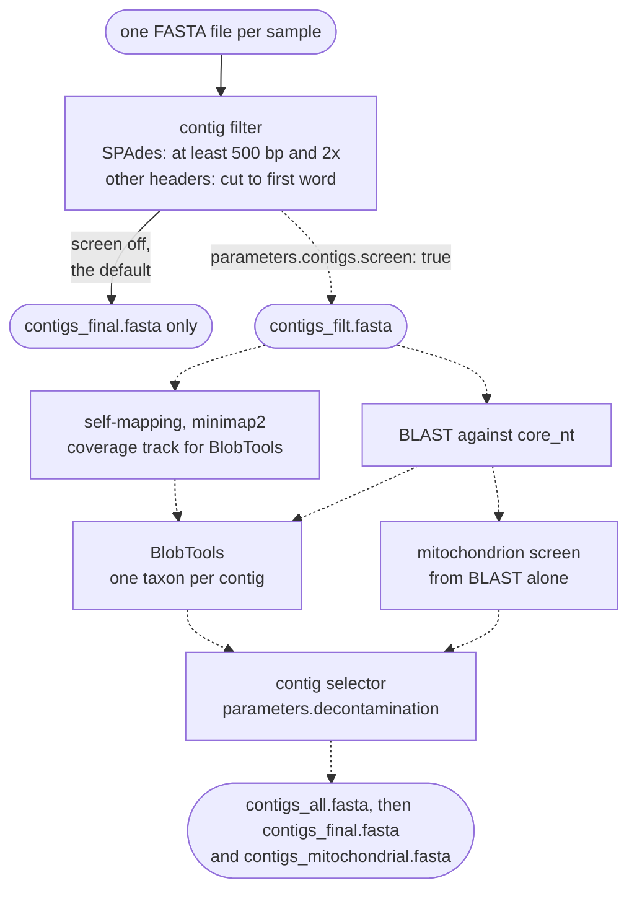

# Pre-assembled contigs

Use `mode: contigs` to annotate genome assemblies you already have. There is no read processing
and no assembler. A contig filter prepares each FASTA, and the contamination and mitochondrion
screen runs only when `parameters.contigs.screen` is `true`. The mode replaces Funnotator, which
shipped inside FunFlux 1.x.

!!! abstract "Terms used on this page"

    | | |
    |---|---|
    | **the screen** | the contamination and mitochondrion screen: BLAST against core_nt, BlobTools, the mitochondrion screen and the contig selector; in `contigs` mode only with `parameters.contigs.screen: true` |
    | **SPAdes-style header** | a FASTA header of the form `>NODE_<n>_length_<L>_cov_<C>`; only with such headers does the contig filter remove contigs under 500 bp or 2x coverage |
    | **contig selector** | rule `select_contigs`, the last step of the screen: it keeps or removes each contig by genus, as `parameters.decontamination` says; the default, `off`, keeps every contig |
    | **confirmed mitochondrial contig** | a contig the mitochondrion screen classes `confirmed_mitochondrial`; with the default `separate_confirmed`, it is kept whatever its genus and moved to `contigs_mitochondrial.fasta` |
    | **nuclear genome** | the delivered genome without the confirmed mitochondrial contigs, `contigs_final.fasta`; it holds every contig when nothing is split off (no screen, or `parameters.mitochondria.mode` `off` or `report`) |
    | **self-mapping** | in `contigs` mode with the screen, the contigs aligned to themselves only because BlobTools needs a BAM file; the coverage then reflects contig length, not depth |
    | **annotation parameter table** | the tab-separated file named by `files.annotation_params`, one row per sample: name, species, a protein FASTA of related fungi and, optionally, an AUGUSTUS model |

## Input

FunFlux takes one FASTA file per sample from one folder:

| | |
|---|---|
| Folder | `input.contigs_dir` |
| File names | `{sample}.fasta`, `{sample}.fa` or `{sample}.fna`, uncompressed, the same extension for every sample |
| Sample name | the file name up to the last dot: `my.genome.fasta` is sample `my.genome` |

Every file in the folder whose name contains a dot is read as a sample, files in subfolders included.
Keep the folder flat, with only uncompressed FASTA files that share one extension. Each of the
following stops the run:

| In the folder | The run stops before any job starts with |
|---|---|
| `README.txt` next to `S1.fasta` | `[FunFlux] input.contigs_dir: more than one file extension in this folder (fasta, txt). All files in it must use the same one.` |
| only gzipped FASTA files, such as `S1.fasta.gz` | `[FunFlux] input.contigs_dir: file extension 'gz' is not recognised (expected one of: fasta, fa, fna).` |
| `sub/S2.fasta` | `[FunFlux] sample name 'sub/S2' contains characters that are not allowed ('/'). Rename the input files.` |

Every sample needs a row in the annotation parameter table, the file named by
`files.annotation_params`, as in the other modes. The configuration sets the mode, the input
folder and the screen:

```yaml
mode: contigs
input:
  contigs_dir: /path/to/assemblies
parameters:
  contigs:
    screen: false     # true: screen for contaminants and the mitochondrion (needs directories.blast_db)
```

## Flow



By default the contig filter writes `contigs_final.fasta` and no other genome file, and with
`parameters.contigs.screen: true` it writes `contigs_filt.fasta` for the screen instead. In the
screen, BLAST decides both the genus of each contig and whether it is mitochondrial, and the
self-mapping only gives BlobTools the BAM file it needs. The contigs the selector keeps become
`contigs_all.fasta`, which is then split into `contigs_final.fasta` and
`contigs_mitochondrial.fasta`.

## The contig filter

Rule `filter_contigs` prepares every FASTA, with or without the screen. It looks at the first
header of the FASTA and takes one of two branches:

| First header | Example | What happens |
|---|---|---|
| matches `^>NODE_[0-9]+_length_[0-9]+_cov_` (SPAdes) | `>NODE_12_length_45678_cov_23.4` | keeps contigs of at least 500 bp with a coverage of at least 2.0, both read from the header; headers unchanged; each sequence written on one line |
| anything else | `>contig_1`, `>ptg000001l polypolish`, `>scaffold_1 length_12345` | each header cut at the first space or tab; nothing removed, line wrapping unchanged |

- **The test** requires the whole SPAdes pattern, so that numbers in other headers are never
  misread. `>scaffold_1 length_12345` takes the second branch, and so does a SPAdes assembly whose
  contigs were renamed.
- **The coverage** in a SPAdes header is SPAdes' k-mer coverage for its largest k, lower than the
  read depth. The 500 bp and 2x cut-offs are those of the `illumina` mode and are not
  configuration keys.
- **The other headers** are cut at the first space or tab because BLAST, BlobTools and the
  mitochondrion screen read only the first word.

Short contigs in a FASTA without SPAdes-style headers are dropped later, by the first annotation
step, as described under
[Short contigs and funannotate clean](#short-contigs-and-funannotate-clean).

The log, `logs/filter_contigs_{sample}.log`, records the branch and the counts, for example:

```text
SPAdes-style header detected for SAMPLE1: removing contigs shorter than 500 bp or below 2x coverage; headers kept unchanged.
Kept <kept> of <total> records.
```

```text
Header of SAMPLE2 is not SPAdes-style: trimming headers to their first word; NO length or coverage filtering applied.
Kept <n> of <n> records.
```

When no contig is left, the rule stops instead of passing an empty genome to the annotation. This
happens with an empty FASTA, or with a SPAdes FASTA in which every contig fails the cut-offs. The
message reads:

```text
[FunFlux] filter_contigs: no contig of S1 is left (kept 0 of 12 records). Check the input FASTA, and see /path/to/output/logs/filter_contigs_S1.log.
```

## Without the screen (default)

By default your FASTA gets no contamination or mitochondrion screen, and the dry run says so in a
NOTE:

```text
[FunFlux] NOTE: contigs mode without parameters.contigs.screen: your FASTA gets no contamination or mitochondrion screen. If its headers are SPAdes-style (>NODE_<n>_length_<L>_cov_<C>), rule filter_contigs drops contigs under 500 bp or under 2x coverage; otherwise it only cuts each header at its first space or tab. A mitochondrial genome in your FASTA, if present, will be annotated as nuclear. Set parameters.contigs.screen: true to find and split it off (needs directories.blast_db).
```

`filter_contigs` writes `02.assembly/{sample}/contigs_final.fasta` directly, and QUAST, BUSCO,
the ITS search and the annotation read that file. `02.assembly/{sample}/` then holds only
`contigs_final.fasta` and `eval/`.

## With the screen

The screen changes what happens to a mitochondrial genome and to contaminants in your FASTA, and
what the run costs:

| | Screen off (default) | Screen on |
|---|---|---|
| A mitochondrial genome in your FASTA | goes through the nuclear gene predictor, although fungal mitochondria use a different genetic code (code 4 in most fungi, code 3 in *Saccharomyces cerevisiae* and related yeasts) | confirmed by BLAST and, with the default `separate_confirmed`, split off into `contigs_mitochondrial.fasta` |
| Contaminants | not looked for | every contig gets a keep or remove decision; contigs are removed only when `parameters.decontamination.mode` is not `off` |
| Jobs added per sample | none | 8 |
| Time added | none | nearly all of it BLAST, which took 40 to 51 minutes on 24 threads for the 42.6 Mb genome of the [validation runs](../about/validation.md); the self-mapping takes seconds |
| `directories.blast_db` | not needed | required |

!!! warning "An assembly made elsewhere usually still contains the mitochondrial genome"

    The screen, with the default `parameters.mitochondria.mode: separate_confirmed`, is what keeps
    the mitochondrial genome out of the nuclear annotation. The cost is the BLAST search, under an
    hour for a genome of about 40 Mb on 24 threads.

`parameters.contigs.screen: true` runs the screen of the read-based modes on the supplied FASTA.
`filter_contigs` then writes `contigs_filt.fasta` instead of `contigs_final.fasta`, and eight jobs
per sample are added:

| Rule | Does |
|---|---|
| `map_contigs` | maps the contigs to themselves with minimap2, because BlobTools needs a BAM file |
| `blast_contigs` | megablast against NCBI core_nt, up to 50 subjects and 5 alignments per subject |
| `blob_json`, `blob_table` | BlobTools: one taxon per contig from the BLAST hits |
| `screen_mitochondria` | a contig is confirmed mitochondrial when a BLAST hit to a mitochondrial genome in core_nt covers at least `parameters.mitochondria.min_direct_blast_qcov` percent of it (35); BLAST is the only evidence in this mode |
| `select_contigs` | applies `parameters.decontamination` (default `off`: every contig kept) and writes a decision for every contig; with the default `parameters.mitochondria.mode: separate_confirmed`, confirmed mitochondrial contigs are always kept |
| `finalize_assembly` | copies `contaminants/contigs_decontam.fasta` to `contigs_all.fasta` |
| `separate_mitochondria` | splits `contigs_all.fasta` into `contigs_final.fasta` (nuclear) and `contigs_mitochondrial.fasta` |

In this mode BLAST therefore decides both the genus of each contig and whether it is
mitochondrial.

The screen needs `directories.blast_db`, one folder that holds the core_nt database, the BLAST
taxonomy files `taxdb.btd` and `taxdb.bti`, and the NCBI taxonomy files `nodes.dmp` and
`names.dmp`. If `nodes.dmp` or `names.dmp` is missing, the dry run already fails with Snakemake's
`MissingInputException in rule blob_json`. See
[Reference databases](../getting-started/databases.md).

!!! warning "The BlobTools coverage means nothing in this mode"

    Without reads, every contig maps once, to itself. BlobTools still reports a coverage, but it
    only reflects contig length, not read depth. Only the BLAST taxonomy carries information here,
    and the contig selector reads only that.

The alignments and the BlobTools database are temporary. The screen is explained in more detail on
[Decontamination](../analysis/decontamination.md), [Mitochondria](../analysis/mitochondria.md) and
[BLAST hit depth](../methods/blast-hit-depth.md).

## Short contigs and funannotate clean

On a FASTA without SPAdes headers `filter_contigs` removes nothing, so `contigs_final.fasta` can
hold contigs shorter than 500 bp. The later steps treat them differently:

| Step | Contigs shorter than 500 bp | Contig names |
|---|---|---|
| BUSCO, the ITS search | read | the original names |
| QUAST | read, but left out of the main statistics (QUAST's default `--min-contig 500`) | the original names |
| Annotation | dropped by `funannotate clean`, the first annotation step | `scaffold_1`, `scaffold_2`, ..., given by `funannotate sort` |

The `annotated_as` column of the contig summary links each original name to the name the
annotation uses, as described on [Contig summary](../analysis/contig-summary.md).

`funannotate clean` drops three kinds of contig:

- contigs shorter than 500 bp (it keeps 500 bp and longer),
- contigs with characters that are not nucleotide codes, or with fewer than four different
  characters,
- contigs shorter than the N50 that align to a contig of at least N50 length, or to a contig
  shorter than themselves, with more than 95 % identity over more than 95 % of their own length.

Duplicates of the last kind are typical of haplotigs (the second copy of a heterozygous region) in
a provider's assembly. Of two such copies below the N50, the longer one is dropped.

The names of the dropped contigs go to `04.annotation/{sample}/contigs_removed_by_clean.txt`, and
an empty file means nothing was dropped. `funannotate sort` then orders the remaining contigs
longest first and renames them `scaffold_1`, `scaffold_2`, ... in `contigs_sort.fasta`, the
genome the annotation refers to. The details of `funannotate clean` are on
[Repeat masking](../analysis/repeat-masking.md#funannotate-clean).

## Output

What `02.assembly/{sample}/` holds depends on the screen, and an empty cell marks a file or folder
that is not written:

| Path under `02.assembly/{sample}/` | Screen off | Screen on |
|---|---|---|
| `contigs_filt.fasta` | | the filtered input; the draft the screen examines |
| `contaminants/` | | `blastout`, `bestscore.blob.blobDB.table.txt`, `contig_taxonomy_decisions.tsv`, `{sample}_composition.txt`, `contigs.list`, `contigs_decontam.fasta` |
| `mitochondria/` | | `mitochondrial_screen.tsv`, `confirmed_mitochondrial.ids` |
| `contigs_all.fasta` | | the screened genome, mitochondrion included |
| `contigs_final.fasta` | the filtered input | the nuclear genome |
| `contigs_mitochondrial.fasta` | | confirmed mitochondrial contigs; empty file when none |
| `eval/quast/`, `eval/busco/` | yes | yes |
| `eval/telomere_candidates.tsv`, `eval/telomere_unit.txt`, `eval/telomere_ends.tsv` | yes | yes |
| `eval/adapter_screen.tsv`, `eval/adapter_screen_mqc.tsv` | yes: the adapter screen of your assembly | yes |
| `eval/contig_summary.tsv`, `eval/contig_summary_mqc.tsv` | yes; the depth and screen columns are `NA` | yes; the depth columns are `NA` (the self-mapping gives no read depth), the screen columns are filled |

`01.reads/` is not created, and `03.taxonomy` to `06.report` are the same in every mode, as listed
on [Output files](../reference/output.md).

With the AMR screen on and `parameters.contigs.screen: false`, both ChroQueTas runs, the nuclear
and the mitochondrial one, read `contigs_final.fasta`. A mitochondrial genome in your FASTA then
stays among the contigs of that file, and the mitochondrial run looks for cytochrome b there
([Two runs](../analysis/amr.md#two-runs)).
