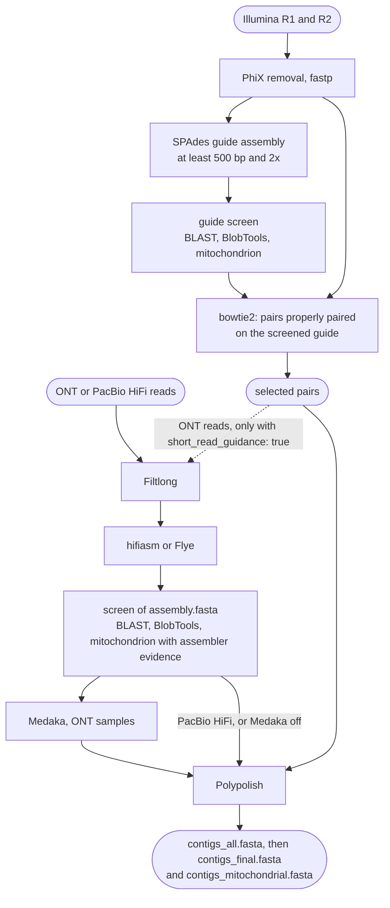

# Hybrid

Use `mode: hybrid` when Illumina paired-end reads and long reads, ONT or PacBio HiFi, are
available for the same isolate. FunFlux assembles the Illumina reads into a guide assembly,
screens it, and keeps the Illumina pairs that map back to it. It then assembles the long reads and
corrects the long-read assembly with those pairs. This requires more computation than either
single-technology mode.

The two read types provide complementary evidence: long reads span repeats, while accurate short
reads correct residual base errors. The delivered genome is the corrected long-read assembly. The
guide assembly is not delivered and serves only to tell the isolate's Illumina reads from those
of a contaminant.

!!! abstract "Terms used on this page"

    | | |
    |---|---|
    | **ONT** | Oxford Nanopore Technologies, a long-read sequencing platform |
    | **HiFi** | PacBio's accurate long reads, each the consensus of several passes over one molecule (CCS) |
    | **guide assembly** | the SPAdes assembly of the Illumina reads; it is screened, and only the pairs that map to it go on |
    | **properly paired** | both reads of a pair map to the same contig, in the expected orientation and distance |
    | **k-mer** | a short sequence of fixed length; Filtlong compares long reads with the Illumina reads through their k-mers |

## Input

| | |
|---|---|
| Folders | `input.illumina_dir` and `input.longread_dir`; they may be the same folder |
| Illumina reads | `{sample}_R1.<ext>` and `{sample}_R2.<ext>` |
| Long reads | `{sample}_ont.<ext>` or `{sample}_pacbio.<ext>`, one technology per sample |
| `<ext>` | `fastq`, `fq`, `fastq.gz` or `fq.gz`; one extension for all Illumina files and one for all long-read files |

Every sample needs both kinds of reads. A sample found on one side only stops the run before any
job starts, and the message lists the missing side:

```text
[FunFlux] hybrid mode needs Illumina and long reads for every sample.
  No _ont or _pacbio file for: SAM3
```

Illumina pairs with PacBio HiFi reads are allowed. As in [Long reads](longread.md), `_pacbio`
files must hold HiFi (CCS) reads.

## Flow



The Illumina half builds and screens a guide assembly and selects reads from it. The long-read
half filters, assembles and screens the long reads and, for ONT samples, polishes the assembly
with Medaka. Polypolish then corrects the long-read assembly with the selected Illumina pairs.

## Steps

| Step | Rule (as named in the console and in `logs/`) | Tool | Writes |
|---|---|---|---|
| PhiX removal, trimming | `download_phix`, `build_phix`, `map_phix`, `trim_adapters` | bowtie2 2.5.4, fastp 1.0.1 | `01.reads/{sample}/illumina/` |
| Guide assembly and filter | `illumina_assembly`, `filter_contigs` | SPAdes 4.2.0, awk | `guide/spades/`, `guide/contigs_filt.fasta` |
| Guide screen | `index_guide_contigs`, `map_guide_contigs`, `map_guide_evaluation`, `blast_guide_contigs`, `blob_guide_json`, `blob_guide_table`, `screen_guide_mitochondria`, `select_guide_contigs` | bowtie2 2.5.4, samtools 1.21, Qualimap 2.3, BLAST+ 2.16.0, BlobTools 1.1.1 | `guide/contaminants/`, `guide/mitochondria/`, `guide/eval/qualimap/` |
| Read selection | `index_selected_contigs`, `map_sel_contigs` | bowtie2 2.5.4, samtools 1.21 | `01.reads/{sample}/selected/` |
| Long-read filter | `filter_long_reads` | Filtlong 0.3.1 | `01.reads/{sample}/long/{sample}_filtered.fastq` |
| Long-read QC | `raw_long_read_qc`, `filtered_long_read_qc` | NanoPlot 1.46.2 | `01.reads/{sample}/long/raw_qc/`, `filtered_qc/` |
| Model check (ONT with Medaka) | `check_medaka_model` | Medaka 2.2.2 | `{sample}_medaka_model.txt` |
| Long-read assembly | `long_read_assembly` | hifiasm 0.25.0 or Flye 2.9.6 | `hifiasm/` or `flye/`, `assembly.fasta`, `assembly_provenance.tsv` |
| Assembler evidence | `assembly_evidence` | FunFlux script, Python 3.12 | `assembly_evidence.tsv` |
| Screen | `map_contigs`, `map_evaluation`, `blast_contigs`, `blob_json`, `blob_table`, `screen_mitochondria`, `select_contigs` | minimap2 2.30, Qualimap 2.3, BLAST+ 2.16.0, BlobTools 1.1.1 | `contaminants/`, `mitochondria/`, `eval/qualimap/` |
| Long-read polishing (ONT with Medaka) | `long_read_consensus` | Medaka 2.2.2 | `medaka/consensus.fasta` |
| Short-read polishing | `short_read_correction` | Polypolish 0.6.1, bwa 0.7.19 | `polypolish/polished.fasta` |
| Genome files | `finalize_assembly`, `separate_mitochondria` | | `contigs_all.fasta`, `contigs_final.fasta`, `contigs_mitochondrial.fasta` |

Paths without a stage prefix are under `02.assembly/{sample}/`. One sample plans 58 jobs, 60 for
an ONT sample with Medaka, and the resistance-mutation screen adds 2
([Dry run](../reference/running.md#dry-run)). The threads of each step are listed on
[CPU cores and threads](../reference/running.md#cpu-cores-and-threads).

## The Illumina guide assembly

PhiX removal, fastp, SPAdes and the filter (at least 500 bp, at least 2x SPAdes coverage) run as
in [`illumina`](illumina.md) mode. The reads and the fastp reports go to
`01.reads/{sample}/illumina/`, the SPAdes output and `contigs_filt.fasta` to
`02.assembly/{sample}/guide/`.

The guide is screened like an Illumina assembly:

- the trimmed pairs are mapped to it with bowtie2, for the BlobTools coverage and for Qualimap
  (`guide/eval/qualimap/`); the BAM, `guide/contaminants/{sample}_map.bam`, is kept;
- BLAST and BlobTools assign a taxon to each contig;
- the mitochondrion screen confirms mitochondrial contigs from BLAST alone;
- the contig selector applies `parameters.decontamination` and writes
  `guide/contaminants/contigs_decontam.fasta`.

With the default `parameters.mitochondria.mode: separate_confirmed`, confirmed mitochondrial
contigs are kept whatever the genus filter says. With a genus filter on,
the Illumina reads of the mitochondrion therefore stay in the read selection, and so in Polypolish
and, when it is on, in the Filtlong guidance.

The guide is not delivered as a genome. QUAST reports it next to the final genome, under the
label `{sample}_guide`.

## Read selection

The trimmed pairs are mapped to the screened guide with `bowtie2 --no-unal`, and the properly
paired reads are kept (`samtools fastq -f 0x2`). The selected pairs,
`01.reads/{sample}/selected/{sample}_selected_R1.fastq` and `_R2.fastq`, are kept after the run.
Polypolish uses them, and so does Filtlong for ONT samples when the guidance is on.

| `parameters.decontamination.mode` | The selected pairs are those properly paired on |
|---|---|
| `off` (default) | every guide contig that passed the 500 bp / 2x filter |
| a genus filter | the guide contigs the filter kept; pairs on removed contigs drop out |

With the default `off`, the selection drops only the pairs that are not properly paired on the
filtered guide, among them the pairs of contigs under 500 bp or 2x coverage.

## Long-read filter

With the defaults, `filter_long_reads` gives every sample the plain filter of `longread` mode:

```text
filtlong --min_length 1000 --keep_percent 90 --length_weight 10 [--target_bases <size>] <raw long reads>
```

With `short_read_guidance: true`, the ONT samples are also scored against the selected Illumina
pairs:

```text
filtlong -1 <selected R1> -2 <selected R2> --trim --split 1000 \
    --min_length 1000 --keep_percent 90 --length_weight 10 [--target_bases <size>] <raw ONT reads>
```

With `-1` and `-2`, "read quality will be determined using these instead of from the Phred scores"
(Filtlong 0.3.1 help): a stretch of a long read that has no k-mer match in the Illumina pairs
scores low. `--trim` removes such bases from the read ends, and `--split 1000` cuts a read wherever
1,000 or more consecutive bases have no match.

| `short_read_guidance` | `filtlong_split` | ONT reads | PacBio HiFi reads |
|---|---|---|---|
| `false` (default) | not used; a NOTE says so if it holds a number other than 1000 | plain filter | plain filter |
| `true` | `1000` (default) | `-1 -2 --trim --split 1000` | plain filter |
| `true` | `null` | `-1 -2`: scored, never cut | plain filter |

The plain filter is the one of `longread` mode: `--min_length`, `--keep_percent`,
`--length_weight` and, if set, `--target_bases`. PacBio HiFi reads are never guided: they are
already accurate, and cutting them where the Illumina reads leave a gap would discard the long,
accurate reads that HiFi sequencing is used for. With Flye and very deep ONT reads, cap the reads
with `filtlong.target_bases` ([Flye](longread.md#flye)).

!!! note "Why the guidance is off by default"

    The Filtlong README: "I recommend *against* using short reads as an external reference unless
    you are very confident in the quality of your short-read set." Long reads that span regions
    the Illumina reads cover poorly, typically repeats, can be scored low and, with `--split`, cut
    there. In BacFlux's tests on five bacterial genomes this broke assemblies apart, and on
    *B. cinerea* B05.10 it gained nothing measurable:
    [Filtlong guidance in hybrid mode](../methods/filtlong-guidance.md).

The dry run prints the decision for each sample. With the guidance on, it reads:

```text
[FunFlux] SAM1: ont reads -> Filtlong guided by the Illumina reads, hifiasm --ont, minimap2 map-ont, Medaka.
[FunFlux] SAM2: pacbio reads -> Filtlong not guided, hifiasm, minimap2 map-hifi, no Medaka.
```

## Long-read assembly, screen and Medaka

These steps are those of [Long reads](longread.md), with the settings of `parameters.hybrid`:
NanoPlot on the raw and the filtered reads, the Medaka model check on the raw ONT reads, hifiasm
(default) or Flye, the minimap2 coverage track and Qualimap, the screen of `assembly.fasta` with
the assembler's evidence for the mitochondrion, and Medaka on
`contaminants/contigs_decontam.fasta` for ONT samples.

Medaka runs as in `longread` mode. `parameters.hybrid.medaka_model` takes the same values: `auto`
(the default), a model name, or `false` to switch Medaka off. The model is checked on the raw ONT
reads before the assembler starts, and PacBio HiFi samples are never polished with Medaka. See
[Medaka model, checked before assembly](longread.md#medaka-model-checked-before-assembly) for how
the model is chosen, and
[Coverage track, screen and polishing](longread.md#coverage-track-screen-and-polishing) for the
polishing step itself.

The guide and the long-read assembly are screened independently, with the same
`parameters.decontamination` and `parameters.mitochondria` settings:

| | Guide screen | Long-read screen |
|---|---|---|
| Draft examined | `guide/contigs_filt.fasta` | `assembly.fasta` |
| Decides | which Illumina pairs are used | which contigs are delivered |
| Reads mapped for the BlobTools coverage and Qualimap | trimmed Illumina pairs, bowtie2 | filtered long reads, minimap2 |
| Evidence for the mitochondrion | BLAST only | BLAST plus the assembler's evidence |
| Qualimap rule and folder | `map_guide_evaluation`, `guide/eval/qualimap/` | `map_evaluation`, `eval/qualimap/` |
| MultiQC row of the Qualimap report | `mapping Illumina QC | {sample}` | `mapping QC | {sample}` |

The guide screen chooses the Illumina reads and the long-read screen the genome, so Qualimap
reports twice per sample.

!!! warning "A mitochondrial genome joined to itself is not trimmed"

    The long-read assembler can join two copies of the mitochondrial genome end to end into one
    contig. FunFlux does not trim such a contig. It flags it in
    `mitochondria/mitochondrial_screen.tsv` (`concatemer_flag` Y), except when the assembler
    recorded the contig as circular, so check `length_ratio` as well: see
    [Mitochondria](../analysis/mitochondria.md).

## Polypolish

`short_read_correction` corrects the long-read assembly with the selected pairs. The draft is the
Medaka consensus for ONT samples with Medaka, otherwise `contaminants/contigs_decontam.fasta`.
Polypolish runs for every sample.

```text
cp <draft> polypolish/draft.fasta
bwa index polypolish/draft.fasta
bwa mem -t <threads> -a polypolish/draft.fasta <selected R1> > polypolish/align_1.sam
bwa mem -t <threads> -a polypolish/draft.fasta <selected R2> > polypolish/align_2.sam
polypolish filter --in1 align_1.sam --in2 align_2.sam --out1 filtered_align_1.sam --out2 filtered_align_2.sam
polypolish polish draft.fasta filtered_align_1.sam filtered_align_2.sam > polished_raw.fasta
awk <cut each header at its first blank> polished_raw.fasta | awk <one line per sequence> > polished.fasta
```

As the Polypolish documentation asks, the two read files are aligned separately, each read to all
its possible locations (`-a`), so that repeats can be polished. `polypolish filter` then filters
the alignments by insert size. Polypolish appends ` polypolish` to every FASTA header, and FunFlux
cuts the headers at the first space or tab, because the later steps identify a contig by the first
word of its header. The result is `polypolish/polished.fasta`.

While the job runs, the two SAM files hold every alignment of every selected read as text, tens
of GB each for a deep library. They are deleted with the other working files when the job ends.
`logs/short_read_correction_{sample}.log` holds the messages of bwa and Polypolish, including how
many alignments the filter kept and how many positions were changed.

`contigs_all.fasta` is then `polished.fasta`, and `separate_mitochondria` splits it into
`contigs_final.fasta` and `contigs_mitochondrial.fasta`. One QUAST report holds the screened guide
(`guide/contaminants/contigs_decontam.fasta`, label `{sample}_guide`) and the final genome
(`{sample}`).

## Configuration

```yaml
input:
  illumina_dir: /path/to/reads
  longread_dir: /path/to/reads       # may be the same folder
parameters:
  spades_kmers: "21,33,55,77,99,127" # guide assembly
  hybrid:
    assembler: hifiasm               # hifiasm | flye
    flye_input_mode: auto
    medaka_model: auto               # ONT samples: auto | a model name | false
    medaka_model_fallback_auto: false
    filtlong: {min_length: 1000, keep_percent: 90, length_weight: 10, target_bases: null}
    hifiasm: {genome_size: null, bloom_filter_bits: 0, purge_dups: auto, homozygous_coverage: auto, telomere_motif: null}
    short_read_guidance: false       # true: ONT reads scored against the selected Illumina pairs
    filtlong_split: 1000             # with guidance: --trim --split 1000; null: score, never cut
```

`parameters.hybrid` holds the keys of `parameters.longread`, explained on
[Long reads](longread.md), plus `short_read_guidance` and `filtlong_split`; an unknown key in it
stops the run. `links.phix_link` and `directories.blast_db` are required. Every key is listed on
[Configuration](../reference/configuration.md).

## Output

```text
<output_dir>/
├── 00.resources/phix/
├── 01.reads/{sample}/
│   ├── illumina/                         fastp HTML and JSON (kept); PhiX-free and trimmed reads (temporary)
│   ├── selected/                         {sample}_selected_R1.fastq, _R2.fastq (kept)
│   └── long/                             {sample}_filtered.fastq (kept), raw_qc/, filtered_qc/
└── 02.assembly/{sample}/
    ├── guide/                            spades/, contigs_filt.fasta, contaminants/ (BAM kept, indexes temporary), mitochondria/, eval/qualimap/
    ├── hifiasm/ or flye/                 the assembler's own files
    ├── assembly.fasta  assembly_evidence.tsv  assembly_provenance.tsv
    ├── {sample}_medaka_model.txt         ONT samples with Medaka
    ├── contaminants/  mitochondria/      screen of the long-read assembly
    ├── medaka/consensus.fasta            ONT samples with Medaka
    ├── polypolish/polished.fasta         working files temporary
    ├── contigs_all.fasta  contigs_final.fasta  contigs_mitochondrial.fasta
    └── eval/quast/  eval/busco/  eval/qualimap/  eval/telomere_*  eval/contig_summary*.tsv
```

In the MultiQC report a sample has the rows `fastp read QC | {sample}`,
`NanoPlot raw read QC | {sample}`, `NanoPlot filtered read QC | {sample}`,
`mapping Illumina QC | {sample}` (the guide), `mapping QC | {sample}` (the long-read draft),
`QUAST guide assembly QC | {sample}`, `QUAST assembly QC | {sample}` and its BUSCO rows, and one
row per contig of the long-read draft, `{sample}: {contig}`, in the contig summary table
([Report](../analysis/report.md)). `03.taxonomy` to `06.report` are the same in every mode: see
[Output files](../reference/output.md).

## Tested so far

| Reads | Genome | Assembler | Details |
|---|---|---|---|
| Illumina 79x plus ONT 136x | *Botrytis cinerea* B05.10 | hifiasm | [Validation on public genomes](../about/validation.md) |
| MGISEQ short reads 2 x 150 bp, 151x, plus PacBio HiFi 85x | *Cordyceps cateniannulata* GXU-8616 | hifiasm | [PacBio HiFi reads](../about/validation.md#pacbio-hifi-reads-cordyceps-cateniannulata-gxu-8616) |

Both long-read technologies have run in this mode, each on one public genome and with hifiasm;
`hybrid` with Flye has been checked in dry runs only. The short reads of GXU-8616 come from an
MGISEQ-2000RS, a short-read sequencer from MGI Tech (DNBSEQ technology) that produces paired
reads like Illumina's, here 2 x 150 bp. FunFlux ran them as Illumina pairs with the default
settings, and the MultiQC row of the guide keeps its name, `mapping Illumina QC`.
