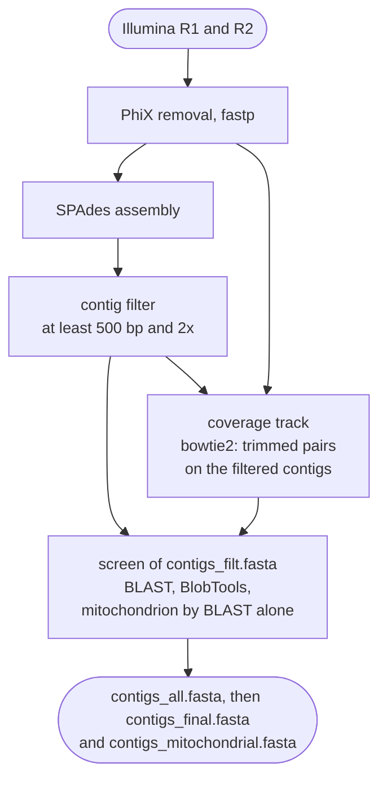

# Illumina

Use `mode: illumina` for Illumina paired-end reads of a fungal isolate. FunFlux assembles the
reads with SPAdes and runs the contamination and mitochondrion screen on the contigs before QC and
annotation. This mode replaces FunFlux 1.x.

!!! abstract "Terms used on this page"

    | | |
    |---|---|
    | **concordantly** | bowtie2's word for a pair whose reads align in the expected orientation and distance |
    | **k-mer coverage** | the coverage in a SPAdes contig header, counted in k-mers of the largest k and so lower than the read depth |
    | **the draft** | the assembly the screen examines, before the screen removes any contig: in this mode `contigs_filt.fasta` |
    | **the screen** | the contamination and mitochondrion screen of the draft: BLAST against core_nt, BlobTools, the mitochondrion screen and the contig selector |
    | **contig selector** | rule `select_contigs`, the last step of the screen: it keeps or removes each contig by genus, as `parameters.decontamination` says |
    | **genus filter** | the setting `parameters.decontamination.mode: include` or `exclude`, under which the contig selector keeps or removes contigs by the genus BlobTools gave them |
    | **confirmed mitochondrial contig** | a contig the mitochondrion screen classes `confirmed_mitochondrial`; with the default `separate_confirmed`, it is kept whatever its genus and moved to `contigs_mitochondrial.fasta` |
    | **nuclear genome** | the delivered genome without the confirmed mitochondrial contigs, `contigs_final.fasta`; it holds every contig when `parameters.mitochondria.mode` is `off` or `report` |

## Input

FunFlux finds the read pairs of a batch in one folder, by their file names:

| | |
|---|---|
| Folder | `input.illumina_dir` |
| File names | `{sample}_R1.<ext>` and `{sample}_R2.<ext>` |
| `<ext>` | `fastq`, `fq`, `fastq.gz` or `fq.gz`, the same for every sample of the batch |

Samples are found from the R1 files, and a sample without its R2 file stops the run before any
job starts:

```text
[FunFlux] input.illumina_dir: sample 'S1' has an R1 file but no R2 mate: /path/to/reads/S1_R2.fastq.gz
```

Names as the sequencer writes them, such as `S1_S1_L001_R1_001.fastq.gz`, are not found. Link
such files under the expected names, in a folder of their own. For a sample sequenced on several
lanes, join the files of the lanes first, R1 and R2 in the same order:

```bash
mkdir -p reads
ln -s /path/to/raw/S1_S1_L001_R1_001.fastq.gz reads/S1_R1.fastq.gz     # one lane
ln -s /path/to/raw/S1_S1_L001_R2_001.fastq.gz reads/S1_R2.fastq.gz
cat /path/to/raw/S2_*_R1_001.fastq.gz > reads/S2_R1.fastq.gz           # several lanes
cat /path/to/raw/S2_*_R2_001.fastq.gz > reads/S2_R2.fastq.gz
```

The rules for sample names are the same in every mode and are given under
[File names](../getting-started/choosing-a-mode.md#file-names).

## Flow



After PhiX removal and fastp, SPAdes assembles the trimmed pairs, and the contig filter keeps the
contigs of at least 500 bp and 2x. The screen checks these contigs with BLAST and BlobTools, which
takes their coverage from the same pairs mapped back with bowtie2, and it confirms mitochondrial
contigs from BLAST alone. With no polishing step in this mode, the screened contigs become
`contigs_all.fasta`, which is then split into `contigs_final.fasta` and
`contigs_mitochondrial.fasta`.

## Steps

The reads lose PhiX and adapters, SPAdes assembles them, and the contigs are filtered and
screened. The last step writes the nuclear genome, which QC, the ITS search and annotation read.

| Step | Rule (as named in the console and in `logs/`) | Tool | Writes |
|---|---|---|---|
| PhiX reference | `download_phix`, `build_phix` | bowtie2 2.5.4 | `00.resources/phix/`, once per output folder |
| PhiX removal | `map_phix` | bowtie2 2.5.4 | PhiX-free pairs (temporary) |
| Trimming | `trim_adapters` | fastp 1.0.1 | trimmed pairs (temporary), fastp HTML and JSON |
| Assembly | `illumina_assembly` | SPAdes 4.2.0 | `spades/` |
| Contig filter | `filter_contigs` | awk | `contigs_filt.fasta` |
| Coverage track | `index_contigs`, `map_contigs` | bowtie2 2.5.4, samtools 1.21 | `contaminants/{sample}_map.bam` |
| Mapping QC | `map_evaluation` | Qualimap 2.3 | `eval/qualimap/` |
| Screen | `blast_contigs`, `blob_json`, `blob_table`, `screen_mitochondria`, `select_contigs` | BLAST+ 2.16.0, BlobTools 1.1.1 | `contaminants/`, `mitochondria/` |
| Genome files | `finalize_assembly`, `separate_mitochondria` | | `contigs_all.fasta`, `contigs_final.fasta`, `contigs_mitochondrial.fasta` |
| Adapter screen of the draft | `blast_adapters`, `screen_adapters` | BLAST+ 2.16.0, FunFlux script | `eval/adapter_screen.tsv` |

Paths without a stage prefix are under `02.assembly/{sample}/`. One sample plans 46 jobs, 48 with
the AMR screen on ([Dry run](../reference/running.md#dry-run)). The threads of each step are
listed on [CPU cores and threads](../reference/running.md#cpu-cores-and-threads).

## PhiX removal

Illumina libraries are spiked with the genome of phage PhiX174, and three rules remove its reads:

1. `download_phix` fetches the PhiX genome with `curl` from `links.phix_link` into
   `00.resources/phix/`. The template points this key at NCBI assembly GCF_000819615.1.
2. `build_phix` indexes it there. Both rules run once per output folder, and the genome and its
   index are kept.
3. `map_phix` aligns every pair with `bowtie2 --local`, and the pairs that do not align
   concordantly to PhiX (`--un-conc`) go on to trimming.

The bowtie2 summary in `logs/map_phix_{sample}.log` gives the share of the library that was PhiX.
`links.phix_link` is required in this mode, and an empty value stops the run before any job
starts.

## Trimming

`trim_adapters` runs fastp, which finds the adapters itself, trims low-quality stretches from the
start of a read and cuts the read at its first low-quality window. It keeps only reads of at least
75 bp.

| Option | Effect (fastp 1.0.1 help) |
|---|---|
| `--detect_adapter_for_pe` | adapter detection for paired-end data |
| `--cut_front` | sliding window from the 5' end; drops windows whose mean quality is below the threshold, stops at the first good one |
| `--cut_right` | sliding window from 5' to 3'; at the first window below the threshold, drops it and everything to its right |
| `--length_required 75` | discards reads shorter than 75 bp (fastp default: 15) |

The fastp HTML and JSON reports are kept in `01.reads/{sample}/illumina/` and appear in the
MultiQC report. The trimmed reads are temporary and are deleted once SPAdes and the coverage
mapping have read them.

## Assembly

`illumina_assembly` runs SPAdes once per sample into `02.assembly/{sample}/spades/`, in isolate
mode, on every thread and with `resources.ram_gb` as its memory limit:

| Option | Value |
|---|---|
| `--isolate` | SPAdes' mode for "high-coverage isolate and multi-cell data" (SPAdes help) |
| `-k` | `parameters.spades_kmers`, default `21,33,55,77,99,127`, the list FunFlux 1.x hard-coded; or `auto`, SPAdes' own choice from the read length (21 to 77 for 150 bp reads) |
| `-t` | `resources.threads` |
| `-m` | `resources.ram_gb` (default 128): "RAM limit for SPAdes in Gb (terminates if exceeded)" (SPAdes help) |

Of these options, only a changed k-mer list re-runs the assembly.

`parameters.spades_kmers` takes a string such as `"21,33,55"`, a YAML list, or `auto`. Every value
must be odd and below 128, and the list ascending, or the run stops before any job starts.

!!! note "With thin coverage, try `auto` instead of the default k-mer list"

    On *B. cinerea* B05.10 (Illumina 79x, 150 bp reads), the default list gave 413 contigs and an
    N50 of 314 kb, and `auto` 592 contigs and an N50 of 217 kb. Both covered the same 98.8 % of the
    reference. With thin coverage, some 20-30x, the large k of the default may hold too few reads,
    so try `auto` there.

With several samples, `snakemake --resources mem_gb=N` starts only as many assemblies at once as
fit into N GB, as described under
[CPU cores and threads](../reference/running.md#cpu-cores-and-threads).

`spades/` holds the whole SPAdes working folder, the unfiltered `contigs.fasta` and the scaffolds
included, but FunFlux reads the contigs and never the scaffolds.

## Contig filter

`filter_contigs` removes short and thinly covered contigs before the screen. It reads length and
coverage from each SPAdes header, for example `>NODE_12_length_45678_cov_23.4`, and keeps contigs
of at least 500 bp with a coverage of at least 2.0. Both cut-offs are fixed, not configuration
keys. The header coverage is SPAdes' k-mer coverage for its largest k, which "is always lower than
the read (per-base) coverage", as the SPAdes manual says.

The result, `contigs_filt.fasta`, is the draft the screen examines.
`logs/filter_contigs_{sample}.log` records how many contigs were kept out of how many. When none
is left, the run stops with `[FunFlux] filter_contigs: no contig of <sample> is left ...` instead
of handing an empty draft to BLAST.

## Coverage track and mapping QC

One mapping serves both the screen and the mapping QC. The trimmed pairs are mapped back to
`contigs_filt.fasta` with bowtie2, and the alignments, `contaminants/{sample}_map.bam`, are kept.
BlobTools takes the read coverage of every contig from this BAM. Qualimap (`map_evaluation`)
reads it for the mapping report in `eval/qualimap/`, with the share of mapped reads, the insert
sizes and the depth per contig.

!!! note "A Qualimap failure does not stop the run"

    When Qualimap fails, a `[FunFlux]` line in `logs/map_evaluation_{sample}.log` says so, and the
    run goes on. The MultiQC page then has no mapping table for the sample: see
    [Assembly QC](../analysis/assembly-qc.md#qualimap-read-modes).

## Screen and genome files

The screen runs on `contigs_filt.fasta`, in four steps:

1. `blast_contigs` runs megablast against NCBI core_nt (`-evalue 1e-5`) and saves up to 50
   subjects and 5 alignments per subject, as set by `parameters.blast_max_target_seqs` and
   `parameters.blast_max_hsps`.
2. `screen_mitochondria` decides from BLAST alone, because Illumina reads give no assembler
   evidence. A contig is confirmed mitochondrial when a hit to a mitochondrial genome covers at
   least `parameters.mitochondria.min_direct_blast_qcov` percent of it (default 35).
3. `blob_json` and `blob_table` run BlobTools, which joins the BLAST hits, the coverage and the
   contigs and assigns a taxon to each contig.
4. `select_contigs`, the contig selector, applies `parameters.decontamination`. Its default,
   `off`, keeps every contig and gives every contig a decision in
   `contaminants/contig_taxonomy_decisions.tsv`. With the default
   `parameters.mitochondria.mode: separate_confirmed`, confirmed mitochondrial contigs are kept
   whatever the genus filter says.

`contigs_all.fasta` is then the screened assembly, as this mode has no polishing step.
`separate_mitochondria` splits it into `contigs_final.fasta`, the nuclear genome, and
`contigs_mitochondrial.fasta`, an empty file when no contig was confirmed.

[Decontamination](../analysis/decontamination.md) and [Mitochondria](../analysis/mitochondria.md)
describe the screen in detail. [BLAST hit depth](../methods/blast-hit-depth.md) explains why BLAST
keeps 5 alignments per subject.

## Configuration

Of the keys below, `input.illumina_dir` and `directories.blast_db` have no default and must be
set, while every other key here has one.

| Key | Default | Effect |
|---|---|---|
| `input.illumina_dir` | none, required | folder with the read pairs |
| `links.phix_link` | NCBI PhiX174 genome (GCF_000819615.1) | PhiX reference; required |
| `parameters.spades_kmers` | `"21,33,55,77,99,127"` | SPAdes `-k` |
| `resources.threads` | 24 | SPAdes `-t`, bowtie2; upper limit for every other rule. Pass the same number to `--cores` |
| `resources.ram_gb` | 128 | SPAdes `-m`; Qualimap Java heap `min(ram_gb, 64)` GB |
| `directories.blast_db` | none, required | NCBI core_nt with its taxonomy files: [Reference databases](../getting-started/databases.md) |
| `parameters.nt_version`, `blast_max_target_seqs`, `blast_max_hsps`, `decontamination.mode`, `mitochondria.mode` | `core_nt`, 50, 5, `off`, `separate_confirmed` | the screen |

Every key is listed on [Configuration](../reference/configuration.md).

## Output

Up to `02.assembly`, the output folder of this mode looks like this:

```text
<output_dir>/
├── 00.resources/phix/                    PhiX genome and its bowtie2 index
├── 01.reads/{sample}/illumina/           fastp HTML and JSON (kept); PhiX-free and trimmed reads (temporary)
└── 02.assembly/{sample}/
    ├── spades/                           SPAdes output, including the unfiltered contigs.fasta
    ├── contigs_filt.fasta                after the 500 bp / 2x filter
    ├── contaminants/                     BAM, BLAST table, BlobTools table, decisions, contigs_decontam.fasta
    ├── mitochondria/                     mitochondrial_screen.tsv, confirmed_mitochondrial.ids
    ├── contigs_all.fasta                 screened assembly, mitochondrion included
    ├── contigs_final.fasta               nuclear genome: QUAST, BUSCO, ITS and annotation read this
    ├── contigs_mitochondrial.fasta       confirmed mitochondrial contigs
    └── eval/quast/  eval/busco/  eval/qualimap/  eval/telomere_*  eval/adapter_*  eval/contig_summary*.tsv
```

In the MultiQC report a sample has the rows `fastp read QC | {sample}`, `mapping QC | {sample}`,
`QUAST assembly QC | {sample}` and its BUSCO rows. It also has one row per contig,
`{sample}: {contig}`, in the contig summary table, and one row, `{sample}`, in the Adapters table
([Report](../analysis/report.md)).
`03.taxonomy` to `06.report` are the same in every mode: see
[Output files](../reference/output.md).
