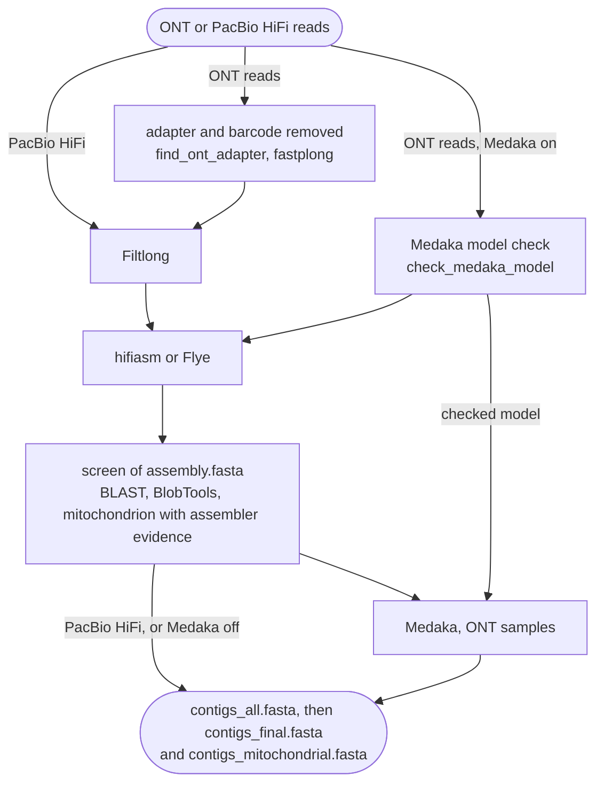

# Long reads (ONT and PacBio HiFi)

Use `mode: longread` for Oxford Nanopore (ONT) or PacBio HiFi reads. FunFlux assembles the reads
with hifiasm (the default) or Flye, runs the contamination and mitochondrion screen on the
assembly, and polishes ONT assemblies with Medaka. This mode replaces FunFluxL 0.1. Which
assembler to choose is discussed under [hifiasm or Flye](#hifiasm-or-flye).

!!! abstract "Terms used on this page"

    | | |
    |---|---|
    | **HiFi** | PacBio's accurate long reads, each the consensus of several passes over one molecule (CCS) |
    | **coverage track** | the filtered reads aligned back to `assembly.fasta`, kept as `contaminants/{sample}_map.bam`; BlobTools takes each contig's coverage from it, `samtools coverage` the read depth for the contig summary, and Qualimap its report |
    | **assembler evidence** | what hifiasm or Flye report for each contig, above all read depth and circularity, written to `assembly_evidence.tsv` for the mitochondrion screen |
    | **basecaller tag** | the `basecall_model_version_id=` field in ONT read headers, which names the basecaller model; with `medaka_model: auto`, Medaka reads it from the first 100 reads |
    | **purge level** | how strongly hifiasm removes haplotigs from its primary contigs (`-l`, 0 to 3), set by `hifiasm.purge_dups`; `auto` passes nothing and keeps hifiasm's default |
    | **rDNA array** | the tandem copies of the rDNA unit, SSU-ITS1-5.8S-ITS2-LSU; a contig with 3 or more units (by default) and fewer genes than units gets the verdict `rDNA_array` |
    | **telomere array** | tandem copies of the telomere repeat unit at a contig end; by default 5 or more copies within 25,000 bp of the end make a telomere |
    | **contig selector** | rule `select_contigs`, the last step of the screen: it keeps or removes each contig by genus, as `parameters.decontamination` says; the default, `off`, keeps every contig |

## Input

FunFlux finds the long reads of each sample by their file name, in one folder:

| | |
|---|---|
| Folder | `input.longread_dir` |
| ONT reads | `{sample}_ont.<ext>` |
| PacBio HiFi (CCS) reads | `{sample}_pacbio.<ext>` |
| `<ext>` | `fastq`, `fq`, `fastq.gz` or `fq.gz`, the same for every sample of the batch |

FunFlux takes one file per sample. An ONT run usually delivers many files per barcode folder, so
join them first. Gzip files can be joined with `cat`, for example
`cat fastq_pass/barcode01/*.fastq.gz > reads/SAM1_ont.fastq.gz`.

One batch may mix ONT and PacBio HiFi samples. A sample with both an `_ont` and a `_pacbio` file
stops the run before any job starts:

```text
[FunFlux] sample 'SAM1' has both _ont and _pacbio files in /path/to/reads. Provide one long-read technology per sample.
```

!!! warning "PacBio reads must be HiFi, and nothing checks the read type"

    Every PacBio step assumes HiFi (CCS) reads, and no tool in the chain is set up for continuous
    long reads (CLR). Nothing checks the read type, so a `_pacbio` file of CLR reads is assembled
    as if it held HiFi reads. The dry run prints a NOTE naming the `_pacbio` samples.

## One technology per sample

The file-name suffix tells FunFlux the technology of each sample, in `longread` and in `hybrid`
mode, and sets the following per sample. The assembler (`parameters.<mode>.assembler`) is one for
the whole run, and everything else is the same for both technologies.

| | ONT (`_ont`) | PacBio HiFi (`_pacbio`) |
|---|---|---|
| hifiasm | `--ont` | no flag: hifiasm's HiFi mode |
| Flye | `--nano-hq`, or `--nano-raw` (see [Flye](#flye)) | `--pacbio-hifi` |
| minimap2 preset for the coverage track | `map-ont` | `map-hifi` |
| Adapter trimming before Filtlong | yes, unless `ont_adapter: off` | never |
| Medaka | yes, unless `medaka_model: false` | never |
| Filtlong guided by the Illumina pairs (`hybrid` only) | only with `short_read_guidance: true` | never |

PacBio HiFi samples therefore get no adapter trimming, no Medaka and no Filtlong guidance. In `hybrid` mode,
Polypolish corrects the assemblies of both technologies with the Illumina pairs, as described on
[Hybrid](hybrid.md).

The dry run prints the decision for each sample. In `hybrid` mode the line also says
`Filtlong guided by the Illumina reads` or `Filtlong not guided`. For a `longread` batch with one
sample of each technology, the output reads:

```text
Long-read assembler: hifiasm.
Sample SAM1 will be processed.
Sample SAM2 will be processed.
[FunFlux] SAM1: ont reads -> adapter check + fastplong, hifiasm --ont, minimap2 map-ont, Medaka.
[FunFlux] SAM2: pacbio reads -> hifiasm, minimap2 map-hifi, no Medaka.
[FunFlux] NOTE: samples with a _pacbio file are assumed to hold PacBio HiFi (CCS) reads: SAM2. Continuous long reads (CLR) are not supported by this workflow.
Medaka model will be worked out from the FASTQ headers (checked before assembly).
```

## Flow



For ONT samples, fastplong first removes the adapter and the barcode that follows it from the
read ends ([Adapter trimming](../methods/adapter-trimming.md)). Filtlong filters the reads,
hifiasm or Flye assembles them, and the screen examines
`assembly.fasta` with BLAST, BlobTools and, for the mitochondrion, the assembler's evidence. For
ONT samples, unless Medaka is off, `check_medaka_model` settles the model on the raw reads before
the assembler starts, and Medaka polishes the screened assembly with that model. The polished
assembly, or the screened one for PacBio HiFi samples or with Medaka off, becomes
`contigs_all.fasta`, which is split into `contigs_final.fasta` and `contigs_mitochondrial.fasta`.

## Steps

FunFlux filters the reads and reports on them, and checks the Medaka model of ONT samples before
the assembler starts. It then screens the assembly and polishes ONT assemblies with Medaka before
it writes the genome files.

| Step | Rule (as named in the console and in `logs/`) | Tool | Writes |
|---|---|---|---|
| Adapter trimming (ONT) | `find_ont_adapter`, `trim_ont_adapters`, `check_ont_trimming` | FunFlux script, fastplong 0.7.1 | `01.reads/{sample}/long/adapters/` |
| Read filter | `filter_long_reads` | Filtlong 0.3.1 | `01.reads/{sample}/long/{sample}_filtered.fastq` |
| Read QC | `raw_long_read_qc`, `filtered_long_read_qc` | NanoPlot 1.46.2 | `01.reads/{sample}/long/raw_qc/`, `filtered_qc/` |
| Model check (ONT with Medaka) | `check_medaka_model` | Medaka 2.2.2 | `{sample}_medaka_model.txt` |
| Assembly | `long_read_assembly` | hifiasm 0.25.0 or Flye 2.9.6 | `hifiasm/` or `flye/`, `assembly.fasta`, `assembly_provenance.tsv` |
| Assembler evidence | `assembly_evidence` | FunFlux script, Python 3.12 | `assembly_evidence.tsv` |
| Coverage track | `map_contigs` | minimap2 2.30, samtools 1.21 | `contaminants/{sample}_map.bam` |
| Mapping QC | `map_evaluation` | Qualimap 2.3 | `eval/qualimap/` |
| Read depth per contig | `contig_depth` | samtools 1.21 | `contaminants/{sample}_depth.tsv` |
| Screen | `blast_contigs`, `blob_json`, `blob_table`, `screen_mitochondria`, `select_contigs` | BLAST+ 2.16.0, BlobTools 1.1.1 | `contaminants/`, `mitochondria/` |
| Polishing (ONT with Medaka) | `long_read_consensus` | Medaka 2.2.2 | `medaka/consensus.fasta` |
| Genome files | `finalize_assembly`, `separate_mitochondria` | | `contigs_all.fasta`, `contigs_final.fasta`, `contigs_mitochondrial.fasta` |
| Adapter screen of the draft | `blast_adapters`, `screen_adapters` | BLAST+ 2.16.0, FunFlux script | `eval/adapter_screen.tsv` |

Paths without a stage prefix are under `02.assembly/{sample}/`. One PacBio HiFi sample plans 45
jobs, an ONT sample with Medaka 50, and the AMR screen adds 2
([Dry run](../reference/running.md#dry-run)). The threads of each step are listed on
[CPU cores and threads](../reference/running.md#cpu-cores-and-threads).

## Adapter trimming

ONT reads that were not trimmed at basecalling start with the sequencing adapter and, in a barcoded
library, the barcode. `find_ont_adapter` reads every read and works out the sequence to remove:
the adapter, followed by the barcode block when most reads share one, or nothing when the reads
are already trimmed. fastplong then removes exactly that sequence from both read ends, and
`check_ont_trimming` counts what is left. fastplong never guesses the adapter itself: on fungal
reads its guess can be the telomere repeat. `ont_adapter: off` switches the step off, and a
sequence written there is trimmed as given. [Adapter trimming](../methods/adapter-trimming.md)
explains the method, and [Validation on public genomes](../about/validation.md#adapter-trimming)
shows what it changed in the *Botrytis cinerea* B05.10 runs.

## Read filter

`filter_long_reads` runs Filtlong without a reference, on the reads fastplong trimmed (ONT) or on
the raw reads (PacBio HiFi, or `ont_adapter: off`). With the defaults,
Filtlong drops reads under 1,000 bp and keeps the best reads up to 90 % of the bases, favouring
long reads. The total is not capped unless `target_bases` is set.

| Option | Key in `parameters.longread.filtlong` | Default | Effect |
|---|---|---|---|
| `--min_length` | `min_length` | 1000 | discards reads shorter than this |
| `--keep_percent` | `keep_percent` | 90 | keeps the best reads up to this percentage of the bases |
| `--length_weight` | `length_weight` | 10 | weight of read length in Filtlong's score (Filtlong default: 1); a higher value favours longer reads |
| `--target_bases` | `target_bases` | empty | empty: no cap. A size such as `2.4g` keeps the best reads up to that many bases, for a very deep run |

- Without a reference, Filtlong scores read quality from the Phred scores. `--trim` and `--split`
  need a reference and are not used in this mode. [`hybrid`](hybrid.md) mode can score ONT reads
  against Illumina pairs instead, when you switch that on.
- The defaults are sized for ONT reads. For PacBio HiFi reads they are provisional, because they
  have run on one public dataset only
  ([PacBio HiFi reads](../about/validation.md#pacbio-hifi-reads-cordyceps-cateniannulata-gxu-8616)).
- The filtered reads are kept, uncompressed. Filtlong's report, which counts the reads and bases in
  and the reads and bases kept, is `logs/filter_long_reads_{sample}.log`.

## Read QC

NanoPlot reports on the raw reads (`raw_qc/`) and on the filtered reads (`filtered_qc/`), with read
lengths on a log scale, so that the two reports show what trimming (ONT samples) and Filtlong
removed. A NanoPlot failure
leaves a `[FunFlux]` line in the log and does not stop the run. The MultiQC page then has no
read-QC row for the sample.

## Medaka model, checked before assembly

Medaka polishes after the assembly and the screen, and its model has to match the basecaller that
produced the reads. `check_medaka_model` settles the model on the raw ONT reads before the
assembler starts, so a wrong model stops the run within seconds instead of hours later. PacBio HiFi
samples are not checked.

Keep `auto` when the reads still carry their basecaller tag, name the model when they do not, and
set `false` to skip Medaka.

| `parameters.longread.medaka_model` | Effect |
|---|---|
| `auto` (default; also empty or an unquoted `null`, `true`, `yes`, `on`, `1`) | model worked out from the basecaller tag in the FASTQ headers |
| a model name, e.g. `r1041_e82_400bps_sup_v4.3.0` | that model, after checking that this Medaka version has it |
| `false` (also `0`, `no`, `off`, `none`, and `null` in quotes) | no Medaka; `contigs_all.fasta` is the screened assembly |

- `auto` asks Medaka for its generic `consensus` model for the basecaller named in the reads. It
  needs exactly one basecaller tag (`basecall_model_version_id=`) among the first 100 reads. Reads
  from public archives, or reads pooled from several basecalling runs, often lack tags or mix
  them, so name the model for those. `zcat reads.fastq.gz | head -n 1` shows what a file carries.
- Medaka downloads the weights of a model the first time it uses that model, so the first run
  needs network access. The download happens during the check, for a named model and with `auto`,
  on the computer that runs Snakemake, and polishing then needs no network. Medaka 2.2.2 ships the
  weights of four models, which need no download.
- A named model that this Medaka version does not have stops the run with a table of the closest
  models, printed to the console as well as to `logs/check_medaka_model_{sample}.log`.
  `medaka_model_fallback_auto: true` makes it fall back to `auto` instead, with a warning.

!!! warning "Changing `medaka_model` re-runs the assembly of every ONT sample"

    The resolved model is written to `02.assembly/{sample}/{sample}_medaka_model.txt`, and the
    assembler waits for this file. A changed `medaka_model` therefore re-runs the assembly of every
    ONT sample.

How the model is checked or worked out, and what can fail, is described on
[The Medaka model](../methods/medaka-model.md).

## Assembly

One assembler serves the whole run, `parameters.longread.assembler: hifiasm` (the default) or
`flye`. Either way, the same three files end up next to the assembler's own folder, so the screen
reads the same draft and the same evidence table whichever assembler ran:

| File | Content | Written by |
|---|---|---|
| `assembly.fasta` | the assembly the screen examines | `long_read_assembly` |
| `assembly_evidence.tsv` | per contig: `contig`, `source`, `circular`, `coverage`, `repeat`, `alt_group`; read by the mitochondrion screen | `assembly_evidence`, a short step right after the assembly, from the assembler's own per-contig file |
| `assembly_provenance.tsv` | assembler, version, read type, input file and command line | `long_read_assembly` |

If `assembly_evidence` fails, the run stops there, but the assembly stays on disk. The next run
makes the table again without assembling again.

### hifiasm

With hifiasm, `long_read_assembly` runs this command. The options in brackets come from the keys
in the table that follows it, and `--ont` is added for ONT reads.

```text
hifiasm -i --primary -f <bloom_filter_bits> [--hg-size ...] [-l ...] [--hom-cov ...] [--telo-m ...] [--ont] \
    -t <resources.threads> -o hifiasm/hifiasm <filtered reads>
```

`assembly.fasta` holds the primary contigs of `hifiasm/hifiasm.p_ctg.gfa`, and the rule stops when
the graph holds no contig. The coverage in the evidence table is the `rd:i` read depth of each
contig, and a contig whose name ends in `c` is recorded as circular. `-i` makes hifiasm ignore read
corrections and overlaps saved by an earlier run.

| Key in `parameters.longread.hifiasm` | Default | hifiasm option (hifiasm 0.25.0 help) |
|---|---|---|
| `genome_size` | empty | `--hg-size`: estimated haploid genome size, used to infer read coverage, e.g. `40m`. Empty: hifiasm infers it |
| `bloom_filter_bits` | 0 | `-f`: bits of the bloom filter; 0 disables it (hifiasm default: 37) |
| `purge_dups` | `auto` | `-l`: purge level, 0 none, 1 light, 2 or 3 aggressive. `auto` passes nothing |
| `homozygous_coverage` | `auto` | `--hom-cov`: read depth of the homozygous peak. `auto` passes nothing |
| `telomere_motif` | empty | `--telo-m`: "telomere motif at 5'-end; CCCTAA for human" |

With the defaults, the only assembly options hifiasm gets are `-i --primary -f 0`, plus `--ont` for
ONT reads. It infers the read coverage and the homozygous coverage itself, but not the purge level.
With no `-l`, hifiasm uses its own default, `-l 3` outside trio mode (hifiasm's mode for parental
reads, which FunFlux does not use). No telomere motif is passed, because
`parameters.longread.hifiasm.telomere_motif` is empty.

### Flye

With Flye, `long_read_assembly` runs:

```text
flye <read flag> <filtered reads> --out-dir flye/ --threads <resources.threads> --iterations 5
```

`--iterations 5` runs five rounds of Flye's own polishing (the Flye default is 1). Flye's
`assembly.fasta` is copied from `flye/` up one level. The evidence table comes from
`flye/assembly_info.txt`, which gives the mean read depth, the circularity, and the repeat and
alternative-group flags.

`parameters.longread.flye_input_mode` sets the ONT flag. It takes `nano-hq`, `nano-raw` or `auto`
(the default), while the `_pacbio` suffix alone decides `--pacbio-hifi`.

| Read flag | Used for | Flye 2.9.6 help |
|---|---|---|
| `--pacbio-hifi` | every PacBio sample | PacBio HiFi reads (<1% error) |
| `--nano-hq` | ONT samples with `flye_input_mode: nano-hq`, or with `auto` (default) unless `medaka_model` names a model with `fast` in its name | ONT R10 reads, aka Q20 (<3% error) |
| `--nano-raw` | ONT samples with `flye_input_mode: nano-raw`, or with `auto` when `medaka_model` names a model with `fast` in its name | ONT reads with older chemistries, pre R9 Guppy5 (10-20% error) |

!!! note "With `flye_input_mode: auto`, naming a fast Medaka model also changes Flye's read mode"

    For ONT reads, `flye_input_mode: auto` follows the Medaka model. Naming a fast Medaka model
    then changes the assembler's read mode as well as the polisher. Set `flye_input_mode`
    explicitly to keep the two apart.

- `flye_input_mode: pacbio-hifi` stops the run with a message, because the `_pacbio` suffix
  chooses `--pacbio-hifi`.
- With hifiasm, `flye_input_mode` is ignored, and a NOTE says so when it is set to anything but
  `auto`.
- Flye does not repeat its assembly byte for byte from run to run.
- Very deep ONT data can leave Flye with no assembly. In BacFlux's runs on 300x to 1,000x reads of
  five bacteria, Flye reported `Assembled 0 disjointigs`, while the 136x reads of B05.10 assembled
  normally. For much deeper reads, cap them with `filtlong.target_bases` at about 100 times the
  genome size, for example `4g` for a 40 Mb genome.

### hifiasm or Flye { #hifiasm-or-flye }

Both assemblers have run on the same reads of two public genomes, with the same settings apart
from the assembler and the number of cores. The runs are described on
[Validation on public genomes](../about/validation.md).

| Reads | Assembler | Contigs | Of them, rDNA pieces | N50 (Mb) | Contigs with telomeres at both ends |
|---|---|---|---|---|---|
| *Botrytis cinerea* B05.10, ONT 136x (FunFlux 2.1.0) | hifiasm | 33 | 13 | 2.58 | 15 |
| | Flye | 21 | 0 | 2.58 | 6 |
| *Cordyceps cateniannulata* GXU-8616, PacBio HiFi 85x (FunFlux 2.0.0) | hifiasm | 18 | 7 | 4.79 | 7 |
| | Flye | 12 | 0 | 4.79 | 6 |

In these runs the N50 was the same with both assemblers, and hifiasm gave more contigs with
telomeres at both ends, most clearly on the ONT reads (15 against 6).

- **Contigs** are those of `contigs_final.fasta`, the nuclear genome, as QUAST counts them.
- **rDNA pieces** are the contigs to which the [contig summary](../analysis/contig-summary.md)
  gives the verdict `rDNA_array`. hifiasm's extra contigs are such pieces of the rDNA array, which
  Flye did not produce. Without them, hifiasm has fewer contigs than Flye: 20 against 21 on B05.10
  and 11 against 12 on GXU-8616.
- **Telomeres** come from the contig summary too: the last column counts the contigs with a
  telomere array at both ends. On the ONT reads, 11 Flye contigs carry a telomere array at one end
  only, against 4 with hifiasm.
- Each assembler ran once on each genome. Whether a contig is a whole chromosome is checked against
  the reference on the validation page.

## Coverage track, screen and polishing

The filtered reads are mapped to `assembly.fasta` with `minimap2 -ax map-ont` or `map-hifi`. The
alignments, `contaminants/{sample}_map.bam`, are kept. BlobTools reads them for the read coverage
of each contig, and Qualimap (`map_evaluation`) reports on them in `eval/qualimap/`. A Qualimap
failure does not stop the run ([Assembly QC](../analysis/assembly-qc.md#qualimap-read-modes)).
From the same alignments, `contig_depth` measures the mean read depth of each contig with
`samtools coverage` and writes it to `contaminants/{sample}_depth.tsv`. The
[contig summary](../analysis/contig-summary.md) takes its depth from that table, not from
BlobTools.

The screen runs on `assembly.fasta` with BLAST (10 subjects and 5 alignments per subject),
BlobTools and the contig selector. The mitochondrion screen also reads `assembly_evidence.tsv`,
and decides as follows whether a contig is confirmed:

| A BLAST hit to a mitochondrial genome covers | Plus, from the assembler | Contig |
|---|---|---|
| at least `very_strong_qcov` percent of it (70) | nothing needed | confirmed |
| at least `min_direct_blast_qcov` percent of it (35) | read depth at least `min_assembler_coverage_ratio` (3.0) times the median depth of the contigs | confirmed |
| at least `min_direct_blast_qcov` percent of it (35) | a circle that is not a repeat or an alternative copy of another contig | confirmed |
| no hit | circularity or depth | never confirmed |

A BLAST hit is always needed, and the assembler's evidence lets a partial hit count. A contig
whose best mitochondrial hit is an animal's or a plant's, such as a contig of human mitochondrial
DNA from the sequencing library, is never confirmed: it gets the class `foreign_mitochondrial` and
stays in the assembly, where the contig selector treats it like any other contig. See [Mitochondria](../analysis/mitochondria.md).

`long_read_consensus` polishes `contaminants/contigs_decontam.fasta`, the contigs the contig
selector kept, with the filtered reads:

```text
medaka_consensus -i <filtered reads> -d contaminants/contigs_decontam.fasta -x -t <up to 12> -m <model> -o medaka/
```

- `<model>` is the line in `{sample}_medaka_model.txt`: the checked name, or the path of the model
  file `auto` found.
- A Medaka failure stops the run with a `[FunFlux] long_read_consensus:` line that names the model
  and the log. Unlike the QC steps, polishing is never skipped on failure, because its output is
  the genome.
- Medaka is distributed under the Oxford Nanopore Technologies Public License 1.0, which grants use
  for research purposes. See [Licensing](../about/licensing.md).

`contigs_all.fasta` is then the Medaka consensus for ONT samples with Medaka, and
`contigs_decontam.fasta` for PacBio HiFi samples or with Medaka off.
`logs/finalize_assembly_{sample}.log` names the file that was copied. `separate_mitochondria`
splits `contigs_all.fasta` into `contigs_final.fasta` and `contigs_mitochondrial.fasta`, and QUAST
reports on `contigs_final.fasta`.

## Configuration

`parameters.longread` is read only in `longread` mode, and `hybrid` mode reads the same keys from
`parameters.hybrid`. An unknown key in the block stops the run. So do `long_read_assembler`,
`flye_input_mode`, `medaka_model`, `filtlong` and `hifiasm` when they sit at the top of
`parameters`, where FunFluxL kept its long-read settings, and the message then names their new
place.

```yaml
parameters:
  longread:
    assembler: hifiasm               # hifiasm | flye
    flye_input_mode: auto            # Flye, ONT samples: auto | nano-hq | nano-raw
    medaka_model: auto               # ONT samples: auto | a model name | false
    medaka_model_fallback_auto: false
    ont_adapter: detect              # ONT samples: detect | off | the sequence to trim
    filtlong:
      min_length: 1000
      keep_percent: 90
      length_weight: 10
      target_bases:                  # empty: no cap
    hifiasm:
      genome_size:
      bloom_filter_bits: 0
      purge_dups: auto
      homozygous_coverage: auto
      telomere_motif:
```

`directories.blast_db` is required. Every key is listed on
[Configuration](../reference/configuration.md).

## Output

Each sample has its reads in `01.reads` and its assembly in `02.assembly`:

```text
<output_dir>/
├── 01.reads/{sample}/long/
│   ├── {sample}_filtered.fastq           Filtlong output (kept, uncompressed)
│   ├── adapters/                         ONT samples: the adapter scan, the trimmed sequence, fastplong's reports, the check
│   └── raw_qc/  filtered_qc/             NanoPlot
└── 02.assembly/{sample}/
    ├── hifiasm/ or flye/                 the assembler's own files
    ├── assembly.fasta  assembly_evidence.tsv  assembly_provenance.tsv
    ├── {sample}_medaka_model.txt         ONT samples with Medaka
    ├── contaminants/                     BAM, depth table, BLAST table, BlobTools table, decisions, contigs_decontam.fasta
    ├── mitochondria/                     mitochondrial_screen.tsv, confirmed_mitochondrial.ids
    ├── medaka/consensus.fasta            ONT samples with Medaka
    ├── contigs_all.fasta  contigs_final.fasta  contigs_mitochondrial.fasta
    └── eval/quast/  eval/busco/  eval/qualimap/  eval/telomere_*  eval/adapter_*  eval/contig_summary*.tsv
```

In the MultiQC report a sample has the rows `NanoPlot raw read QC | {sample}`,
`NanoPlot filtered read QC | {sample}`, `mapping QC | {sample}`, `QUAST assembly QC | {sample}` and
its BUSCO rows, one row per contig, `{sample}: {contig}`, in the contig summary table, and one
row, `{sample}`, in the Adapters table ([Report](../analysis/report.md)). `03.taxonomy` to `06.report` are the same in every mode, as
described on [Output files](../reference/output.md).

## Tested so far

Each read type has run on one public genome, and each assembler at least once on each:

| Reads | Genome | Assemblers that have run | Details |
|---|---|---|---|
| ONT, 136x and a 42x subsample | *Botrytis cinerea* B05.10 | hifiasm (both depths), Flye (136x) | [Validation on public genomes](../about/validation.md) |
| PacBio HiFi, 85x | *Cordyceps cateniannulata* GXU-8616 | hifiasm, Flye | [PacBio HiFi reads](../about/validation.md#pacbio-hifi-reads-cordyceps-cateniannulata-gxu-8616) |
